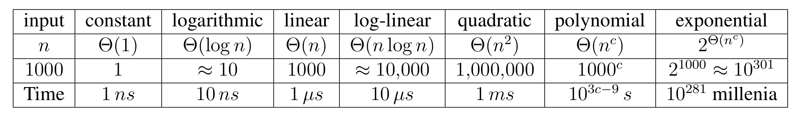
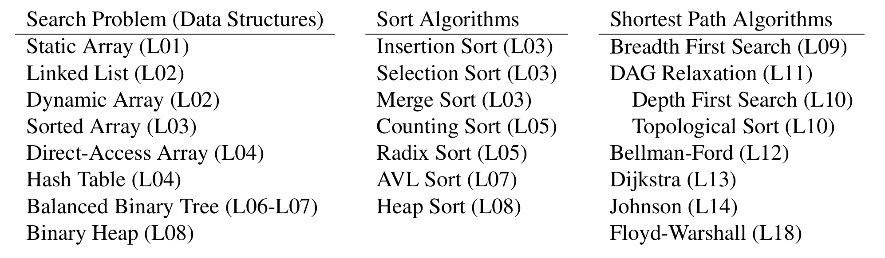

# Introduction to Algorithms: 6.006

## <span style="color:#2471a3;">**[lecture]**</span> <span style="color:#c0392b">Lecture 1: Introduction（课程导论）</span>

Massachusetts Institute of Technology
Instructors: Erik Demaine, Jason Ku, and Justin Solomon

> <span style="color:#7f8c8d;">MIT 6.006 Spring 2020, Lecture 1 译注（对应视频：Introduction）</span>

---

## 1. Problem（问题）与 Algorithm（算法）

本课程的目标是教你**解决计算问题（computation problem）**，并且能够**说明你的解是正确的（correct）且高效的（efficient）**。

### 1.1 Problem（问题）

- 问题是一个**binary relation（二元关系）**：从「problem inputs（问题的输入）」映射到「correct outputs（正确的输出）」。
- 通常我们**不会**为所有输入一一列出每个正确输出（数量太多、不可能穷举）。
- 取而代之的是提供一个**verifiable predicate（可判定的谓词）**——也就是一个「property（性质）」，正确的输出必须满足它。所谓「可判定」，指给定任意一个输出，我们能在有限步内判断它是否符合要求。
- 6.006 研究的是**大规模、一般性的输入空间（large general input spaces）**上的问题。

两个层次的区别：

- **not general（非一般性的）——small input instance（小规模输入实例）**：
  - 例：就在这间教室里，是否存在一对生日相同的学生？
- **general（一般性的）——arbitrarily large inputs（任意大的输入）**：
  - 例：给定任意 $n$ 个学生构成的集合，其中是否存在一对生日相同的学生？
  - 如果「生日」只取 $365$ 个值之一，那么当 $n > 365$ 时，由**pigeon-hole principle（鸽笼原理）**，答案恒为「是」。
  - 所以我们要假设「可能的生日」的分辨率超过 $n$（例如把年份、时刻等都算进去），问题才真正有内容。

### 1.2 Algorithm（算法）

- 算法是一个**procedure（过程）**：把每个输入映射到**唯一的**一个输出（确定性，deterministic）。
- 一个算法「解决了某个问题」，当且仅当它对该问题的**每一个**输入都返回正确的输出。
- 例：解决「birthday matching（生日匹配）」问题的算法：
  - 维护一份「姓名—生日」的记录（record），初始为空。
  - 按某个顺序逐一「询问」每个学生：
    - 若该学生的生日已存在于记录中，则立即返回这对匹配（found pair）。
    - 否则把该姓名与生日加入记录。
  - 若问完最后一名学生仍无匹配，返回 `None`。

> **本质 idea**：生日匹配的核心是「一边扫描、一边查重」——用一个「已见过的生日」集合，每遇到一个新学生，只需检查他的生日是否已经出现过，即可判定是否有重复。

---

## 2. Correctness（正确性）

- 程序/算法的规模是**固定**的，那么该如何证明它对**任意大的输入**都正确？
- 对**小输入**，可以用**case analysis（分情况讨论）**逐一验证。
- 对**任意大的输入**，算法必然要**recursive（递归）**或以某种方式**loop（循环）**。
- 因此必须使用**induction（归纳法）**——这也正是「递归」在计算机科学中如此核心的原因。

### 2.1 生日匹配算法的正确性证明（归纳）

- 归纳变量 $k$：记录中学生的个数。
- **induction hypothesis（归纳假设）**：若前 $k$ 个学生中存在生日相同的匹配，则算法会在询问第 $k+1$ 个学生之前就返回这个匹配。
- **base case（基例）**：$k = 0$，前 $0$ 个学生中不存在任何匹配（空集无重复），命题显然成立。
- **归纳步**：设归纳假设对 $k = k_0$ 成立，考虑 $k = k_0 + 1$ 的情形。
  - 若前 $k_0$ 个学生中已存在匹配，则由归纳假设，算法早就返回了匹配。
  - 否则前 $k_0$ 个学生两两生日互不相同；此时若前 $k_0 + 1$ 个学生中存在匹配，这个匹配必然包含第 $k_0 + 1$ 个学生。
  - 而算法恰好会直接检查：第 $k_0 + 1$ 个学生的生日是否已存在于前 $k_0$ 个学生的记录中。

由此，归纳论证闭合：算法对所有 $n$ 都正确。

---

## 3. Efficiency（效率）与渐近记号（Asymptotic Notation）

### 3.1 效率

- 如何衡量算法「多快」给出正确输出？
  - 直接测时间（time）当然可以，但我们希望性能**与具体机器无关（machine independent）**。
  - 思路：数一数算法返回前所执行的**fixed-time operations（固定时间操作）**的次数。
  - 这个次数通常依赖于输入的大小（size of input）：输入越大，耗时越长。
  - 输入大小常记作 $n$，但**并非总是**用 $n$ 表示。
  - 若算法能在「关于输入大小的**polynomial time（多项式时间）**」内返回，就认为它是高效的（efficient）。
  - 注意：**并非所有问题都存在高效算法**！（见 L20。）

### 3.2 Asymptotic Notation（渐近记号）

渐近记号的核心思想：**忽略常数因子（constant factors）和低阶项（low order terms）**，只看增长阶。

- **upper bound（上界）**：大 $O$ 记号，记 $O(\cdot)$
- **lower bound（下界）**：大 $\Omega$ 记号，记 $\Omega(\cdot)$
- **tight bound（紧界）**：大 $\Theta$ 记号，记 $\Theta(\cdot)$
  - 读法上常写作「属于/是/同阶」，即 $f(n) \in O(g(n))$、$f(n) = O(g(n))$、$f(n)$ is order $g(n)$ 等。

下表给出若干常见增长阶，以及「在 $1$ GHz 单核机器上、每周期执行一次操作」的估计耗时（并假定宇宙中粒子数 $\lt  10^{100}$）：

| 输入规模 $n$ | 常数 $\Theta(1)$ | 对数 $\Theta(\log n)$ | 线性 $\Theta(n)$ | 线对 $\Theta(n\log n)$ | 二次 $\Theta(n^2)$ | 多项式 $\Theta(n^c)$ | 指数 $2^{\Theta(n^c)}$ |
|---|---|---|---|---|---|---|---|
| 1000 | 1 | $\approx 10$ | 1000 | $\approx 10{,}000$ | $1{,}000{,}000$ | $1000^c$ | $2^{1000}\approx 10^{301}$ |
| 耗时 | 1 ns | 10 ns | 1 µs | 10 µs | 1 ms | $10^{3c-9}$ s | $10^{281}$ 个千年 |

> 注：原表「指数」一列原文为 $2^{\Theta(n^c)}$，代入 $n=1000$ 时按 $2^{1000}\approx 10^{301}$ 估计；「多项式」列耗时按每周期一次操作从 $1000^c$ 次操作换算为 $10^{3c-9}$ 秒。此表旨在直观说明：**指数增长会迅速爆炸**，远超宇宙可容纳的任何资源。



**图 2-1**：同样是 $n=1000$，增长阶从常数升到指数，1 GHz 单核机器上的耗时从 $1\ \text{ns}$ 涨到 $10^{281}$ 个千年 —— 跨了约 300 个数量级，说明只有多项式及以下的阶才可能真的跑完。

For the same $n=1000$, stepping the growth class from constant to exponential moves the 1 GHz single-core running time from $1$ ns to $10^{281}$ millennia, roughly 300 orders of magnitude.


---

## 4. Model of Computation（计算模型）—— Word-RAM

- model of computation（计算模型）是对「机器上哪些操作可以在 $O(1)$ 时间内完成」的**specification（规格说明）**。
- 本课程采用的模型叫 **Word-RAM（按机器字随机存取机）**：
  - **machine word（机器字）**：由 $w$ 个比特（bit）组成的块，$w$ 即这个 $w$-bit Word-RAM 的**word size（字长）**。
  - **memory（内存）**：一串**addressable（可寻址）的机器字序列**。
  - 处理器支持对「常数个（$O(1)$ 个）字」进行的诸多常数时间操作（以整数为基本单位）：
    - 整数算术：`+`、`-`、`*`、`//`（整除）、`%`（取余）
    - 逻辑运算：`&&`、`||`、`!`、`==`、`<`、`>`、`<=`、`>=`
    - bitwise arithmetic（位运算）：`&`、`|`、`<<`、`>>`、`...`
    - 给定一个字 $a$，可以**读取地址 $a$ 处的字**，也可以**向地址 $a$ 写入一个字**。
- 内存地址必须能访问到内存中的每个位置，因此要求：
  - $w \ge$ 表示最大内存地址所需的比特数，即 $w \ge \log_2 n$。
  - $32$-bit 字长 → 最多约 $4$ GB 内存；$64$-bit 字长 → 最多约 $16$ EB（exabytes，艾字节）内存。
- Python 是一个更复杂的计算模型，它在底层也是基于 Word-RAM 实现的。

---

## 5. Data Structure（数据结构）

- **data structure（数据结构）** 是**存储非常量数据（non-constant data）**、并**支持一组操作（a set of operations）**的方式。
- 一组操作的集合称为**interface（接口）**。接口定义了「能做什么」，而不规定「怎么做」。
  - **Sequence（序列）**：元素之间有**extrinsic order（外在顺序）**（谁是第一个、最后一个、第 $n$ 个）。
  - **Set（集合）**：元素之间有**intrinsic order（内在顺序）**（基于元素的 key 进行查询）。
- 不同数据结构可以实现**同一接口**，但**性能不同**。
- 例：**Static Array（静态数组）**——固定宽度的槽位、固定长度、实现静态序列接口：
  - `StaticArray(n)`：分配大小为 $n$ 的静态数组并初始化为 $0$，耗时 $\Theta(n)$。
  - `StaticArray.get_at(i)`：返回数组下标 $i$ 处存储的字，耗时 $\Theta(1)$。
  - `StaticArray.set_at(i, x)`：把字 $x$ 写入下标 $i$，耗时 $\Theta(1)$。
- 存储的「字」可以存放一个更大对象的**address（地址）**。
- 静态数组类似于 Python 的 tuple，但额外支持 `set_at(i, x)`；Python 的 list 则是一种**dynamic array（动态数组）**（见 L02）。

---

## 6. 生日匹配算法的代码与复杂度分析

### 6.1 代码（pseudocode，Python 风格）

```python
def birthday_match(students):
    """
    Find a pair of students with the same birthday.
    Input:  tuple of student (name, bday) tuples
    Output: tuple of student names or None
    """
    n = len(students)                    # O(1)
    record = StaticArray(n)              # O(n)
    for k in range(n):                   # n 次
        (name1, bday1) = students[k]     # O(1)
        # 若 bday1 已在 record 中，则返回匹配对
        for i in range(k):               # k 次
            (name2, bday2) = record.get_at(i)   # O(1)
            if bday1 == bday2:           # O(1)
                return (name1, name2)    # O(1)
        record.set_at(k, (name1, bday1)) # O(1)
    return None                          # O(1)
```

### 6.2 复杂度分析（写出递推式并解出）

外层循环变量 $k \in \{0,\dots,n-1\}$，内层循环变量 $i \in \{0,\dots,k-1\}$（共 $k$ 次）。总运行时间 $T(n)$ 由两部分构成：初始的 `len` 与 `StaticArray(n)` 为 $O(n)$，再加两层循环的总和：

```math
T(n) = O(n) + \sum_{k=0}^{n-1}\big(O(1) + k\cdot O(1)\big)
```

内层求和逐项展开：

```math
\sum_{k=0}^{n-1}\big(O(1) + k\cdot O(1)\big)
= O(1)\sum_{k=0}^{n-1} 1 \;+\; O(1)\sum_{k=0}^{n-1} k
```

代入 $\sum_{k=0}^{n-1} 1 = n$ 与 $\sum_{k=0}^{n-1} k = \dfrac{n(n-1)}{2} = \Theta(n^2)$：

```math
T(n) = O(n) + O(n) + O(n^2) = O(n^2)
```

- 关于 $n$ 是**quadratic（二次的）**，属于多项式时间，因此「高效」。
- 能否做得更好？**换一种数据结构来存 `record` 即可**（例如用哈希表直接查重，把内层 $O(k)$ 降为 $O(1)$，整体降到 $O(n)$）。这正体现了「数据结构选择决定算法效率」的核心思想。

---

## 7. How to Solve an Algorithms Problem（如何解一道算法题）

两条路径：

### 7.1 Reduce to a problem you already know（归约到你已知的问题）

即套用现成的数据结构或算法。课程后续覆盖的两大类别：

**搜索问题（Search Problem，基于数据结构）** 与 **排序算法（Sort Algorithms）**：

| 数据结构（Data Structure） | 排序算法（Sort Algorithm） |
|---|---|
| Static Array（静态数组，L01） | Insertion Sort（插入排序，L03） |
| Linked List（链表，L02） | Selection Sort（选择排序，L03） |
| Dynamic Array（动态数组，L02） | Merge Sort（归并排序，L03） |
| Sorted Array（有序数组，L03） | Counting Sort（计数排序，L05） |
| Direct-Access Array（直接访问数组，L04） | Radix Sort（基数排序，L05） |
| Hash Table（哈希表，L04） | AVL Sort（AVL 排序，L07） |
| Balanced Binary Tree（平衡二叉树，L06–L07） | Heap Sort（堆排序，L08） |
| Binary Heap（二叉堆，L08） |  |



**图 4-1**：课程把「归约到已知问题」拆成三条并列路线 —— 10 种解决 search 的数据结构、8 种排序算法、8 种最短路算法 —— 每个条目都标注首次出现的讲义编号（L01–L18），所以这张表本身就是全课的知识地图。

The lecture splits "reduce to a known problem" into three parallel ladders (10 data structures for search, 8 sorting algorithms, 8 shortest-path algorithms), each item tagged with the lecture that introduces it (L01–L18).


### 7.2 自己设计（递归）算法

- Brute Force（暴力枚举）
- Decrease and Conquer（减而治之）
- Divide and Conquer（分而治之）
- Dynamic Programming（动态规划，L15–L19）
- Greedy / Incremental（贪心 / 增量式）

**Shortest Path Algorithms（最短路径算法）** 一览（后续讲座）：

| 算法 | 讲座 |
|---|---|
| Breadth First Search（广度优先搜索，BFS） | L09 |
| Depth First Search（深度优先搜索，DFS） | L10 |
| Topological Sort（拓扑排序） | L10 |
| DAG Relaxation（有向无环图松弛） | L11 |
| Bellman-Ford（贝尔曼-福特） | L12 |
| Dijkstra（迪杰斯特拉） | L13 |
| Johnson（约翰逊） | L14 |
| Floyd-Warshall（弗洛伊德-沃舍尔） | L18 |

---

## 关键术语速查（本讲首次出现的核心概念）

- **Problem（问题）**：输入到正确输出的二元关系，用一个可判定谓词刻画「正确」。
- **Algorithm（算法）**：把每个输入确定性地映射到唯一输出的过程。
- **Correctness（正确性）**：算法对问题所有输入都返回正确输出的性质，用归纳法证明。
- **Induction（归纳法）**：先证基例、再由「$k$ 成立 ⇒ $k+1$ 成立」推出全体的证明方法，是证明递归/循环算法正确性的核心工具。
- **Asymptotic Notation（渐近记号）**：忽略常数因子与低阶项、刻画增长阶的记号（$O$ 上界、$\Omega$ 下界、$\Theta$ 紧界）。
- **Polynomial Time（多项式时间）**：运行时间为输入规模的某个多项式 $O(n^c)$，作为「高效」的判定标准。
- **Model of Computation（计算模型）**：规定哪些操作可在 $O(1)$ 时间内完成的规格说明。
- **Word-RAM（按机器字随机存取机）**：以 $w$ 位机器字为基本单位、支持常数时间整数/逻辑/位运算与随机寻址的计算模型。
- **Data Structure（数据结构）**：存储非常量数据并支持一组操作的方式。
- **Interface（接口）**：一组操作的集合，规定「能做什么」而不规定「怎么做」。
- **Sequence（序列）**：元素间有外在顺序（first/last/nth）的数据抽象。
- **Set（集合）**：元素间有内在顺序（按 key 查询）的数据抽象。
- **Static Array（静态数组）**：固定长度、固定宽度槽位、实现静态序列接口的数组。

---

*MIT OpenCourseWare · https://ocw.mit.edu · 6.006 Introduction to Algorithms · Spring 2020*
*本材料引用与使用条款见 https://ocw.mit.edu/terms*
