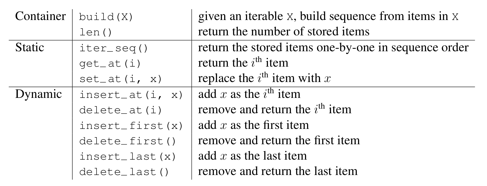
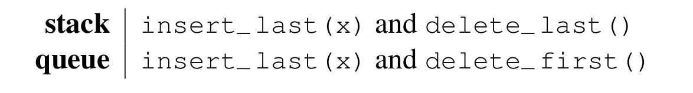
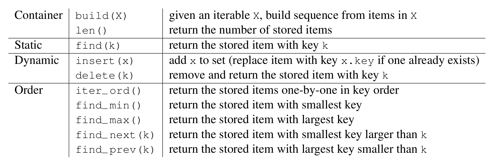
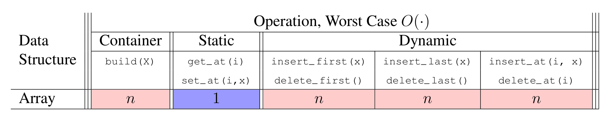
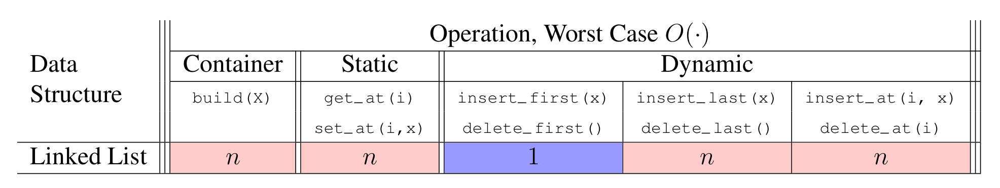
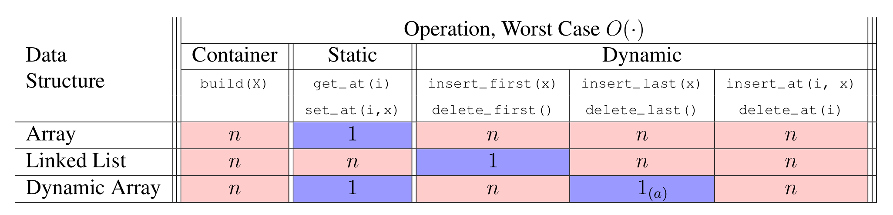

# Introduction to Algorithms: 6.006

## <span style="color:#2471a3;">**[lecture]**</span> <span style="color:#c0392b">Lecture 2: Data Structures（数据结构）</span>

Massachusetts Institute of Technology
Instructors: Erik Demaine, Jason Ku, and Justin Solomon

> <span style="color:#7f8c8d;">MIT 6.006 Spring 2020, Lecture 2 译注（对应视频：Data Structures）</span>

> 本讲主题：**Data Structures（数据结构）**，核心是两大接口 Sequence（序列）与 Set（集合），以及三种具体实现——Array、Linked List、Dynamic Array——并引入**Amortized Analysis（平摊分析）**。

---

## 1. Data Structure Interfaces 数据结构的接口

- data structure（数据结构）是一种「存储数据的方式」，它配套一组算法来支持对数据的各种操作（operations）。
- 把一组受支持的操作称为**interface（接口）**，也叫 **API（Application Programming Interface，应用程序编程接口）** 或 **ADT（Abstract Data Type，抽象数据类型）**。
- 接口是一份**specification（规格说明）**：它只规定「支持哪些操作」——这才是问题本身（the problem）。
- 数据结构是一种**representation（表示）**：它说明「这些操作是如何被实现的」——这是解（the solution）。
- 本课程主要关注两大接口：**Sequence（序列）** 与 **Set（集合）**。

> **interface / ADT（定义）**：接口是对「一组操作及其语义」的抽象约定，只回答「能做什么」，不涉及「怎么做」。可判定标准：看它是否只描述操作签名与行为，而不绑定任何存储布局。

---

## 2. Sequence Interface 序列接口（L02, L07）

- 维护一串**项（items）**，其顺序是**外在的（extrinsic order）**——顺序由外部赋予，而非项本身决定。
- 例：$(x_0, x_1, x_2, \dots, x_{n-1})$（从 0 开始的下标，zero indexing）。
- （用 $n$ 表示当前存储在数据结构中的项的个数。）

### 支持的操作

**Container（容器类）操作**

```math
\text{build}(X)  \quad 给定可迭代对象 X，按 X 中项的顺序构建序列
\text{len}()     \quad 返回已存储的项的个数
```

**Static（静态）操作**

```math
\text{iter\_seq}()     \quad 按序列顺序逐个返回已存储的项
\text{get\_at}(i)      \quad 返回第 i 个项
\text{set\_at}(i, x)   \quad 把第 i 个项替换为 x
```

**Dynamic（动态）操作**

```math
\text{insert\_at}(i, x) \quad 把 x 作为第 i 个项加入
\text{delete\_at}(i)     \quad 删除并返回第 i 个项
\text{insert\_first}(x)  \quad 把 x 作为第一个项加入
\text{delete\_first}()   \quad 删除并返回第一个项
\text{insert\_last}(x)   \quad 把 x 作为最后一个项加入
\text{delete\_last}()    \quad 删除并返回最后一个项
```



**图 1-1**：Sequence 接口的 10 个操作按 Container（2 个）/ Static（3 个）/ Dynamic（6 个）三档分层，分层依据是「是否改变已存内容」而非实现难度：Static 一档全部只读。

The 10 Sequence operations split into Container (2), Static (3) and Dynamic (6); the cut is "changes the stored contents or not", not implementation difficulty — every Static operation is read-only.


### special case interfaces（特例接口）

```math
\text{stack（栈）}: \quad 只保留 \text{insert\_last}(x) 与 \text{delete\_last}()  \\
\text{queue（队列）}: \quad 只保留 \text{insert\_last}(x) 与 \text{delete\_first}()
```

> 一句话理解：栈（stack）是「LIFO, Last-In-First-Out（后进先出）」，队列（queue）是「FIFO, First-In-First-Out（先进先出）」——都只是 Sequence 接口的受限版本。



**图 1-2**：stack 与 queue 只差一处 —— 删除端：stack 用 `delete_last()`（LIFO），queue 用 `delete_first()`（FIFO）；插入端两者都是 `insert_last(x)`。

Stack and queue differ in exactly one operation — the delete end: stack uses `delete_last()` (LIFO), queue uses `delete_first()` (FIFO); both insert with `insert_last(x)`.


---

## 3. Set Interface 集合接口（L03–L08）

- 序列关心**外在顺序**，集合关心**intrinsic order（内在顺序）**——顺序由键本身的大小关系决定。
- 维护一组具有**unique keys（唯一键）** 的项（例如项 $x$ 带有键 $x.\text{key}$）。
- （是 set 还是 multi-set？目前先限定为**唯一键**。）
- 常把项自身的键设为该项本身，但可能希望在键之外存储更多信息。

### 支持的操作

**容器类操作**

```math
\text{build}(X) \quad 给定可迭代对象 X，按 X 中的项构建集合
\text{len}()     \quad 返回已存储的项的个数
```

**静态操作**

```math
\text{find}(k) \quad 返回键为 k 的已存储项
```

**动态操作**

```math
\text{insert}(x) \quad 把 x 加入集合（若已存在键为 x.\text{key} 的项则替换之）
\text{delete}(k) \quad 删除并返回键为 k 的已存储项
```

**Order（顺序）操作**

```math
\text{iter\_ord}()    \quad 按键序逐个返回已存储的项
\text{find\_min}()    \quad 返回键最小的已存储项
\text{find\_max}()    \quad 返回键最大的已存储项
\text{find\_next}(k)  \quad 返回键大于 k 且最小的已存储项（后继）
\text{find\_prev}(k)  \quad 返回键小于 k 且最大的已存储项（前驱）
```



**图 2-1**：Set 接口比 Sequence 多出 Order 一档（4 个操作），因为 Set 的顺序由键本身决定（intrinsic order）而不是由插入位置决定；代价是 `find_next` / `find_prev` 这类「找相邻键」的操作在未排序数组上只能 $O(n)$。

Set adds the Order tier (4 operations) that Sequence lacks, because Set order is intrinsic to the keys; the cost is that neighbour queries such as `find_next` and `find_prev` degrade to $O(n)$ on an unsorted array.


### 特例接口

```math
\text{dictionary（字典）}: \quad 即不含 Order 操作的 Set
```

- 在习题课（recitation）中，会要求你**基于一个 Sequence 数据结构去实现一个 Set**。

---

## 4. Array Sequence 数组序列

- Array（数组）非常擅长**静态操作**：`get_at(i)` 与 `set_at(i, x)` 都是 $\Theta(1)$ 时间。
- 但不太擅长**动态操作**……
- （为保持一致，我们维护一条**invariant（不变式）**：数组总是「满的」，即 $r=1$。）

> **定义（invariant，不变式）**：一条在每次操作前后都保持成立的性质。可判定标准：能否写出「对任意一次合法操作，操作前成立则操作后仍成立」的归纳断言。这里的不变式是「数组被填满」，即装载比例 $r=1$。

- 于是在满数组上插入或删除一项，需要：
  - **reallocating（重新分配数组）**；
  - **shifting（移动）** 被修改项之后的所有项。

**复杂度表（Worst Case，最坏情况）**

| 数据结构 | build(X) | get_at(i) | set_at(i,x) | insert_first(x) | delete_first() | insert_last(x) | delete_last() | insert_at(i,x) | delete_at(i) |
|---|---|---|---|---|---|---|---|---|---|
| Array 数组 | $n$ | $1$ | $1$ | $n$ | $n$ | $n$ | $n$ | $n$ | $n$ |

> 说明：数组中任何「在中间/头尾」的插入删除都要移动后续元素，故除 `get_at` / `set_at` 外，其余动态操作最坏均为 $\Theta(n)$。



**图 2-2**：数组只有 `get_at` / `set_at` 是 $\Theta(1)$（蓝色格），其余 5 个动态操作全是 $\Theta(n)$（红色格）—— 因为在满数组上插入或删除都必须搬移后继元素。

An array has only `get_at` and `set_at` in $\Theta(1)$ (blue); the other five dynamic operations are all $\Theta(n)$ (red), since inserting or deleting in a full array must shift the successors.


---

## 5. Linked List Sequence 链表序列

- 一种**pointer data structure（指针型数据结构）**（这与 Python 的 `list` 无关）。
- 每个项存放在一个**node（节点）** 中，节点含一个指向序列中下一个节点的指针（pointer）。
- 每个节点有两个字段：`node.item` 与 `node.next`。
- 只需**重连指针（relinking pointers）** 就能轻松操作节点。
- 维护一个指向序列首节点的指针，称为 **head（头指针）**。
- 现在可以在**头部**以 $\Theta(1)$ 时间插入与删除——太好了！（Yay!）
- （在尾部高效插入/删除同样可行，将在 PS1 中完成。）
- 但现在 `get_at(i)` 与 `set_at(i, x)` 各自都要 $O(n)$ 时间…… :(
- 能否两全其美？可以！（算是吧……）

**复杂度表**

| 数据结构 | build(X) | get_at(i) | set_at(i,x) | insert_first(x) | delete_first() | insert_last(x) | delete_last() | insert_at(i,x) | delete_at(i) |
|---|---|---|---|---|---|---|---|---|---|
| Linked List 链表 | $n$ | $n$ | $n$ | $1$ | $1$ | $n$ | $n$ | $n$ | $n$ |

> 说明：链表靠 head 在头部 $\Theta(1)$ 操作；但随机访问需沿指针逐个走，故 `get_at` / `set_at` 为 $\Theta(n)$。



**图 3-1**：链表与数组恰好互为镜像：头部的 `insert_first` / `delete_first` 降到 $\Theta(1)$，但 `get_at` / `set_at` 从 $\Theta(1)$ 升到 $\Theta(n)$ —— 任何单一结构都不能同时给出随机访问与 $O(1)$ 头部操作。

Linked list is the mirror image of array: `insert_first` and `delete_first` become $\Theta(1)$ while `get_at` and `set_at` rise to $\Theta(n)$, so no single structure gives both random access and $O(1)$ head operations.


---

## 6. Dynamic Array Sequence 动态数组序列

- 让数组在**尾部动态操作**上变得高效。
- Python 的 `list` 就是一种动态数组。
- **Idea（一句话本质）**：多分配一些额外空间，这样每次动态操作都不必重新分配（reallocation）。
- **fill ratio（填充比例）** $r$：$0 \le r \le 1$，即「项数 / 空间数」的比值。
- 每当数组满了（$r=1$），在末尾分配 $\Theta(n)$ 的额外空间，把填充比例降到 $r_i$（例如 $1/2$）。
- 于是在下一次重新分配之前，必须插入 $\Theta(n)$ 个项。
- 单次操作可能花 $\Theta(n)$ 时间用于重新分配。
- 然而，任意 $\Theta(n)$ 次操作的**序列**总耗时仍是 $\Theta(n)$。
- 因此每次操作**「平均而言」**只需 $\Theta(1)$ 时间。

---

## 7. Amortized Analysis 平摊分析

- 一种「把总代价分摊到多次操作上」的数据结构分析技术。
- 若 $k$ 次操作的总代价至多 $\le k\,T(n)$，则称操作具有**amortized cost（平摊代价）** $T(n)$。
- 「$T(n)$ amortized（平摊）」大致表示「多次操作的平均意义下」为 $T(n)$。
- 向动态数组插入，平摊时间是 $\Theta(1)$。
- 更多平摊分析技术将在 6.046 中学习！

> **定义（amortized analysis，平摊分析）**：把一系列操作的总代价，按「每个操作平均分摊」的视角来衡量。可判定标准：给定 $k$ 次操作，能否证明总代价 $\le k \cdot T(n)$，从而宣称单次操作平摊为 $T(n)$。

### 平摊代价的正式推导（以动态数组插入为例）

设初始数组大小为 $1$，每当装满（$r=1$）就扩容为原来的 $2$ 倍。考虑连续 $n$ 次 `insert_last`：

- 一次扩容的代价为当前数组大小 $\Theta(\text{size})$；发生扩容时大小为 $1, 2, 4, \dots, 2^{\lfloor \lg n \rfloor}$。
- 全部扩容的总代价：

```math
1 + 2 + 4 + \cdots + 2^{\lfloor \lg n \rfloor} \;=\; 2^{\lfloor \lg n \rfloor + 1} - 1 \;<\; 2 \cdot 2^{\lg n} \;=\; 2n \;=\; O(n)
```

- 加上每次插入本身的 $O(1)$，共 $n$ 次操作总代价 $O(n)$。
- 于是每次操作的**平摊代价** $T(n) = O(n)/n = O(1)$。

> 关键点：虽然**某一次**插入可能触发 $\Theta(n)$ 的扩容，但「贵」的操作很稀疏，把总代价摊到 $n$ 次上后，平均每次仍是常数。

---

## 8. Dynamic Array Deletion 动态数组删除

- 从尾部删除？$\Theta(1)$ 时间且无需额外努力，太好了！（Yay!）
- 然而，空间可能被严重浪费。我们希望数据结构的**大小保持为 $\Theta(n)$**（即空间与项数同阶）。
- 一种尝试：若「非常空」就缩容到 $r=1$。但**插入与删除交替**会变得很糟……
- **Idea（一句话本质）**：当 $r \lt  r_d$ 时，把数组缩容到比例 $r_i$，其中 $r_d \lt  r_i$（例如 $r_d = 1/4,\ r_i = 1/2$）。
- 于是在下一次昂贵的缩容之前，必须先完成 $\Theta(n)$ 次「便宜」的操作。
- 可把额外空间开销限制在 $(1+\varepsilon)n$（对任意 $\varepsilon > 0$）。设置：

```math
r_d = \frac{1}{1+\varepsilon}, \qquad r_i = \frac{1}{2}
```

- 动态数组只支持**尾部**动态操作，且为 $\Theta(1)$ 时间。
- Python `list` 的 `append` 与 `pop` 是平摊 $O(1)$ 时间，其他操作可能是 $O(n)$！
- （在头部高效插入/删除同样可行，将在 PS1 中完成。）

### 缩容策略的平摊代价推导

设 $r_d = 1/4$、$r_i = 1/2$。考察从装满（$r=1$）开始，连续 `delete_last`：

- 当 $r$ 从 $1$ 降到 $1/4$ 以下，触发一次缩容，把容量从 $C$ 缩到 $C/2$，使 $r$ 回到 $1/2$。
- 缩容发生前，已删除约 $3C/4$ 个项（从满到 $1/4$）；每次删除 $O(1)$，累计 $O(C)$ 的「便宜」操作铺好了垫。
- 一次缩容代价 $\Theta(C)$，被这 $O(C)$ 次删除摊掉，故 `delete_last` 平摊 $O(1)$。

> 为什么不用「$r=0$ 才缩容」或「一空就缩」？因为插入/删除交替会让每次操作都触发 $\Theta(n)$ 的搬移，退化为最坏 $\Theta(n)$。留出 $r_d \lt  r_i$ 的**hysteresis（滞回区间）**，保证两次昂贵操作之间隔着 $\Theta(n)$ 次便宜操作。

---



**图 4-1**：Dynamic Array 的 `insert_last` / `delete_last` 标为 $1_{(a)}$ —— 下标 $(a)$ 表示 amortized：单次操作可能是 $\Theta(n)$ 的重新分配，但任意 $\Theta(n)$ 次连续操作的总代价是 $\Theta(n)$。

Dynamic Array's `insert_last` and `delete_last` are annotated $1_{(a)}$; the $(a)$ means amortized — one operation may cost $\Theta(n)$ for reallocation, yet any $\Theta(n)$ consecutive operations cost $\Theta(n)$ in total.


## 9. 三种序列实现的完整复杂度对照表

| 数据结构 | build(X) | get_at(i) | set_at(i,x) | insert_first(x) | delete_first() | insert_last(x) | delete_last() | insert_at(i,x) | delete_at(i) |
|---|---|---|---|---|---|---|---|---|---|
| Array 数组 | $n$ | $1$ | $1$ | $n$ | $n$ | $n$ | $n$ | $n$ | $n$ |
| Linked List 链表 | $n$ | $n$ | $n$ | $1$ | $1$ | $n$ | $n$ | $n$ | $n$ |
| Dynamic Array 动态数组 | $n$ | $1$ | $1$ | $n$ | $n$ | $1^{(a)}$ | $1^{(a)}$ | $n$ | $n$ |

> (a) 标注为 $1^{(a)}$ 表示：`insert_last` 与 `delete_last` 的**amortized（平摊）**代价为 $\Theta(1)$。

### 三者权衡小结

- **Array**：随机访问快（$O(1)$），但任何插入/删除都要搬移元素（$O(n)$）。
- **Linked List**：头尾指针操作快（头部 $O(1)$），但随机访问慢（$O(n)$），且每项有指针的额外空间开销。
- **Dynamic Array**：保留随机访问 $O(1)$，同时尾部增删平摊 $O(1)$——是「两全其美」的折中（头部与中间操作仍 $O(n)$）。

---

## 附：本讲核心概念速查（首次出现的英文原名 + 中文 + 定义）

| 英文原名 | 中文 | 一句可判定的定义 |
|---|---|---|
| data structure | 数据结构 | 存储数据并配套一组操作算法的组织方式 |
| interface / API / ADT | 接口 / 抽象数据类型 | 只规定「支持哪些操作及其语义」的抽象约定，不涉及实现 |
| Sequence | 序列 | 维护有序项的接口，顺序是外在赋予的 |
| Set | 集合 | 维护唯一键项的接口，顺序由键的内在大小关系决定 |
| stack | 栈 | 只允许在尾部插入/删除的受限序列（LIFO 后进先出） |
| queue | 队列 | 尾部插入、头部删除的受限序列（FIFO 先进先出） |
| dictionary | 字典 | 不含 Order 操作的集合 |
| invariant | 不变式 | 每次操作前后都保持成立的性质 |
| amortized analysis | 平摊分析 | 把一系列操作总代价分摊到每次操作的衡量技术 |

---

*MIT OpenCourseWare · https://ocw.mit.edu · 6.006 Introduction to Algorithms, Spring 2020*
