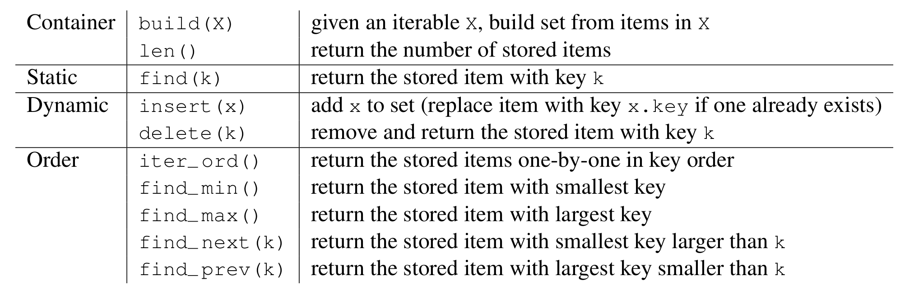
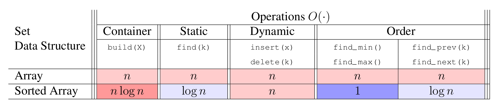

# Introduction to Algorithms: 6.006

## <span style="color:#2471a3;">**[lecture]**</span> <span style="color:#c0392b">Lecture 3: Sorting（排序）</span>

Massachusetts Institute of Technology
Instructors: Erik Demaine, Jason Ku, and Justin Solomon

> <span style="color:#7f8c8d;">MIT 6.006 Spring 2020, Lecture 3 译注（对应视频：Sorting）</span>

> 本讲是「排序 + 集合接口」的开篇。核心思想贯穿全课：**先定义抽象接口（interface），再用不同数据结构实现，比较各自的操作复杂度（operation cost）**。排序本身是构造有序数组的手段，而有序数组又能反过来支撑高效的集合查询（二分查找）。全讲用「递归分治」铺开，并配套讲了三种解递推式的方法，为后续所有复杂度分析打地基。

---

## 1. Set Interface（集合接口）（L03–L08）

**Set Interface（集合接口）** 是一种抽象数据类型约定：它规定了一个「可存放若干元素」的容器必须支持哪些操作（及其语义），但不规定底层怎么实现。

```
build(X)        给定一个可迭代对象 X，用 X 中的元素构建集合（build set from items in X）
len()           返回已存储的元素个数（number of stored items）
```

**Container（容器）**：上述 `build` 与 `len` 属于「容器级」操作，即只关心集合整体的构造与规模，与具体键值无关。

**Static（静态）**：只读、不改变集合内容的操作。

```
find(k)         返回键为 k 的那个已存元素（return the stored item with key k）
```

**Dynamic（动态）**：会改变集合内容的操作。

```
insert(x)       把 x 加入集合（若已存在键为 x.key 的元素，则用 x 替换它）
delete(k)       删除并返回键为 k 的那个已存元素
```

**Order（有序）**：依赖键的排序关系、需要遍历或定位「相邻」键的操作。

```
iter_ord()      按键的大小顺序，一个接一个地返回所有已存元素
find_min()      返回键最小的那个元素
find_max()      返回键最大的那个元素
find_next(k)    返回键比 k 大、且最小的那个元素（即 k 的「后继」successor）
find_prev(k)    返回键比 k 小、且最大的那个元素（即 k 的「前驱」predecessor）
```

**要点**：一个集合数据结构好不好，就看它实现上面这 9 类操作（容器 2 + 静态 1 + 动态 2 + 有序 4）各花多少时间。



**图 1-1**：Set 接口的 9 个操作分成四档，其中 Order 一档（4 个）最多 —— 而「如何低成本地维护键的排序」正是本讲的主题，这就是为什么 Lecture 3 开篇要重抄这张表。

The 9 Set operations form four tiers, and the Order tier (4 operations) is the largest; maintaining key order cheaply is exactly this lecture's subject, which is why the table is repeated here.


- 把元素**任意顺序**地塞进数组，也能实现一个（效率不高的）集合。
- 把元素**按键递增排序**后，能带来两个好处：
  - 更快地找 min/max（就在数组的第一个 / 最后一个位置）；
  - 用**binary search（二分查找）** 更快地查找：$O(\log n)$。

### 两种实现的复杂度对比

| 数据结构 | build(X) | find(k) | insert(x) | delete(k) | find_min() | find_max() | find_prev(k) | find_next(k) |
| --- | --- | --- | --- | --- | --- | --- | --- | --- |
| Array（未排序数组） | $n$ | $n$ | $n$ | $n$ | $n$ | $n$ | $n$ | $n$ |
| Sorted Array（有序数组） | $n \log n$ | $\log n$ | $n$ | $n$ | $1$ | $1$ | $\log n$ | $\log n$ |

- 未排序数组：什么都得线性扫一遍，全是 $O(n)$。
- 有序数组：查找类操作降到 $O(\log n)$、min/max 降到 $O(1)$，但插入、删除因为要移动元素保持有序，仍是 $O(n)$。
- 于是引出一个关键问题：**如何高效地构造一个有序数组？** —— 这就是排序（sorting）要解决的问题。



**图 1-2**：有序数组把 `find` 从 $n$ 降到 $\log n$、`find_min` / `find_max` 从 $n$ 降到 $1$，但 `build` 从 $n$ 升到 $n\log n$：收益与代价都压在构造上，于是问题归结为「如何高效地构造有序数组」。

Sorting the array drops `find` from $n$ to $\log n$ and `find_min` / `find_max` from $n$ to $1$, but raises `build` from $n$ to $n\log n$ — the whole trade-off sits in construction.


---

## 2. Sorting（排序）

- 有了有序数组，我们就能借助二分查找，做出一个高效的集合数据结构。
- **Input（输入）**：一个（静态的）数组 $A$，含 $n$ 个数。
- **Output（输出）**：一个（静态的）数组 $B$，它是 $A$ 的一个有序排列（sorted permutation）。
  - **Permutation（排列）**：元素相同、但顺序可能不同的数组。
  - **Sorted（有序）**：对所有 $i \in \{1, \dots, n\}$，有 $B[i-1] \le B[i]$。
- 例子：$[8, 2, 4, 9, 3] \to [2, 3, 4, 8, 9]$。
- 一个排序是**destructive（破坏性的）**，如果它直接覆盖 $A$（而不是另建一个新数组 $B$ 来存有序版本）。
- 一个排序是**in place（原地的）**，如果它只使用 $O(1)$ 额外空间（原地蕴含破坏性：in place ⊆ destructive）。

### Permutation Sort（全排列排序）

**Idea（一句话本质）**：暴力枚举 $A$ 的所有排列，逐个检查谁是有序的，碰到第一个有序的就返回——正确但慢到无法使用。

- $A$ 共有 $n!$ 种排列，其中至少有一种是有序的。
- 对每种排列，花 $\Theta(n)$ 时间检查它是否有序。
- 例子：$[2, 3, 1]$ 的全部排列：

```math
[2,3,1] \;\to\; \big\{\, [1,2,3],\, [1,3,2],\, [2,1,3],\, [2,3,1],\, [3,1,2],\, [3,2,1] \,\big\}
```

```
def permutation_sort(A):          # 对 A 排序
    for B in permutations(A):     # O(n!)：枚举所有排列
        if is_sorted(B):          # O(n)：检查是否有序
            return B              # O(1)
```

**复杂度分析（permutation sort）**：

- **正确性**：靠穷举（case analysis）——把所有可能性都试一遍（暴力法 Brute Force），必然能覆盖到那个有序排列，故正确。
- **运行时间**：$\Omega(n! \cdot n)$，这是**exponential（指数级）**的，慢到不可接受。结论：不能靠暴力，得找更聪明的排序。

---

## 3. Solving Recurrences（解递推式）

后续每个分治排序都要算复杂度，于是先备好三件工具：

- **Substitution（代入法 / 替换法）**：猜一个解的形式，代回递推式验证是否成立（配合归纳）。
- **Recurrence Tree（递推树）**：画一棵树表示各层递归调用，把每个节点上的工作量加起来。
- **Master Theorem（主定理）**：一个公式，能直接解出大量常见递推式（详见 R03 讲义）。

> 本讲后面会反复用前两种；主定理留到 recitation 展开。

---

## 4. Selection Sort（选择排序）

**Idea（一句话本质）**：每次在未排序的前缀里挑出最大的数，换到末尾，再递归处理剩下的前缀。

- 在 $A[:i+1]$ 中找到最大的数，把它换到 $A[i]$；
- 递归地排序 $A[:i]$。

- 例子（每一步后的状态）：
  ```math
  [8,2,4,9,3],\; [8,2,4,3,9],\; [3,2,4,8,9],\; [3,2,4,8,9],\; [2,3,4,8,9]
  ```

```
def selection_sort(A, i = None):   # T(i)：排序 A[:i+1]
    if i is None: i = len(A) - 1   # O(1)
    if i > 0:                      # O(1)
        j = prefix_max(A, i)       # S(i)
        A[i], A[j] = A[j], A[i]    # O(1)：把最大数换到末尾
        selection_sort(A, i - 1)   # T(i-1)

def prefix_max(A, i):              # S(i)：返回 A[:i+1] 中最大值的下标
    if i > 0:                      # O(1)
        j = prefix_max(A, i - 1)   # S(i-1)
        if A[i] < A[j]:            # O(1)
            return j               # O(1)
        return i                   # O(1)
    return i                       # 基线：i = 0 时只有一个元素
```

### prefix_max 的复杂度分析

- **基例**：当 $i = 0$，数组只有一个元素，最大值下标就是 $i$。
- **归纳**：假设对规模 $i$ 成立——此时最大值要么是 $A[:i]$ 的最大值，要么是 $A[i]$ 本身；两种情况函数都返回正确下标。
- 递推式：

```math
S(1) = \Theta(1), \qquad S(n) = S(n-1) + \Theta(1)
```

- **代入法**：猜 $S(n) = \Theta(n)$，即存在常数 $c$ 使 $S(n) = cn$：

```math
cn = \Theta(1) + c(n-1) \;\Longrightarrow\; cn = cn - c + \Theta(1) \;\Longrightarrow\; c = \Theta(1)
```

取 $c$ 足够大即可吸收 $\Theta(1)$ 项，等式成立，故 $S(n) = \Theta(n)$。

- **递推树**：一条长度为 $n$ 的链，每个节点做 $\Theta(1)$ 的工作，总和：

```math
\sum_{i=0}^{n-1} 1 = \Theta(n)
```

### selection_sort 的复杂度分析

- **基例**：当 $i = 0$，数组只有一个元素，天然有序。
- **归纳（循环不变式视角）**：假设对规模 $i$ 成立——有序输出的最后一个数一定是整个数组的最大数，而算法恰好把最大数放到那个位置；于是剩下的 $A[:i]$ 由归纳假设已有序。归纳成立。
- 递推式：

```math
T(1) = \Theta(1), \qquad T(n) = T(n-1) + \Theta(n)
```

- **代入法**：猜 $T(n) = \Theta(n^2)$，即 $T(n) = cn^2$：

```math
cn^2 = \Theta(n) + c(n-1)^2 = \Theta(n) + c(n^2 - 2n + 1)
```

```math
cn^2 = cn^2 - 2cn + c + \Theta(n) \;\Longrightarrow\; c(2n - 1) = \Theta(n)
```

即 $2cn - c = \Theta(n)$，取 $c$ 足够大可吸收低阶项，成立，故 $T(n) = \Theta(n^2)$。

- **递推树**：一条长度为 $n$ 的链，第 $i$ 个节点做 $\Theta(i)$ 的工作，总和：

```math
\sum_{i=0}^{n-1} i = \frac{n(n-1)}{2} = \Theta(n^2)
```

---

## 5. Insertion Sort（插入排序）

**Idea（一句话本质）**：先递归排好前缀 $A[:i]$，再假设它已有序，用「反复交换」把新元素 $A[i]$ 插到正确位置。

- 递归地排序 $A[:i]$；
- 假设 $A[:i]$ 已有序，通过反复相邻交换，把它扩展成有序的 $A[:i+1]$。

- 例子（每一步后的状态）：
  ```math
  [8,2,4,9,3],\; [2,8,4,9,3],\; [2,4,8,9,3],\; [2,4,8,9,3],\; [2,3,4,8,9]
  ```

```
def insertion_sort(A, i = None):   # T(i)：排序 A[:i+1]
    if i is None: i = len(A) - 1   # O(1)
    if i > 0:                      # O(1)
        insertion_sort(A, i - 1)   # T(i-1)：先排好前缀
        insert_last(A, i)          # S(i)：把 A[i] 插到正确位置

def insert_last(A, i):             # S(i)：假设 A[:i] 有序，使 A[:i+1] 有序
    if i > 0 and A[i] < A[i-1]:    # O(1)：若违反有序
        A[i], A[i-1] = A[i-1], A[i]  # O(1)：相邻交换
        insert_last(A, i - 1)      # S(i-1)：继续向前冒
```

### insert_last 的复杂度分析

- **基例**：当 $i = 0$，数组只有一个元素，天然有序。
- **归纳**：假设对规模 $i$ 成立——若 $A[i] \ge A[i-1]$，整个数组已经有序；否则交换最后两个元素后，剩下的 $A[:i]$ 由归纳假设可排成有序。两种情况都正确。
- 递推式：

```math
S(1) = \Theta(1), \qquad S(n) = S(n-1) + \Theta(1) \;\Longrightarrow\; S(n) = \Theta(n)
```

（与 prefix_max 同型，代回即可得 $S(n) = \Theta(n)$。）

### insertion_sort 的复杂度分析

- **基例**：当 $i = 0$，数组只有一个元素，天然有序。
- **归纳**：假设对规模 $i$ 成立——算法先由归纳假设把 $A[:i]$ 排好，再由上面已证明的 `insert_last` 把剩余部分正确插入，故整体有序。
- 递推式：

```math
T(1) = \Theta(1), \qquad T(n) = T(n-1) + \Theta(n) \;\Longrightarrow\; T(n) = \Theta(n^2)
```

（与 selection sort 同型，代入法验证步骤完全一致，故 $T(n) = \Theta(n^2)$。）

> **小结**：selection sort 与 insertion sort 都是 $\Theta(n^2)$，本质原因相同——每步递归都退化为「链式」结构（$T(n)=T(n-1)+\Theta(n)$），把问题只缩小 1。要突破平方，必须把问题「对半切」，引出归并排序。

---

## 6. Merge Sort（归并排序）

**Idea（一句话本质）**：把问题对半切成两个子数组分别递归排序，再用「two finger（双指针）」把两个有序半段归并成一个有序整体。

- 递归地排序前半段和后半段（可假设 $n$ 是 2 的幂，便于分析）；
- 用**two finger algorithm（双指针算法）** 把两个有序半段归并成一个有序列表。

- 例子（逐步状态）：
  ```math
  [7,1,5,6,2,4,9,3],\; [1,7,5,6,2,4,3,9],\; [1,5,6,7,2,3,4,9],\; [1,2,3,4,5,6,7,9]
  ```

```
def merge_sort(A, a = 0, b = None):   # T(b-a = n)：排序 A[a:b]
    if b is None: b = len(A)          # O(1)
    if 1 < b - a:                     # O(1)：区间长度 > 1 才继续
        c = (a + b + 1) // 2          # O(1)：取中点
        merge_sort(A, a, c)           # T(n/2)：递归左半
        merge_sort(A, c, b)           # T(n/2)：递归右半
        L, R = A[a:c], A[c:b]         # O(n)：复制出两个半段
        merge(L, R, A, len(L), len(R), a, b)   # S(n)：归并回 A

def merge(L, R, A, i, j, a, b):       # S(b-a = n)：把有序 L[:i]、R[:j] 归并进 A[a:b]
    if a < b:                         # O(1)
        if (j <= 0) or (i > 0 and L[i-1] > R[j-1]):  # O(1)：取 L、R 剩余段末位的较大者
            A[b-1] = L[i-1]           # O(1)
            i = i - 1                 # O(1)
        else:
            A[b-1] = R[j-1]           # O(1)
            j = j - 1                 # O(1)
        merge(L, R, A, i, j, a, b-1)  # S(n-1)：继续填前一个位置
```

> 注意：这份讲义里的 `merge` 是「从后往前填」的写法——每次比较 $L$、$R$ 剩余前缀的**末位**，把较大的那个放到 $A$ 的末尾 $A[b-1]$，再递归向前。这与常见的「从前往后、双指针取较小者」方向相反，但逻辑等价（都是稳定地归并两个有序段）。

### merge 的复杂度分析

- **基例**：当 $n = 0$，两个数组都为空，vacuously（空真）成立。
- **归纳（循环不变式）**：假设对规模 $n$ 成立——$A[r]$ 这个位置放的一定是 $L$、$R$ 剩余前缀中的最大数；由于 $L$、$R$ 各自有序，取它们末位元素的较大者即可；剩下的部分由归纳假设继续正确归并。
- 递推式：

```math
S(0) = \Theta(1), \qquad S(n) = S(n-1) + \Theta(1) \;\Longrightarrow\; S(n) = \Theta(n)
```

### merge_sort 的复杂度分析

- **基例**：当 $n = 1$，数组只有一个元素，天然有序。
- **归纳（强归纳）**：假设对所有 $k \lt  n$ 成立——算法先由归纳假设把两个更小的半段排好，再由上面已证明的 `merge` 把它们归并成有序数组。
- 递推式：

```math
T(1) = \Theta(1), \qquad T(n) = 2\,T\!\left(\frac{n}{2}\right) + \Theta(n)
```

- **代入法**：猜 $T(n) = \Theta(n \log n)$，即 $T(n) = c\,n\log n$：

```math
c\,n\log n = \Theta(n) + 2 \cdot c\,\frac{n}{2}\log\frac{n}{2}
```

```math
c\,n\log n = \Theta(n) + c\,n\,(\log n - \log 2)
```

```math
c\,n\log n = c\,n\log n - c\,n\log 2 + \Theta(n) \;\Longrightarrow\; c\,n\log 2 = \Theta(n)
```

即 $c\log 2 \cdot n = \Theta(n)$，取 $c$ 足够大即可吸收 $\Theta(n)$ 项，成立，故 $T(n) = \Theta(n \log n)$。

- **递推树**：一棵深度为 $\log_2 n$、有 $n$ 个叶子的完全二叉树；第 $i$ 层有 $2^i$ 个节点，每个做 $O(n/2^i)$ 的工作。总和：

```math
\sum_{i=0}^{\log_2 n} 2^{i} \cdot \frac{n}{2^{i}} = \sum_{i=0}^{\log_2 n} n = \Theta(n \log n)
```

> **关键结论**：归并排序把「链式」的 $T(n)=T(n-1)+\Theta(n)$ 换成「二分」的 $T(n)=2T(n/2)+\Theta(n)$，复杂度从 $\Theta(n^2)$ 降到 $\Theta(n\log n)$。代价是归并需要 $O(n)$ 的辅助空间，所以它不是**原地（in place）** 排序。而这一 $\Theta(n\log n)$ 正是「基于比较的排序」的理论下限（comparison-based sorting lower bound），会在后续课程用决策树证明。

---

## 附：来源

- MIT OpenCourseWare — https://ocw.mit.edu
- 6.006 Introduction to Algorithms, Spring 2020
- 引用与使用条款见 https://ocw.mit.edu/terms
