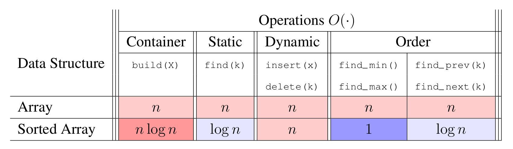
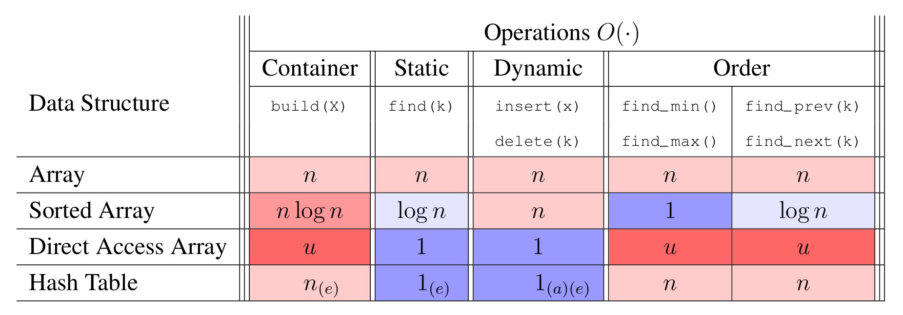

# Introduction to Algorithms: 6.006

## <span style="color:#2471a3;">**[lecture]**</span> <span style="color:#c0392b">Lecture 4: Hashing（散列 / 哈希）</span>

Massachusetts Institute of Technology
Instructors: Erik Demaine, Jason Ku, and Justin Solomon

> <span style="color:#7f8c8d;">MIT 6.006 Spring 2020, Lecture 4 译注（对应视频：Hashing）</span>

---

## Review（回顾）

**Data Structure（数据结构）**：一种组织数据的方式，对外提供一组操作接口。下表按「静态 Static / 动态 Dynamic / 顺序 Order」三类操作列出常见结构的复杂度。

| Operations（操作）O(·) | build(X) 构建 | find(k) 查找 | insert(x) 插入 | delete(k) 删除 | find_min() | find_max() | find_prev(k) | find_next(k) |
|---|---|---|---|---|---|---|---|---|
| **Array（数组）** | n | n | n | n | n | n | n | n |



**图 1-1**：复习表只有两行，但已经把下界钉死：在比较模型下 `find` 最好也只能做到 $\log n$，因此本讲要问的不是「怎么再快一点」，而是「能不能绕过比较」。

Two rows suffice to fix the lower bound: under the comparison model `find` cannot beat $\log n$, so the lecture asks not how to be slightly faster but how to bypass comparison.

| **Sorted Array（有序数组）** | n log n | log n | n | n | 1 | 1 | log n | log n |

- **Idea!（核心想法）**：我们想要更快的查找与动态操作。能否让 `find(k)` 比 $\Theta(\log n)$ 更快？
- **Answer is no (lower bound)!（答案是「不能」，这是下界）**……但等等，其实也可以更快？先看下界是怎么来的。

### Comparison Model（比较模型）

- 在该模型中，假设算法**只能通过比较（comparison）来区分元素**。
- **Comparable items（可比较元素）**：把元素视作「black box（黑箱）」，只支持两两之间的比较操作。
- 比较操作为 `<, ≤, >, ≥, =, ≠`，输出为二值的 **True** 或 **False**。
- **Goal（目标）**：存储 n 个可比较元素，支持 `find(k)` 操作。
- 运行时间由「执行的比较次数」下界决定，所以要数比较次数（count comparisons）。

### Decision Tree（决策树）

- 任意算法都可看作一棵由所执行操作构成的**decision tree（决策树）**。
- 每个**internal node（内部结点）**表示一次二值比较，按 True / False 分叉。
- 对于基于比较的算法，决策树是**binary tree（二叉树）**。
- 每个**leaf（叶结点）**表示算法终止，并产出一个算法输出。
- 一条**root-to-leaf path（根到叶的路径）**表示算法在某个输入上的一次执行。
- 每个算法输出至少要有一个叶结点，因此查找需要 $\ge n + 1$ 个叶结点（n 个「找到」+ 1 个「未找到」）。

---

## Comparison Search Lower Bound（比较查找的下界）

**问题**：比较查找算法的最坏情况运行时间是多少？

推导链（每步含义）：

1. running time ≥ #comparisons（运行时间 ≥ 比较次数）
2. ≥ 最长根到叶路径长度
3. ≥ 决策树的高度 height

即：

```math
\text{running time} \;\ge\; \text{\#comparisons} \;\ge\; \text{最长路径长度} \;\ge\; \text{height of tree}
```

**问题**：包含 ≥ n 个结点的二叉树的最小高度是多少？

**答案**：当二叉树是**complete（完全）**时高度最小（除最后一层外所有行都填满）。

设高度为 h，则完全二叉树的结点数最多为 $2^{h+1}-1$。要求至少容纳 $n+1$ 个叶结点（即结点数 ≥ $n+1$），于是：

```math
2^{h+1} - 1 \;\ge\; n+1
\quad\Longrightarrow\quad
h \;\ge\; \lceil \lg(n+1) \rceil - 1 \;=\; \Omega(\log n)
```

**结论**：任何比较查找算法的运行时间都是 $\Omega(\log n)$。而**有序数组正好达到这个下界**，完美！

更一般地：若树的叶结点数为 $\Theta(n)$、最大分叉因子为 b，则高度为 $\Omega(\log_b n)$。

**要更快**，必须引入一种能带来「超常数 $\omega(1)$ 分叉因子」的操作。怎么做？

---

## Direct Access Array（直接寻址数组）

- 利用 **Word-RAM** 模型中 $O(1)$ 时间的随机访问（random access indexing）——这就是**linear branching factor（线性分叉因子）**！
- **Idea!** 给每个元素分配一个唯一整数键 key $k \in \{0,\dots,u-1\}$，把元素存到数组下标为 k 的位置。
- 为数组的每个下标赋予一个「含义」（即下标 ↔ 键的映射）。
- 若所有键都装得进一个机器字（machine word），即 $u \le 2^w$，则查找/动态操作都是最坏情况 $O(1)$！
- **6.006 约定**：输入的数字/字符串都默认能装进一个字（除非显式参数化了长度）。
- 计算机内存里的任何东西本质上都是一个二进制整数，或用（静态）64 位地址表示。
- **但空间是 $O(u)$**，当 $n \ll u$ 时极浪费。
- **例子**：若键是十字母的名字，每个名字占 1 bit，也需要 $26^{10} \approx 17.6$ TB 的空间。

**问题**：如何用更少的空间？

---

## Hashing（散列 / 哈希）

- **Idea!** 当 $n \ll u$ 时，把键映射到一个更小的范围 $m = \Theta(n)$，再用一个更小的直接寻址数组。
- **Hash function（散列函数）**：$h(k) : \{0,\dots,u-1\} \to \{0,\dots,m-1\}$（也叫 hash map）。
- 那个直接寻址数组称为 **hash table（散列表）**，$h(k)$ 称为键 k 的 **hash（散列值）**。
- 若 $m \ll u$，由**pigeonhole principle（鸽巢原理）**：不存在单射（injective）的散列函数。

**定义（Collision，碰撞/冲突）**：总存在键 $a, b$ 使得 $h(a)=h(b)$，即两个不同键被映射到同一位置，称为碰撞。

既然两个元素不能存到同一位置，那存到哪里？两种方案：

1. **Open addressing（开放寻址）**：存到数组的别处。分析复杂，但常见且实用。
2. **Chaining（拉链法）**：存到另一个支持动态集合接口（dynamic set interface）的数据结构里。

---

## Chaining（拉链法）

- **Idea!** 把碰撞的元素存进另一个数据结构（一条「链 chain」）。
- 若键在各下标上大致均匀分布，链长就是 $\frac{n}{m} = \frac{n}{\Omega(n)} = O(1)$！
- 若链长为 $O(1)$，则所有操作都是 $O(1)$！
- 但若分布不均（例如 $h(k) = \text{常数}$），某条链长可达 $\Theta(n)$。
- 因此需要**好的散列函数**。什么是好的散列函数？

---

## Hash Functions（散列函数）

### Division（除法散列，差）：

```math
h(k) = k \bmod m
```

- 这是一种**heuristic（启发式）**做法，当键均匀分布时效果好。
- m 应避免与键的分布有对称性（如避免取 2 的幂、10 的幂）。
- 远离 2 的幂和 10 的幂的大质数通常较合理。
- Python 就用了这种方法的某个变体，并加了一些额外混淆（mixing）。
- 但若 $u \gg n$，**任何**固定的散列函数都存在某个输入集合会形成 $O(n)$ 长的链。
- **Idea!** 不要用固定的散列函数！随机地（但要小心地）选一个。

### Universal（全域散列，好，理论上有保证）：

```math
h_{ab}(k) = \big((ak + b) \bmod p\big) \bmod m
```

- **Hash Family（散列函数族）**：$H(p, m) = \{ h_{ab} \mid a, b \in \{0,\dots,p-1\},\ a \ne 0 \}$。
- 由一个固定的质数 $p > u$ 参数化，$a$、$b$ 从 $\{0,\dots,p-1\}$ 中选取。
- **定义（Universal family，全域散列族）**：H 是全域的，若对任意 $k_i \ne k_j \in \{0,\dots,u-1\}$，

```math
\Pr_{h \in H}\{ h(k_i) = h(k_j) \} \;\le\; \frac{1}{m}
```

**为什么全域性有用？** 它保证（在期望意义上）链长很短。证明如下：

设指示随机变量（indicator random variable）$X_{ij}$（在 $h \in H$ 上随机）：

```math
X_{ij} =
\begin{cases}
1, & \text{若 } h(k_i) = h(k_j) \\
0, & \text{否则}
\end{cases}
```

键 $k_i$ 所在链的长度是随机变量：

```math
X_i = \sum_{j} X_{ij}
```

其期望：

```math
\begin{aligned}
\mathbb{E}\{X_i\}
&= \mathbb{E}\Big\{\sum_j X_{ij}\Big\}
 = \sum_j \mathbb{E}\{X_{ij}\}
 = 1 + \sum_{j \ne i} \mathbb{E}\{X_{ij}\} \\
&= 1 + \sum_{j \ne i} \Big( 1 \cdot \Pr\{h(k_i)=h(k_j)\} + 0 \cdot \Pr\{h(k_i) \ne h(k_j)\} \Big) \\
&\le 1 + \sum_{j \ne i} \frac{1}{m}
 = 1 + \frac{n-1}{m}
\end{aligned}
```

其中第一步是**linearity of expectation（期望的线性性）**，第二步代入 $X_{ii}=1$（键与自身必然碰撞）。

由于 $m = \Omega(n)$，**load factor（负载因子）** $\alpha = n/m = O(1)$，故链长期望为 $O(1)$。

**定义（Load factor，负载因子）**：$\alpha = n/m$，即平均每个槽中的元素个数，是散列表性能的关键指标。

---

## Dynamic（动态扩展）

- 当 $n/m$ 偏离 1 较多时，用新的随机散列函数、以新的尺寸 m rebuild（重建）散列表。
- 分析与动态数组（dynamic arrays）相同，代价可摊到多次动态操作上。

**amortized analysis（摊还分析）**：把一次性的大开销（如重建）均摊到多次廉价操作上，从而得到每次操作的「平均」代价；常见工具有聚合分析、记账法、势能法。

- 因此散列表可实现动态集合操作，**期望摊还 $O(1)$** 时间！

---

## 复杂度汇总表

| Operations O(·) | build(X) | find(k) | insert(x) | delete(k) | find_min() | find_max() | find_prev(k) | find_next(k) |
|---|---|---|---|---|---|---|---|---|
| **Array（数组）** | n | n | n | n | n | n | n | n |
| **Sorted Array（有序数组）** | n log n | log n | n | n | 1 | 1 | log n | log n |
| **Direct Access Array（直接寻址数组）** | u | 1 | 1 | 1 | u | u | u | u |
| **Hash Table（散列表）** | $n_{(e)}$ | $1_{(e)}$ | $1_{(a)(e)}$ | $1_{(a)(e)}$ | n | n | n | n |

> 注：下标 $(e)$ 表示期望（expected）时间，$(a)$ 表示摊还（amortized）时间。散列表的 find/insert/delete 均为期望（摊还）$O(1)$；由于散列打乱了顺序，find_min/max/prev/next 这些顺序操作需 $O(n)$。



**图 4-1**：Direct Access Array 的 `find` 是 $1$ 但 `build` 要 $u$；Hash Table 把 `build` 压到 $n_{(e)}$、`find` 压到 $1_{(e)}$，代价是 `find_min` / `find_max` / `find_prev` / `find_next` 全部退化为 $n$ —— 常数期望查找是用顺序换来的。

Direct Access Array buys `find` $=1$ by paying `build` $=u$; Hash Table pushes `build` to $n_{(e)}$ and `find` to $1_{(e)}$, but every order query degrades to $n$ — expected constant lookup is paid for with ordering.


---

## 本讲核心结论

1. **比较模型下界**：任何比较查找算法都是 $\Omega(\log n)$，有序数组达到该下界。
2. **突破下界的关键**：放弃「只比较」，改用 Word-RAM 的 $O(1)$ 直接寻址，得到线性分叉因子。
3. **直接寻址数组**：$O(1)$ 操作但空间 $O(u)$，当 $n \ll u$ 时不可接受。
4. **散列**：用散列函数 $h$ 把键压缩到 $m=\Theta(n)$ 的槽位，代价是引入碰撞。
5. **拉链法 + 全域散列**：链长期望 $O(1)$，从而所有操作期望（摊还）$O(1)$。

---

*MIT OpenCourseWare — 6.006 Introduction to Algorithms, Spring 2020*
