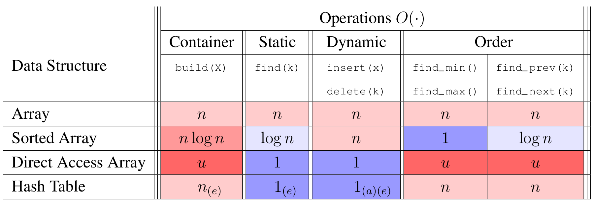
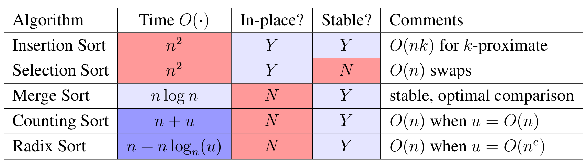

# Introduction to Algorithms: 6.006

## <span style="color:#2471a3;">**[lecture]**</span> <span style="color:#c0392b">Lecture 5: Linear Sorting（线性时间排序）</span>

Massachusetts Institute of Technology
Instructors: Erik Demaine, Jason Ku, and Justin Solomon

> <span style="color:#7f8c8d;">MIT 6.006 Spring 2020, Lecture 5 译注（对应视频：Linear Sorting）</span>

> 本讲主题：**Linear Sorting（线性排序）**。从比较排序的下界出发，论证「基于比较的排序最坏 $\Omega(n\log n)$」，再借助直接访问数组（direct access array）与哈希思想突破下界，依次引出**直接访问数组排序 → Counting Sort（计数排序）→ Radix Sort（基数排序）**，最终得到 $O(n)$ 的线性排序算法，并重点讲解**stability（稳定性）**。

---

## 1. Review 回顾

- **comparison search lower bound（比较搜索下界）**：任何具有 $n$ 个节点的决策树（decision tree），其高度都满足 $h \ge \lceil \lg(n+1) \rceil - 1$。
- 借助**random access indexing（随机访问索引）** 可以做得更快：这是一类**分支因子为线性（linear branching factor）** 的操作！
- 直接访问数组很快，但可能占用大量空间（$\Theta(u)$）。
- 通过**映射（hashing，哈希）** 把键空间 $u$ 缩小到 $m = \Theta(n)$，解决空间问题。
- hash table（哈希表）给出**期望 $O(1)$ 时间**的操作，若支持动态则**平摊 $O(1)$（amortized）**。
- 期望与输入无关：从**universal hash family（全域哈希族）** 中随机选择哈希函数。
- 数据结构全景回顾！
- 上一讲我们实现了更快的查找（find）。能否也实现更快的排序（sort）？

### 数据结构操作复杂度表

| 数据结构 Data Structure | build(X) | find(k) | insert(x) | delete(k) | find_min() | find_max() | find_prev(k) | find_next(k) |
|---|---|---|---|---|---|---|---|---|
| Array 数组 | $n$ | $n$ | $n$ | $n$ | $n$ | $n$ | $n$ | $n$ |
| Sorted Array 有序数组 | $n\log n$ | $\log n$ | $n$ | $n$ | $1$ | $1$ | $\log n$ | $\log n$ |
| Direct Access Array 直接访问数组 | $u$ | $1$ | $1$ | $1$ | $u$ | $u$ | $u$ | $u$ |
| Hash Table 哈希表 | $n^{(e)}$ | $1^{(e)}$ | $1^{(a)(e)}$ | $1^{(a)(e)}$ | $n$ | $n$ | $n$ | $n$ |



**图 1-1**：红蓝格互斥的格局在 Hash Table 这一行被打破 —— 它让 find(k)/insert(x)/delete(k) 全部落到 $O(1)$ 的 $1^{(e)}$/$1^{(a)(e)}$（蓝色），却把 find_min()/find_prev(k) 留在 $n$（粉红），因为哈希按 key 直接定位、完全不保序；反过来 Direct Access Array 是唯一让 find/insert/delete 与 find_min 全为 $1$ 的结构，但 build(X) 是 $u$（深红），代价是空间 $\Theta(u)$ 而不是 $\Theta(n)$。*A hash table buys $O(1)$ search without ordering; only the direct access array makes both sides 1, and it pays $u$ at build time.*

> 表中标注：(e) 表示**expected（期望）** 代价，(a) 表示**amortized（平摊）** 代价。直接访问数组的查找/插入/删除都是 $O(1)$，但 `find_min`/`find_max`/`find_prev`/`find_next` 需要扫描整个键空间，故为 $O(u)$；哈希表能高效查找但不支持顺序操作（Order 操作需 $O(n)$）。

---

## 2. Comparison Sort Lower Bound 比较排序的下界

- **comparison model（比较模型）** 意味着算法的决策树是**binary tree（二叉树）**，即分支因子为常数。
- 要求**叶节点数 $L \ge$ 可能的输出数**（每个输出至少对应一个叶）。
- 树高下界为 $\Omega(\log L)$，故**最坏情况运行时间**为 $\Omega(\log L)$。
- 对 $n$ 个元素的数组排序，可能的输出数是 $n!$ 种排列（permutations）。
- 因此树高下界为：

```math
\log(n!) \;\ge\; \log\!\left(\frac{n}{2}\right)^{n/2} \;=\; \frac{n}{2}\log\frac{n}{2} \;=\; \Omega(n\log n)
```

- 所以**merge sort（归并排序）在比较模型下是最优的**。
- 能否借助直接访问数组来突破这个下界、实现更快的排序？

### 下界的正确性论证

> 关键论证（用「叶数 ≥ 输出数」的计数方式）：比较排序的每一步比较只有 $\le$ 和 $>$ 两种结果，故执行过程是一棵二叉树；对某一特定输入，算法沿一条「从根到叶」的路径走，每个叶对应一个「比较结果序列」。要区分 $n$ 个元素的所有 $n!$ 种排列，树的叶数 $L$ 必须至少为 $n!$。而一棵高度为 $h$ 的二叉树最多有 $2^h$ 个叶，即 $L \le 2^h$，联立得 $2^h \ge n!$，故 $h \ge \log(n!) = \Omega(n\log n)$。
>
> 这里放缩 $\log(n!) \ge \log((n/2)^{n/2})$ 的依据：$n! = 1\cdot 2\cdots n$ 中，后一半因子 $n/2, n/2+1, \dots, n$ 共 $n/2$ 个，每个都 $\ge n/2$，故 $n! \ge (n/2)^{n/2}$。由此得到干净的 $\Omega(n\log n)$ 下界，无需 Stirling 公式。

---

## 3. Direct Access Array Sort 直接访问数组排序

- 例：数组 $[5, 2, 7, 0, 4]$。
- 假设所有键都是**互不相同的非负整数**，取值于 $\{0, \dots, u-1\}$，故 $n \le u$。
- 把每个项插入一个大小为 $u$ 的直接访问数组，耗时 $\Theta(n)$。
- 按项在直接访问数组中出现的顺序返回它们，耗时 $\Theta(u)$。
- 总运行时间 $\Theta(u)$；若 $u = \Theta(n)$，则为 $\Theta(n)$。太好了！（Yay!）

### Idea（算法思路）

> **Idea（一句话本质）**：既然键是 $0..u-1$ 的整数，就把「值本身」当作数组下标——插入时 `D[key] = item`，读回时按下标从小到大扫一遍，天然得到有序序列。这是「用空间换时间」的极致：跳过比较，直接用键定位。

### Pseudocode（伪代码）

```python
def direct_access_sort(A):
    "Sort A assuming items have distinct non-negative keys"
    u = 1 + max([x.key for x in A])   # O(n) 找最大键
    D = [None] * u                    # O(u) 直接访问数组
    for x in A:                       # O(n) 插入各项
        D[x.key] = x
    i = 0
    for key in range(u):              # O(u) 按序读出
        if D[key] is not None:
            A[i] = D[key]
            i += 1
```

### 复杂度分析（含递推式）

设 $u$ 为键空间大小，$n$ 为元素个数。算法分三个阶段，总时间：

```math
T(n, u) \;=\; \underbrace{O(n)}_{\text{找最大值}} \;+\; \underbrace{O(u)}_{\text{建数组}} \;+\; \underbrace{O(n)}_{\text{插入}} \;+\; \underbrace{O(u)}_{\text{读出}} \;=\; O(n + u)
```

当键密集（$u = \Theta(n)$）时，$T(n) = O(n + n) = O(n)$。空间为 $\Theta(u)$，这是本算法的代价——键空间很大时空间不可接受。

> 注意：本算法**要求键互不相同**。若两个项键相同，后插入者会覆盖先插入者，导致丢项。这正是引出下节「计数排序」的动机。

---

## 4. 键空间过大怎么办：base-n 表示

- 若键在更大的范围内，比如 $u = \Omega(n^2) \lt  n^2$，怎么办？
- **Idea（一句话本质）**！把每个键 $k$ 表示成**tuple（二元组）** $(a, b)$，其中 $k = an + b$ 且 $0 \le b \lt  n$。
- 具体地，$a = \lfloor k/n \rfloor \lt  n$，$b = (k \bmod n)$——这正是一个**两位的 base-$n$ 数（2-digit base-$n$ number）**！
- 这是 Python 的内置操作：`(a, b) = divmod(k, n)`。
- 例：$[17, 3, 24, 22, 12] \Rightarrow [(3,2), (0,3), (4,4), (4,2), (2,2)] \Rightarrow [32, 03, 44, 42, 22]$（其中 $n=5$）。
- 如何对这样的二元组排序？

### base-n 拆分的正确性说明

> 任何一个非负整数 $k$，用「除 $n$ 取商和余」都能唯一地写成 $k = an + b$（$0 \le b \lt  n$）。这里 $b = k \bmod n$ 是「least significant digit（低位）」，$a = \lfloor k/n \rfloor$ 是「most significant digit（高位）」。当 $u \lt  n^2$ 时，$k \lt  n^2$，故 $a = \lfloor k/n \rfloor \lt  n$，即高位也落在 $0..n-1$ 内，于是整个键可视为一个「两位 base-$n$ 数」$(a, b)_{n}$，其十进制值 $= an + b$。反之，给定 $(a,b)$ 也能唯一还原出 $k$——两者一一对应。

---

## 5. Tuple Sort 元组排序

- 项的键是**等长的元组**，即 $x.\text{key} = (x.k_1, x.k_2, x.k_3, \dots)$。
- 希望按所有分量**lexicographically（字典序）** 排序，故第一个键 $k_1$ 是**most significant（最高位）**。
- 怎么排？**Idea（核心思想）**！借用其他辅助排序算法，对每个键分量分别排序。
- （就像在电子表格里按多列对行排序。）
- 按什么顺序排这些分量？**从最低位到最高位（least significant to most significant）**！
- 练习：$[32, 03, 44, 42, 22] \Rightarrow [42, 22, 32, 03, 44] \Rightarrow [03, 22, 32, 42, 44]$（$n=5$）。
- **Idea（核心思想）**！用「辅助的直接访问数组排序」作为元组排序的底层，去排二元组 $(a, b)$。
- **问题**！即便输入键互不相同，也可能有多个整数具有相同的 $a$ 或 $b$ 值。
- 需要一种**允许重复键**、且**保持输入顺序**的排序。
- 希望排序是**stable（稳定的）**：重复的键在输出中出现的顺序，与其在输入中的顺序相同。
- 直接访问数组排序甚至**无法**对含重复键的数组排序！
- 能否改造直接访问数组排序，使其能容纳多个键、并且是稳定的？

### 元组排序为何「低位优先」——正确性论证

> **归纳假设**：对某个分量下标 $i$，执行完第 $i$ 轮（从最低位往上）后，数组已按「分量 $k_{i}, k_{i+1}, \dots$（即从第 $i$ 位到末位）字典序」有序。
>
> **基例**（$i$ = 最低位）：对最低位排序后，数组按最低位有序，显然成立。
>
> **归纳步**：设前 $i$ 轮后数组按「第 $i$ 位到末位」字典序有序。现在用**稳定**排序对第 $i-1$ 位排序。对任意两个项 $x, y$：
> - 若 $x.k_{i-1} \ne y.k_{i-1}$，则本轮排序直接按第 $i-1$ 位把它们分开，顺序正确；
> - 若 $x.k_{i-1} = y.k_{i-1}$，稳定性保证它们保持「上一轮结束时的相对顺序」，而上轮已按「第 $i$ 位到末位」排好，故顺序仍正确。
>
> 归纳成立。**关键在于稳定性**：高位相同时，必须靠底层稳定排序「锁住」低位已排好的顺序。这也是为何低位优先 + 稳定排序缺一不可。

> **定义（stability，稳定性）**：一个排序算法是稳定的，当且仅当对任意两个键相等的项，它们在输出中的相对次序与输入中一致。可判定标准：造一个「含相同键、但携带不同卫星数据」的输入，看排序后同键项的先后是否保持不变。

---

## 6. Counting Sort 计数排序

- 不再在每个数组下标处存单个项，而是存一条**链（chain）**，就像哈希（hashing）那样！
- 为保持稳定，链数据结构要**记住项被加入的顺序**。
- 用一个**保持插入顺序**的序列数据结构（sequence data structure）来实现链。
- 插入项 $x$ 时，把 $x$ 追加到下标 $x.\text{key}$ 处链的末尾。
- 排序时，按序列顺序读遍所有链，逐个返回项。

### Idea（算法思路）

> **Idea（一句话本质）**：把直接访问数组的「每个格子存一个值」升级为「每个格子存一个列表（链）」，同键项按插入顺序排在链里。这样既允许重复键，又因「链内保持插入顺序」而天然稳定。

### Pseudocode（伪代码）

```python
def counting_sort(A):
    "Sort A assuming items have non-negative keys"
    u = 1 + max([x.key for x in A])   # O(n) 找最大键
    D = [[] for i in range(u)]        # O(u) 直接访问数组，每格是一条链
    for x in A:                       # O(n) 插入到 x.key 处的链
        D[x.key].append(x)
    i = 0
    for chain in D:                   # O(u) 按序读出
        for x in chain:
            A[i] = x
            i += 1
```

### 复杂度分析（含递推式）

设键空间大小 $u$、元素个数 $n$。三个阶段的开销相加：

```math
T(n, u) \;=\; O(n) + O(u) + O(n) + O(u) \;=\; O(n + u)
```

当 $u = O(n)$ 时，$T(n) = O(n)$。空间上，每条链的总长度恰为 $n$，故存储所有链的空间为 $O(u + n)$（$O(u)$ 个空链 + 共 $n$ 个元素）。

### 稳定性论证

> 计数排序是稳定的。对任意两个键相等的项 $x, y$（即 $x.\text{key} = y.\text{key}$），它们会进入**同一条链**。因为插入时总是 `append`（追加到链尾），而读出时又是**按链内顺序**逐个取出，所以链内顺序 = 插入顺序 = 输入顺序。故 $x, y$ 在输出中的相对次序与输入一致，稳定性成立。
>
> 直接访问数组排序之所以不稳定（甚至不适用），正因为它每格只存一个值，同键项会互相覆盖；计数排序用「链」补上了这一环。

---

## 7. Radix Sort 基数排序

- **Idea（核心思想）**！若 $u \lt  n^2$，用「辅助计数排序」的元组排序去排二元组 $(a, b)$。
- 先排低位 $b$，再排高位 $a$。
- 稳定性保证先前排好的顺序不被破坏。
- 该算法运行时间为 $O(2n) = O(n)$。太好了！（Yay!）
- 若每个键 $\lt  n^c$（对某个正常数 $c = \log_n u$），则每个键至多有 $c$ 位 base-$n$ 数字。
- 一个 $c$ 位数可在 $O(c)$ 时间内写成一个 $c$ 元元组。
- 对这 $c$ 个 base-$n$ 位，每个都在 $O(n)$ 时间内排序。
- 于是「辅助计数排序的元组排序」总运行时间为 $O(cn)$。
- 若 $c$ 为常数（即每个键 $\le n^c$），这个排序就是线性的 $O(n)$！

### Idea（算法思路）

> **Idea（一句话本质）**：把每个键拆成 $c$ 位 base-$n$ 数字，用「计数排序」作为稳定底层，从最低位到最高位逐位排一遍。低位优先 + 稳定排序，使得高位相同时低位顺序已被锁住，最终整体有序。把「排序 $n$ 个 $0..n^c-1$ 的整数」转化为「$c$ 次 $O(n)$ 的稳定计数排序」。

### Pseudocode（伪代码）

```python
def radix_sort(A):
    "Sort A assuming items have non-negative keys"
    n = len(A)
    u = 1 + max([x.key for x in A])   # O(n) 找最大键
    c = 1 + (u.bit_length() // n.bit_length())  # 位数 c ≈ log_n(u)
    class Obj: pass
    D = [Obj() for a in A]
    for i in range(n):                # O(nc) 生成各位数字元组
        D[i].digits = []
        D[i].item = A[i]
        high = A[i].key
        for j in range(c):            # O(c) 逐位拆分
            high, low = divmod(high, n)
            D[i].digits.append(low)
    for i in range(c):                # O(nc) 对每一位排序
        for j in range(n):            # O(n) 把第 i 位设为当前键
            D[j].key = D[j].digits[i]
        counting_sort(D)              # O(n) 对第 i 位稳定排序
    for i in range(n):                # O(n) 写回 A
        A[i] = D[i].item
```

### 复杂度分析（含递推式）

设键空间上界 $u$、元素个数 $n$，位数 $c = \lceil \log_n u \rceil$（每键最多 $c$ 位 base-$n$ 数字）。

**第一步拆位**：对每个键做 $c$ 次 `divmod`，每次 $O(1)$，共 $n$ 个键：

```math
T_{\text{split}} \;=\; n \cdot c \cdot O(1) \;=\; O(nc)
```

**第二步逐位排序**：共 $c$ 位，每一位做一次稳定计数排序。计数排序对 $n$ 个元素、键空间 $n$（每位的取值 $0..n-1$）耗时：

```math
T_{\text{digit}}(n, n) \;=\; O(n + n) \;=\; O(n)
```

故 $c$ 位总计：

```math
T_{\text{sort}} \;=\; c \cdot O(n) \;=\; O(cn)
```

**第三步写回**：$O(n)$。三者相加得到总递推式：

```math
T(n, c) \;=\; O(nc) + O(cn) + O(n) \;=\; O(cn)
```

代入 $c = \lceil \log_n u \rceil$：

```math
T(n, u) \;=\; O\!\left(n \cdot \log_n u\right)
```

**关键结论**：当 $u = O(n^c)$ 且 $c$ 为常数时，$\log_n u \le c = O(1)$，故 $T(n) = O(cn) = O(n)$——**线性时间**。这正是突破比较排序 $\Omega(n\log n)$ 下界的做法：基数排序不靠「比较」，而是靠「用键定位」（随机访问），因此不受比较模型下界的约束。

---

## 8. 排序算法总结表

| 算法 Algorithm | 时间 Time $O(\cdot)$ | 原地 In-place? | 稳定 Stable? | 备注 Comments |
|---|---|---|---|---|
| Insertion Sort 插入排序 | $n^2$ | Y | Y | 对 $k$-proximate（近似有序）为 $O(nk)$ |
| Selection Sort 选择排序 | $n^2$ | Y | N | $O(n)$ 次交换 |
| Merge Sort 归并排序 | $n\log n$ | N | Y | 稳定、比较模型下最优 |
| Counting Sort 计数排序 | $n + u$ | N | Y | 当 $u = O(n)$ 时为 $O(n)$ |
| Radix Sort 基数排序 | $n + n\log_n u$ | N | Y | 当 $u = O(n^c)$ 时为 $O(n)$ |



**图 4-1**：五行里没有一行同时拿到「$O(n)$ 时间」和「In-place = Y」 —— Counting Sort（$n+u$）与 Radix Sort（$n+n\log_n u$）确实到达线性（蓝色），但 In-place 一列全是 N（红），即它们用 $\Theta(n+u)$ 的额外 counter 数组换来的线性；Insertion/Selection 是原地但时间钉死在 $n^2$（红）。Merge Sort 的 $n\log n$ 标成蓝色而非线性，说明在**比较模型**内 $n\log n$ 已是最优，要再突破必须放弃比较。*No row is both linear and in-place: linear sorts pay $O(n)$ extra space, in-place sorts stay at $n^2$, and merge sort marks $n\log n$ as the comparison-model ceiling.*

> 上表是打散后的原文表格重建。`In-place` 指是否只使用常数额外空间：插入排序、选择排序为原地；归并排序、计数排序、基数排序需额外数组，非原地。`Stable` 一列中，选择排序因「跨距离交换」会破坏同键相对顺序，故不稳定；其余四个均稳定。计数排序、基数排序的复杂度分别写出 $n+u$ 与 $n+n\log_n u$，便于看出「当 $u$ 足够小时退化为线性」的条件。

---

## 附：本讲核心概念速查（首次出现的英文原名 + 中文 + 定义）

| 英文原名 | 中文 | 一句可判定的定义 |
|---|---|---|
| decision tree | 决策树 | 把算法的每次分支画成树的边、每次执行画成一条根到叶路径的模型 |
| comparison model | 比较模型 | 只允许通过两两比较键来获取信息的计算模型 |
| random access indexing | 随机访问索引 | 能以 $O(1)$ 直接用下标定位数组元素的操作 |
| direct access array | 直接访问数组 | 用键值本身当下标、大小为键空间 $u$ 的数组 |
| hashing | 哈希 | 把大键空间 $u$ 映射到 $m=\Theta(n)$ 的映射技术 |
| hash table | 哈希表 | 借助哈希函数实现期望 $O(1)$ 查找/插入/删除的数据结构 |
| universal hash family | 全域哈希族 | 一族哈希函数，随机选一个可使冲突概率与输入无关 |
| linear branching factor | 线性分支因子 | 一步操作可能有 $\Theta(n)$ 种去向（而非常数种）的分支结构 |
| permutation | 排列 | $n$ 个互异元素的 $n!$ 种全排列之一 |
| tuple | 元组 | 把键拆成若干有序分量的组合，如 base-$n$ 的各位数字 |
| lexicographic order | 字典序 | 先比第一分量、相等再比下一分量的顺序 |
| most significant digit | 最高位 | base-$n$ 表示中权值最大的那一位数字 |
| least significant digit | 最低位 | base-$n$ 表示中权值最小的那一位数字 |
| stability | 稳定性 | 键相等的项在输出中保持输入相对顺序的性质 |
| counting sort | 计数排序 | 用「每格一条链」的直接访问数组实现的稳定线性排序 |
| radix sort | 基数排序 | 逐位（低位优先）做稳定计数排序的线性排序 |
| chain | 链 | 挂在同一数组下标、按插入顺序组织的一组项 |

---

*MIT OpenCourseWare · https://ocw.mit.edu · 6.006 Introduction to Algorithms, Spring 2020*
