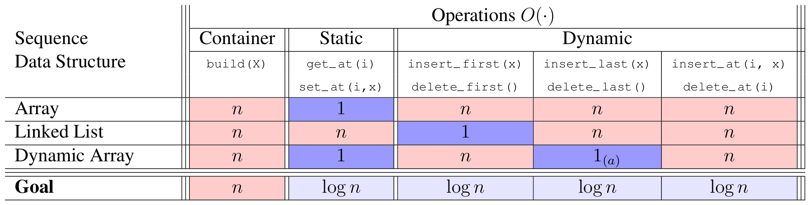
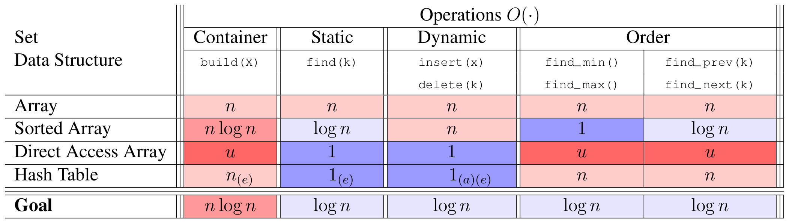
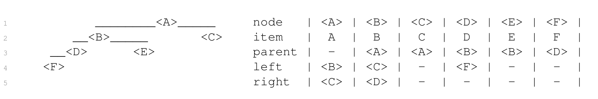
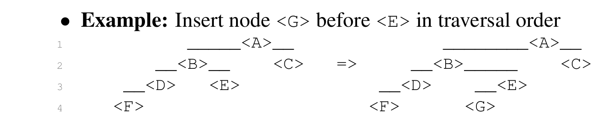
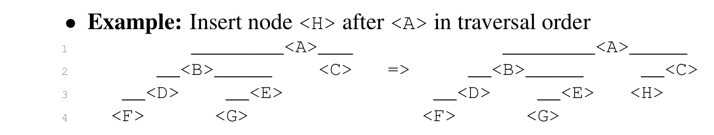
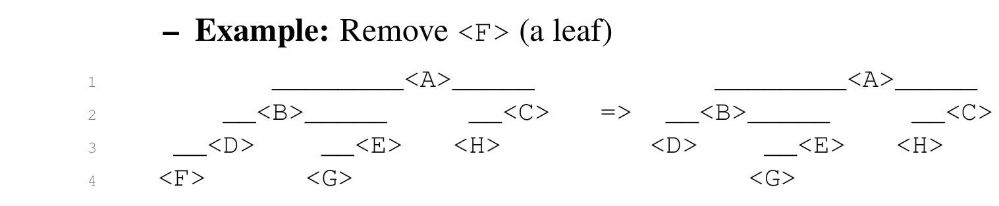
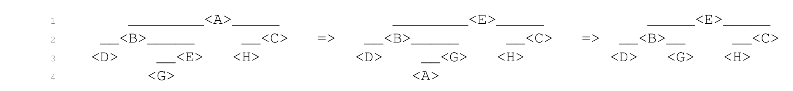
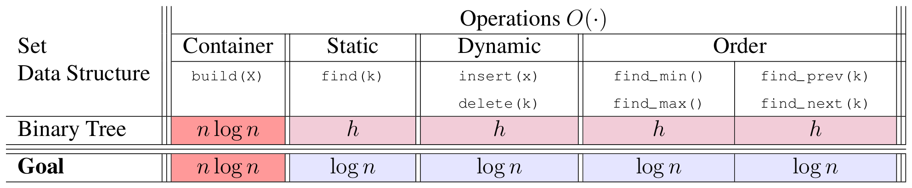
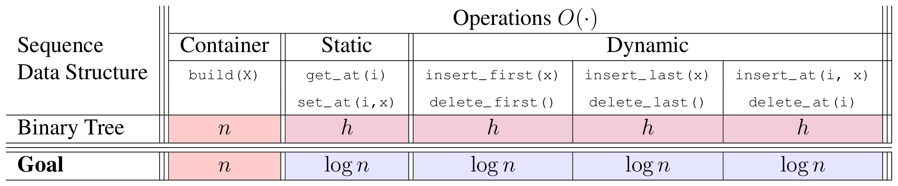

# Introduction to Algorithms: 6.006

## <span style="color:#2471a3;">**[lecture]**</span> <span style="color:#c0392b">Lecture 6: Binary Trees I（二叉树第一讲）</span>

Massachusetts Institute of Technology
Instructors: Erik Demaine, Jason Ku, and Justin Solomon

> <span style="color:#7f8c8d;">MIT 6.006 Spring 2020, Lecture 6 译注（对应视频：Binary Trees I）</span>

---

## 一、Previously and New Goal（先前回顾与新目标）

在进入二叉树之前，先回顾一下此前学过的数据结构在「序列」（Sequence）接口上的表现。下表中的 `O(·)` 均指最坏情形（worst-case）时间复杂度。

### Sequence（序列接口）各数据结构的时间复杂度

| 数据结构 | 容器构建 build(X) | 静态 get_at(i) | 静态 set_at(i,x) | 动态 insert_first / delete_first | 动态 insert_last / delete_last | 动态 insert_at(i,x) / delete_at(i) |
|---|---|---|---|---|---|---|
| **Array**（数组） | n | 1 | 1 | n | n | n |
| **Linked List**（链表） | n | n | n | 1 | n | n |
| **Dynamic Array**（动态数组） | n | 1 | 1 | 1(a)（均摊） | n | n |
| **Goal**（目标） | n | log n | log n | log n | log n | log n |

> **说明**：上表里 `1(a)` 中的 `(a)` 表示「均摊」（amortized）时间——单次操作可能退化到 O(n)，但摊到一整个操作序列上平均每次只有 O(1)。



**图 1-1**：红格与蓝格在同一行里互斥 —— Array 只有 get_at/set_at 是 O(1)，Linked List 只有 insert_first/delete_first 是 O(1)，Dynamic Array 把两组都做到 O(1)，但 **insert_at(i,x)/delete_at(i) 在三行里全是 n**，因为中间插入必须整体右移。原文的红色 = 未达标（O(n)）、蓝色 = 达标（O(1)）。*Red marks O(n), blue marks O(1): no row wins both random access and middle insertion, which is exactly what the "Goal" row demands.*

本节要解决的难题是：**数组**随机访问（get_at/set_at）很快但插入删除慢；**链表**插入删除快但随机访问慢。我们想要一种数据结构，让所有动态操作都做到 O(log n)。

---

## 二、Set（集合接口）各数据结构的时间复杂度

类似地，回顾「集合」（Set）接口上的表现：

| 数据结构 | 构建 build(X) | find(k) | insert(x) / delete(k) | find_min() / find_max() | find_prev(k) / find_next(k) |
|---|---|---|---|---|---|
| **Array**（数组） | n | n | n | n | n |
| **Sorted Array**（有序数组） | n log n | log n | n | 1 | log n |
| **Direct Access Array**（直接寻址数组） | u | 1 | 1 | u | u |
| **Hash Table**（哈希表） | n(e)（期望） | 1(e)（期望） | 1(a)(e)（均摊·期望） | n | n |
| **Goal**（目标） | n log n | log n | log n | log n | log n |

> **说明**：上表中 `u` 表示关键字所在全域（universe）的大小，`(e)` 表示「期望」（expected）时间——即在随机化假设下平均的时间，而非最坏情形。哈希表对 find/insert 很快，但它不维护顺序，因此 find_min / find_max / find_prev / find_next 这些「有序操作」退化到 O(n)。



**图 1-2**：Sorted Array 用 **build 从 n 涨到 n log n** 换来了 find(k) 从 n 降到 log n，而 insert/delete 仍是 n；Direct Access Array 是唯一让 find/insert/delete 全为 1 的结构，代价是 **find_min/find_max/find_prev/find_next 全是 u**（全域大小），因为直接寻址按 key 摆放、不保序。*Sorting pays for search with build time; direct addressing pays for ordered queries with the universe size u.*

---

## 三、如何达成目标？—— 二叉树！（How? Binary Trees!）

我们观察到一个关键事实：像**链表**这样的**pointer-based（基于指针）的数据结构**能够取得最坏情形（worst-case）的性能保证（因为指针结构天然支持 O(1) 的局部改动，无需整体搬移元素）。

**Binary Tree（二叉树）**就是每个节点带三个指针的、基于指针的数据结构：

### Node representation（节点表示）

每个节点 `node` 存有四个字段：

```math
node.\{item,\ parent,\ left,\ right\}
```

即：

- `item`：节点存储的**元素**（数据项）；
- `parent`：指向**父节点**的指针；
- `left`：指向**左孩子**的指针；
- `right`：指向**右孩子**的指针。

### Example（示例）

考虑下面这棵树（用缩进表示父子关系，`<A>` 为根）：

```
        <A>
       /   \
     <B>   <C>
    /   \
  <D>   <E>
  /
<F>
```

其节点表为：

| node | item | parent | left | right |
|------|------|--------|------|-------|
| `<A>` | A | — | `<B>` | `<C>` |
| `<B>` | B | `<A>` | `<D>` | `<E>` |
| `<C>` | C | `<A>` | — | — |
| `<D>` | D | `<B>` | `<F>` | — |
| `<E>` | E | `<B>` | — | — |
| `<F>` | F | `<D>` | — | — |

> 注：原文把 `<C>` 的 left/right 误记为 `<C>`/`<D>`，按树形结构应为两个空指针 `—`（叶子节点 `<C>` 无孩子）。表中 `—` 表示空指针 `None`。



**图 1-3**：这棵树的高度为 3（`<F>` 在深度 3），而中序遍历 (F, D, B, E, A, C) **与 item 的字母序完全不同** —— 遍历顺序只由左右指针决定，与 item 无关；右侧表里每个节点 4 个字段有 3 个是指针，因此 n = 6 个节点共 3n = 18 个指针。*Traversal order is (F, D, B, E, A, C), not alphabetical: position comes from pointers alone, so 6 nodes hold 18 pointers.*

---

## 四、Terminology（术语）

- **root（根节点）**：一棵树的根没有父节点。例如上面的 `<A>`。
- **leaf（叶子节点）**：叶子节点没有孩子。例如 `<C>`、`<E>`、`<F>`。
- **深度 depth(<X>)**：在以 `<R>` 为根的树中，节点 `<X>` 的深度定义为**从 `<X>` 到 `<R>` 的路径长度**（即 `<X>` 距离根有多少条边）。
- **高度 height(<X>)**：节点 `<X>` 的高度定义为**以 `<X>` 为根的子树中，任意节点的最大深度**（即该子树里最深的叶子到 `<X>` 的距离）。
- **Idea（一句话本质）**：把所有操作都设计成 O(h) 时间（h 为树的高度），并且**始终维持 h = O(log n)**。这样每个操作就都变成 O(log n)。

### Traversal Order（遍历顺序）

二叉树有一个**天然的顺序**，即它的**traversal order（遍历顺序）**——其实就是**in-order traversal（中序遍历）**：

- 节点 `<X>` 的**左子树**中的每一个节点，都排在 `<X>` **之前**；
- 节点 `<X>` 的**右子树**中的每一个节点，都排在 `<X>` **之后**。

用递归算法从根出发，就能按遍历顺序列出所有节点：

1. 先递归列出左子树；
2. 再列出自己；
3. 最后递归列出右子树。

**复杂度**：O(n) 时间——因为每列出一个节点只做 O(1) 的工作。

**示例**：上面那棵树的遍历顺序是：

```math
(\langle F\rangle,\ \langle D\rangle,\ \langle B\rangle,\ \langle E\rangle,\ \langle A\rangle,\ \langle C\rangle)
```

> **关键**：目前这个遍历顺序与节点里存的元素还没有任何语义关联。稍后我们会给遍历顺序赋予语义含义（比如「按 key 递增」或「按序列位置」），从而用它来实现集合（Set）和序列（Sequence）接口。

---

## 五、Tree Navigation（树的导航）

### 5.1 找子树的首个节点（first node）

**目标**：找出节点 `<X>` 的子树中，在遍历顺序里排**第一**的节点（最后一个节点是对称的）。

**算法**：

- 如果 `<X>` 有左孩子，就递归返回「左子树中的第一个节点」；
- 否则（`<X>` 没有左孩子），`<X>` 本身就是第一个节点，直接返回它。

**复杂度**：O(h)，其中 h 是树的高度。

**示例**：`<A>` 的子树里第一个节点是 `<F>`（一直沿左孩子往下走）。

### 5.2 找后继节点（successor）与前驱（predecessor）

**目标**：找出节点 `<X>` 在遍历顺序中的**successor（后继）**（即紧跟在 `<X>` 后面的那个节点）；前驱是对称的。

**算法**：

- 如果 `<X>` 有右孩子，则返回「右子树的第一个节点」（即右子树里沿左孩子一路向下的最左节点）；
- 否则（`<X>` 没有右孩子），返回 `<X>` 的**最低的那个祖先**，满足「`<X>` 位于该祖先的左子树中」。即沿着 parent 指针向上走，直到遇到一个「自己是其左孩子」的祖先；若一路走到根都没有这样的祖先，则 `<X>` 是遍历顺序里的最后一个节点，后继为 `None`。

**复杂度**：O(h)，其中 h 是树的高度。

**示例**：

- `<B>` 的后继是 `<E>`（`<B>` 有右孩子 `<E>`，而 `<E>` 无左孩子，故右子树的 first 就是 `<E>`）；
- `<E>` 的后继是 `<A>`（`<E>` 无右孩子，向上找：`<E>` 是 `<B>` 的右孩子，继续向上；`<B>` 是 `<A>` 的左孩子，故 `<A>` 是后继）；
- `<C>` 的后继是 `None`（`<C>` 无右孩子，且沿 parent 一路向上都是「自己是右孩子」，直到根 `<A>` 也没有满足条件的祖先，说明 `<C>` 是最后一个节点）。

---

## 六、Dynamic Operations（动态操作）

我们每次只通过**一个元素**来改变树的结构，而且**只增删叶子节点**：

- **添加**：在遍历顺序里，把新节点插到某个节点的后面（插到前面是对称的）；
- **删除**：从树中移除某个元素对应的节点。

### 6.1 Insert（插入）：在节点 `<X>` 之后插入节点 `<Y>`

**算法**：

- 如果 `<X>` **没有右孩子**，直接把 `<Y>` 设为 `<X>` 的右孩子；
- 否则（`<X>` 有右孩子），把 `<Y>` 设为 `<X>` 的**后继**的左孩子。（这个后继一定没有左孩子——否则它就不是「后继」了，因为它的左子树里会有比它更靠前、却又在 `<X>` 之后的节点。）

**复杂度**：O(h)，其中 h 是树的高度（找后继需要 O(h)）。

**示例 1**：在遍历顺序里，把节点 `<G>` 插到 `<E>` 之前（等价于插到 `<E>` 的前驱 `<D>` 之后；`<D>` 有右孩子 `<F>`，故找 `<D>` 的后继 `<E>`，把 `<G>` 设为 `<E>` 的左孩子）：

```
插入前：              插入后：
     <A>                  <A>
    /   \                /   \
  <B>   <C>            <B>   <C>
 /   \                /   \
<D>   <E>           <D>   <E>
 /                 /  \
<F>               <F>  <G>
```



**图 3-1**：`<D>` 已有右孩子 `<F>`，所以不能直接挂 `<G>`；算法取 `<D>` 的后继 `<E>`，把 `<G>` 挂成 `<E>` 的左孩子 —— 插入后 `<G>` 在深度 3，**树高仍是 3，没有增长**，代价只是改两个指针。*G lands at depth 3, so the height stays 3: inserting a leaf does not automatically grow the tree.*

**示例 2**：在遍历顺序里，把节点 `<H>` 插到 `<A>` 之后（`<A>` 没有右孩子，直接把 `<H>` 设为 `<A>` 的右孩子）：

```
插入前：              插入后：
     <A>                  <A>
    /   \                /   \
  <B>   <C>            <B>   <C>
 /   \                /   \
<D>   <E>           <D>   <E>   <H>
 /                 /  \
<F>               <F>  <G>
```



**图 3-2**：`<A>` 已有右孩子 `<C>`，`<H>` 只能挂到 `<A>` 的后继 `<C>` 的**左侧**（`<C>` 无左孩子）—— 位置右移了，但在遍历顺序里 `<H>` 依旧紧跟在 `<A>` 之后。*H becomes the left child of C at depth 2, yet in-order still reads A then H.*

### 6.2 Delete（删除）：从 `<X>` 的子树中删除 `<X>` 里的元素

**算法**：

- 如果 `<X>` 是**叶子**，直接把它从父节点上摘除，返回；
- 否则（`<X>` 有孩子）：
  - 如果 `<X>` **有左孩子**，把 `<X>` 的元素与 `<X>` 的**前驱**（predecessor）的元素交换，然后递归删除前驱所在的那个节点；
  - 否则（`<X>` 只有右孩子），把 `<X>` 的元素与 `<X>` 的**后继**（successor）的元素交换，然后递归删除后继所在的那个节点。

> **本质**：删除非叶子节点时，先用「与最近邻（前驱或后继）交换元素」的方式，把要删的节点「下沉」到叶子位置，再把那个叶子摘掉。这样始终只删叶子，保持结构简单。

**复杂度**：O(h)，其中 h 是树的高度（每次交换后向下递归一层，最多 h 层）。

**示例 1**：删除 `<F>`（它是叶子，直接摘除）：

```
删除前：              删除后：
     <A>                  <A>
    /   \                /   \
  <B>   <C>            <B>   <C>
 /   \                /   \
<D>   <E>   <H>     <D>   <E>   <H>
 /                 
<F>   <G>             <G>
```



**图 3-3**：删 `<F>` 只把 `<D>` 的左指针置空，**其余 6 个节点一个都没动，也没有任何元素交换**；对比图 3-4，删除非叶子必须先交换两次才能把它变成叶子。*Removing F changes one pointer and zero items — the contrast with Figure 3-4 is the price of deleting a non-leaf.*

**示例 2**：删除 `<A>`（它不是叶子，需先「交换下沉」到叶子再删）：

第一步：`<A>` 有左孩子 `<B>`，与 `<A>` 的前驱 `<E>` 交换元素，`<A>` 的元素被搬到 `<E>`，`<E>` 的元素搬到 `<A>`：

```
      <E>                     <E>
     /   \                   /   \
   <B>   <C>     =>        <B>   <C>
  /   \                   /   \
<D>   <A>   <H>         <D>   <G>   <H>
 /                     /
<F>   <G>             <F>   <A>
```

第二步：现在要删的元素落在 `<A>`（它成了 `<G>` 的左孩子，是叶子），直接摘除：

```
      <E>
     /   \
   <B>   <C>
  /   \
<D>   <G>   <H>
 /
<F>
```

> 最终遍历顺序（F, D, B, G, E, C, H）中，原来的 A 已被移除，且其余元素的相对顺序保持不变。



**图 3-4**：删 `<A>` 需要**两次**交换而不是一次：先 A↔E（A 有左孩子，换前驱），A 落到 `<B>` 的右孩子位置但仍带着左孩子 `<G>`，再 A↔G，A 才成为叶子被摘除 —— 最终 8 个节点变 7 个，而 (F, D, B, G, E, C, H) 的相对顺序完全不变。*A needs two swaps before it is a leaf; the third panel is the post-removal tree, so 8 nodes become 7 in order (F, D, B, G, E, C, H).*

---

## 七、Application: Set（应用：集合）

**Idea（一句话本质）**：**Set Binary Tree（集合二叉树）**，又称**Binary Search Tree（二叉搜索树，BST）**——让**遍历顺序恰好就是按 key 递增的排序顺序**。

这等价于如下 **BST 性质（BST Property）**：对树中**每一个节点**而言，其**左子树中所有节点的 key** 都 $\le$ 该节点的 key，且该节点的 key $\le$ **右子树中所有节点的 key**。

```math
\forall \text{node } X:\quad \max(\text{keys in left subtree of } X) \;\le\; X.key \;\le\; \min(\text{keys in right subtree of } X)
```

### 查找 find(k)

有了 BST 性质，就能像**binary search（二分查找）**一样，在 O(h) 时间内于 `<X>` 的子树中找到 key 为 k 的节点：

- 如果 k **小于** `<X>` 的 key，则递归进入**左子树**（若左子树为空则返回 `None`）；
- 如果 k **大于** `<X>` 的 key，则递归进入**右子树**（若右子树为空则返回 `None`）；
- 否则（k 等于 `<X>` 的 key），返回 `<X>` 中存储的元素。

**复杂度分析**：设 T(h) 为在高度 h 的子树中查找的时间。每次比较后进入左或右子树，高度减 1，故递推式为：

```math
T(h) = T(h - 1) + O(1)
```

展开得：

```math
T(h) = O(h)
```

> 其余集合操作（insert、delete、find_min、find_max、find_prev、find_next）都遵循类似的「沿树向下走、每层 O(1)」模式，详见 recitation（习题课）。

---

## 八、Application: Sequence（应用：序列）

**Idea（一句话本质）**：**Sequence Binary Tree（序列二叉树）**——让**遍历顺序就是序列顺序**（即序列中第 1 个元素是遍历顺序里第一个节点，第 2 个是第二个，依此类推）。

### 8.1 子树定位 subtree_at(i)

**问题**：如何在某子树的遍历顺序中找到第 i 个节点？记此操作为 `subtree_at(i)`。

**朴素做法**：直接遍历整个遍历顺序，这要 O(n) 时间，太慢。

**改进思路**：如果我们能在 O(1) 时间内算出某棵子树的**大小（size，即节点总数）**，就能在 O(h) 时间内解决：

- 设左子树的大小为 $n_L$，与 i 比较：
  - 若 $i \lt  n_L$：目标在**左子树**里，递归进入左子树；
  - 若 $i > n_L$：目标在**右子树**里，用 $i' = i - n_L - 1$ 递归进入右子树；
  - 否则 $i = n_L$：当前节点就是目标节点！

**复杂度分析**：设 T(h) 为在高度 h 的子树中做 `subtree_at(i)` 的时间。每次比较后只进入一棵子树，高度减 1，故：

```math
T(h) = T(h - 1) + O(1)
```

展开：

```math
T(h) = O(h)
```

### 8.2 子树大小的维护（augmentation，增广）

在每个节点上维护其**子树大小**，称为**augmentation（增广）**：

- 给每个节点增加一个 `node.size` 字段，表示以该节点为根的子树中的节点总数；
- **插入新叶子**时，对它的**所有祖先** a 执行 `a.size += 1`，共 O(h) 个祖先，耗时 O(h)；
- **删除叶子**时，对它的**所有祖先** a 执行 `a.size -= 1`，同样 O(h)。

> 之所以是「所有祖先」而非整棵树，是因为只有从被改动的叶子到根的路径上的那些节点的子树大小会发生变化，其余节点的子树不包含这个叶子。

### 8.3 序列操作

有了快速的 `subtree_at(i)`，序列的各种操作就能直接实现：

- `get_at(i)` / `set_at(i, x)`：先 `subtree_at(i)` 定位节点，再读取 / 改写其元素，O(h)；
- `insert_at(i, x)`：先用 `subtree_at(i)` 定位第 i 个节点，再把新节点插到它之前，O(h)；
- `delete_at(i)`：先用 `subtree_at(i)` 定位，再删除该节点，O(h)。

### 8.4 构建 build(X)

**朴素做法**：逐个插入 n 个元素，每次 O(h)，总时间为 O(nh)（最坏 $O(n^2)$）。

**更好做法**：可以在 O(n) 时间内一次性构建（通过把有序序列「自底向上」地搭建成一棵树）。详见 recitation。

---

## 九、So Far（目前进展总结）

### Set（集合接口）—— 用二叉树

| 操作 | build(X) | find(k) | insert(x) / delete(k) | find_min() / find_max() | find_prev(k) / find_next(k) |
|---|---|---|---|---|---|
| **Binary Tree** | n log n | h | h | h | h |
| **Goal** | n log n | log n | log n | log n | log n |



**图 5-1**：二叉树把 build 之后的全部操作从红色（n）刷成粉色（h）—— **但粉色不等于蓝色的 Goal 行**，因为 h 最坏可退化成 n（一条链）；只有再保证 h = O(log n)，这张表才真正达标。*Pink h is not blue log n: h = n in the worst case, so the goal is met only after balancing.*

### Sequence（序列接口）—— 用二叉树

| 操作 | build(X) | get_at(i) / set_at(i,x) | insert_first / delete_first | insert_last / delete_last | insert_at(i,x) / delete_at(i) |
|---|---|---|---|---|---|
| **Binary Tree** | n | h | h | h | h |
| **Goal** | n | log n | log n | log n | log n |



**图 5-2**：Sequence 侧的代价更直白 —— get_at/set_at 从 1 掉到 h，换来的只是 insert_at/delete_at 从 n 升到 h；**二叉树不是全面加速，而是把「1 对 n」的两难折中成同一个参数 h**。*Access gets slower (1 → h) while middle insertion gets faster (n → h): a tree trades a dichotomy for a single parameter.*

> 两表里，除了 build 之外，所有操作现在都是 O(h)；只要我们能保证 h = O(log n)，就能全面达到 O(log n) 的目标。

---

## 十、Next Time（下次预告）

- **目标**：在插入、删除之后**保持二叉树的平衡（balanced）**；
- **手段**：通过**始终维持 h = O(log n)**，把现在的 O(h) 运行时间降为 **O(log n)**。

> 这正是下一讲「二叉平衡树 / AVL 树」的引入动机：普通 BST 在最坏情形下可能退化成一条链（h = n），所有操作退化到 O(n)；通过旋转等平衡维护手段，把高度钉死在 O(log n)。

---

*讲义来源：MIT OpenCourseWare — 6.006 Introduction to Algorithms, Spring 2020, https://ocw.mit.edu*
