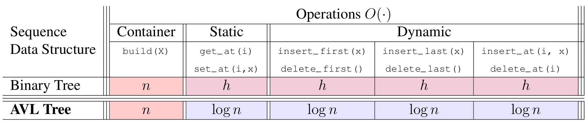
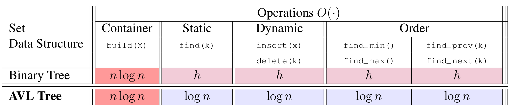
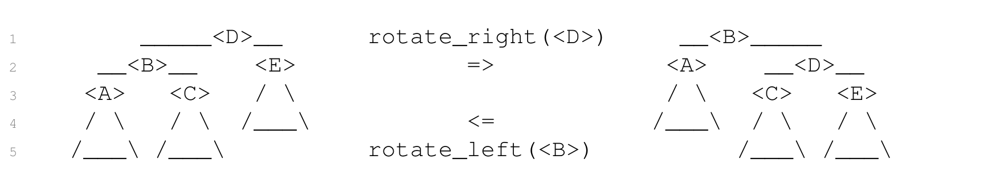

# Introduction to Algorithms: 6.006

## <span style="color:#2471a3;">**[lecture]**</span> <span style="color:#c0392b">Lecture 7: Binary Trees II: AVL（二叉树第二讲：AVL 树）</span>

Massachusetts Institute of Technology
Instructors: Erik Demaine, Jason Ku, and Justin Solomon

> <span style="color:#7f8c8d;">MIT 6.006 Spring 2020, Lecture 7 译注（对应视频：Binary Trees II: AVL）</span>

> 本讲核心：如何在**动态**插入/删除下，仍让二叉树保持高度 $h = O(\log n)$。答案是 AVL 树——一种依赖「height balance（高度平衡）」性质、用**rotation（旋转）**做局部修复的平衡二叉树。

---

## Last Time and Today's Goal（上次内容与今日目标）

### Sequence（序列）接口的复杂度对比

| Data Structure（数据结构） | build(X) | get_at(i) | set_at(i,x) | insert_first(x) / delete_first() | insert_last(x) / delete_last() | insert_at(i,x) / delete_at(i) |
|---|---|---|---|---|---|---|
| Binary Tree（普通二叉树） | $n$ | $h$ | $h$ | $h$ | $h$ | $h$ |
| AVL Tree（AVL 树） | $n$ | $\log n$ | $\log n$ | $\log n$ | $\log n$ | $\log n$ |



**图 1-1**：普通二叉树一行的五列全是 $h$（粉），AVL 一行把 get_at/set_at 与四个动态操作全部换成 $\log n$（蓝）—— 但 **build(X) 两行都是 $n$**，且它不是蓝色：按有序序列自底向上递归建平衡树是 $O(n)$ 的，不需要 $n$ 次 $O(\log n)$ 插入。所以「AVL 让一切变 $\log n$」这句话对 build 是假的。*Every dynamic column turns blue except build, which is $n$ in both rows: a balanced tree is built bottom-up, not by $n$ insertions.*

### Set（集合）接口的复杂度对比

| Data Structure（数据结构） | build(X) | find(k) | insert(x) | delete(k) | find_min() / find_max() | find_prev(k) / find_next(k) |
|---|---|---|---|---|---|---|
| Binary Tree（普通二叉树） | $n\log n$ | $h$ | $h$ | $h$ | $h$ | $h$ |
| AVL Tree（AVL 树） | $n\log n$ | $\log n$ | $\log n$ | $\log n$ | $\log n$ | $\log n$ |



**图 1-2**：Set 侧 AVL 的 build(X) 仍是深红 $n\log n$ —— 平衡能压高度 $h$，压不掉「必须先排序」这个下界；被压成蓝色的是其余五列（find/insert/delete/find_min/find_prev 的 $h \to \log n$）。注意粉色 $h$ 不等于蓝色 $\log n$：普通二叉树的 $h$ 在退化链上是 $n$，这正是本讲要维护 $h = O(\log n)$ 的理由。*Build stays $n\log n$ for AVL in the Set table, because balancing cannot remove the sorting lower bound; pink $h$ is not blue $\log n$ since $h = n$ on a chain.*

> **解读**：普通二叉树的所有动态操作都是 $O(h)$，而 $h$ 最坏可以退化到 $n$（树退化成一条链）。AVL 树把 $h$ 压到 $O(\log n)$，于是所有按位置/按键的动态操作都变成 $O(\log n)$。这就是本讲的动机——**如何维护 $h = O(\log n)$**。

---

## Height Balance（高度平衡）

- 如何维护 $h = O(\log n)$，其中 $n$ 是树的节点数？
- 一棵在动态操作下仍保持 $O(\log n)$ 高度的二叉树称为**balanced（平衡）**二叉树。
  - 平衡方案有很多种（Red-Black Trees 红黑树、Splay Trees 伸展树、2-3 Trees 2-3 树……）
  - 最早被提出的平衡方案就是 **AVL Tree（AVL 树）**（Adelson-Velsky 与 Landis，1962）。

---

## Rotations（旋转）

- 需要在**不改变遍历顺序（traversal order）**的前提下降低树的高度，这样我们表示的仍是同一条 item 序列。
- 如何改变树的结构、同时保持遍历顺序？**旋转！**



**图 1-3**：右旋 `<D>` 把它的左孩子 `<B>` 提到根位、`<D>` 下沉为 `<B>` 的右孩子，中序遍历两边都是 $(A, B, C, D, E)$ —— 改变的是**深度分布**（`<A>` 从深度 3 升到 1、树高 3 降到 2），不是 item 顺序。中间两个箭头 `rotate_right(<D>)` 与 `rotate_left(<B>)` 互为逆操作，所以旋转是可在 $O(1)$ 指针内撤销的。*A rotation changes depths (A: 3 to 1, height 3 to 2) and keeps the in-order sequence (A,B,C,D,E); the two labelled arrows are exact inverses.*

**旋转示意图（rotate_right 右旋 / rotate_left 左旋）：**

```
         <D>                                  <B>
        /   \        rotate_right(<D>)        /   \
      <B>   <E>      ===============>       <A>   <D>
      / \                                      / \  / \
    <A> <C>                                  <C> <E> (原右子树整体挂到 <D> 左)
        ...        <===============         ...
                   rotate_left(<B>)
```

> **旋转的本质（idea）**：旋转只是重连 $O(1)$ 个指针，把「父子」关系沿一条边翻转，从而在**保持中序遍历（in-order traversal）序列完全不变**的前提下，把一侧的深度「借」给另一侧。

- 一次旋转重连 $O(1)$ 个指针来修改树的结构，同时保持遍历顺序。

---

## Rotations Suffice（旋转足够强大）

- **Claim（断言）**：$O(n)$ 次旋转可以把一棵二叉树变换成任意一棵具有相同遍历顺序的二叉树。

- **证明（归纳式，不是"显然"）**：
  - 反复执行「遍历顺序上最后一次可能的右旋」；结果树会变成一条**canonical chain（规范链）**——所有左子树为空、每个节点只有右孩子。
  - 每次右旋把「最后一个节点」的深度增加 1。
  - 最终规范链里，最后一个节点的深度是 $n-1$，因此最多执行 $n-1$ 次旋转。
  - 到达目标树时，只需**逆向**执行这些规范化旋转即可。

- 可以用 $O(n)$ 次旋转把树完全平衡，但太慢了 :(
- 我们将做到：**每次操作 $O(\log n)$ 时间**内保持树的平衡。

---

## AVL 树：高度平衡（AVL Trees: Height Balance）

- AVL 树维护**高度平衡**（也叫 **AVL Property，AVL 性质**）：
  - 一个节点是**height-balanced（高度平衡的）**，当且仅当它的左、右子树高度相差最多 1。
  - 定义节点 $X$ 的**skew（偏斜）**为「右子树高度 − 左子树高度」。
  - 那么节点高度平衡 ⟺ 它的 skew 属于 $\{-1, 0, 1\}$。

> **概念定义（首次出现）**：
> - **skew（偏斜）**：$\text{skew}(X) = \text{height}(\text{right child}) - \text{height}(\text{left child})$，是衡量一个节点左右子树高度差的可判定指标——只要 skew 落在 $\{-1,0,1\}$ 内，该节点即高度平衡。
> - **height-balanced（高度平衡）**：一个节点左右子树高度差不超过 1 的性质，AVL 树要求**所有**节点都满足它。

- **Claim（断言）**：一棵所有节点都高度平衡的二叉树，其高度 $h = O(\log n)$（等价地 $n = 2^{\Omega(h)}$）。

- **证明**：只需证明「任意高度为 $h$ 的树，其最少节点数 $F(h)$ 满足 $F(h) = 2^{\Omega(h)}$」。

  设 $F(h)$ 为高度 $h$ 的 AVL 树的最少节点数。取高度平衡下最「瘦」的构造：根节点 + 一个高度 $h-1$ 的子树 + 一个高度 $h-2$ 的子树（左右子树高度差最多 1，取最极端情况）。由此得到递推式：

```math
F(0) = 1,\quad F(1) = 2,\quad F(h) = 1 + F(h-1) + F(h-2)
```

  因为 $F(h-1) \ge F(h-2)$，所以：

```math
F(h) = 1 + F(h-1) + F(h-2) \ge 2F(h-2)
```

  反复代入 $h, h-2, h-4, \dots$，得到 $F(h) \ge 2^{h/2}$，即 $F(h) = 2^{\Omega(h)}$。因此 $n \ge F(h) \ge 2^{h/2}$，两边取对数得 $h \le 2\log_2 n = O(\log n)$。∎

> **递推式解自检**：代端点验证——$F(0)=1$，$F(1)=2$，$F(2)=1+2+1=4 \ge 2F(0)=2$ ✓；$F(3)=1+4+2=7 \ge 2F(1)=4$ ✓。下界 $2^{h/2}$ 在 $h=2$ 时给 $2^1=2 \le 4$ ✓。两段衔接正确。

- 假设对一棵高度平衡的树添加或删除叶子，导致失衡（imbalance）：
  - 只有**该叶子的祖先**的子树高度或 skew 发生了变化。
  - 高度最多只变了 $\pm 1$，所以 skew 的绝对值仍 $\le 2$。
  - **Idea（一句话本质）**：从叶子出发，自底向上到根，逐个修复祖先的高度平衡。
  - 反复对**最低的那个不高度平衡的祖先**做再平衡；不失一般性（wlog）设其 skew 为 2（skew 为 −2 的情况左右镜像对称）。

---

## Local Rebalance（局部再平衡）

- **局部再平衡**：给定二叉树节点 `<B>`：
  - 其 skew 为 2，且
  - `<B>` 子树中的**其余所有节点**都高度平衡，
  - 那么 `<B>` 的子树可以通过**一次或两次旋转**恢复高度平衡
  - （之后 `<B>` 的高度与原来相同，或比原来少 1）。

- **证明**：
  - 因 `<B>` 的 skew 为 2，`<B>` 的右孩子 `<F>` 一定存在。

  - **Case 1**：`<F>` 的 skew 为 0，或 **Case 2**：`<F>` 的 skew 为 1。
    - 对 `<B>` 执行一次**left rotation（左旋）**：

```
          <B>                            <F>
         /   \                          /   \
       <A>   <F>       左旋<B>          <B>   <G>
            /   \      ========>       / \
          <D>   <G>                  <A> <D>
```


**图 3-1**：`<F>` 的 skew 为 0 或 1 时，一次左旋让 `<F>` 顶上来、`<B>` 成为它的左孩子，而 `<A>`、`<D>`、`<G>` 三棵子树原地不动。这直接解释了旋转后高度为何有两种可能：`<B>` 的新高度 = $1 + \max(\text{height}(\langle A\rangle), \text{height}(\langle D\rangle))$，Case 1 里 height(`<D>`) $= h+1$ 得 $h+3$，Case 2 里是 $h$ 得 $h+2$ —— 差别**全部**由 `<D>` 承担。*One left rotation suffices when `<F>`'s skew is 0 or 1, and the whole $h+3$ vs $h+2$ gap is carried by height(`<D>`).*

    - 设 $h = \text{height}(\langle A\rangle)$。则 $\text{height}(\langle G\rangle) = h + 1$；而 $\text{height}(\langle D\rangle)$ 在 Case 1 为 $h + 1$，在 Case 2 为 $h$。
    - 旋转之后：
      - `<B>` 的 skew 在 Case 1 为 1、在 Case 2 为 0，所以 `<B>` 高度平衡；
      - `<F>` 的 skew 为 −1，所以 `<F>` 高度平衡；
      - `<B>` 旋转前高度为 $h + 3$，旋转后在 Case 1 为 $h + 3$、在 Case 2 为 $h + 2$。

  - **Case 3**：`<F>` 的 skew 为 −1，因此 `<F>` 的左孩子 `<D>` 存在。
    - 先对 `<F>` 执行一次**right rotation（右旋）**，再对 `<B>` 执行一次**左旋**（即「双旋转 / double rotation」）：

```
           <B>                                 <D>
          /   \                               /   \
        <A>    <F>      先右旋<F>            <B>    <F>
              /   \     再左旋<B>           / \    / \
            <D>   <G>   ==========>       <A> <C><E> <G>
           /   \
         <C>   <E>
```


**图 3-2**：`<F>` 的 skew 为 $-1$ 时一次左旋不够 —— 右图里最终根是 `<D>` 而不是 `<F>`，因为必须先右旋 `<F>` 把 `<D>` 顶到 `<F>` 的位置，再左旋 `<B>` 才把 `<D>` 顶到根，`<C>`/`<E>` 分别成为 `<B>`/`<F>` 的孩子。两次旋转后三个节点的 skew 才都落回 $\{-1,0,1\}$，且 `<B>` 高度从 $h+3$ 降到 $h+2$（不是 Case 1 的保持 $h+3$）。*Case 3 needs two rotations because `<D>` must first be lifted above `<F>`; only then can the left rotation on `<B>` leave all three skews within $\pm 1$.*

    - 设 $h = \text{height}(\langle A\rangle)$。则 $\text{height}(\langle G\rangle) = h$，而 $\text{height}(\langle C\rangle)$ 与 $\text{height}(\langle E\rangle)$ 各自是 $h$ 或 $h - 1$。
    - 旋转之后：
      - `<B>` 的 skew 为 0 或 −1，所以 `<B>` 高度平衡；
      - `<F>` 的 skew 为 0 或 1，所以 `<F>` 高度平衡；
      - `<D>` 的 skew 为 0，所以 `<D>` 高度平衡；
      - `<B>` 旋转前高度为 $h + 3$，旋转后为 $h + 2$。

> **三种 case 的统一本质（idea）**：失衡节点 `<B>` 偏右（skew 2），关键看右孩子 `<F>` 偏不偏——`<F>` 不偏左（skew 0/1）就一次左旋摆平；`<F>` 偏左（skew −1）就先右旋 `<F>` 把它「掰正」再左旋 `<B>`，两次旋转摆平。所有情况旋转后 `<B>` 高度要么不变、要么降 1，这保证修复不会「向上传播破坏」。

---

## Global Rebalance（全局再平衡）

- **全局再平衡**：从高度平衡的树 $T$ 添加或删除一个叶子，得到树 $T'$。那么 $T'$ 可以用**至多 $O(\log n)$ 次旋转**变换回一棵高度平衡的树 $T''$。

- **证明（按插入/删除分情形，用归纳思路）**：
  - 只有受影响叶子的**祖先**在 $T'$ 中高度与 $T$ 不同。
  - 受影响的叶子至多有 $h = O(\log n)$ 个祖先，其子树可能发生变化。
  - 设 `<X>` 是**最低的**不高度平衡的祖先（skew 绝对值为 2）。

  - **若是在 $T$ 中插入了一个叶子**：
    - 插入使 `<X>` 的高度增加，落在局部再平衡的 Case 2 或 Case 3。
    - 旋转使子树高度下降：一次旋转后即恢复平衡。

  - **若是在 $T$ 中删除了一个叶子**：
    - 删除降低了 `<X>` 的**某个孩子**（而非 `<X>` 本身）的高度，造成失衡。
    - 可能使 `<X>` 的高度下降 1；于是 `<X>` 的父节点现在也可能失衡。
    - 所以可能要沿祖先链一路再平衡，但至多 $h = O(\log n)$ 个祖先。

- **结论**：插入/删除后，只需 $O(\log n)$ 次旋转即可维持高度平衡！

- 但这要求我们判断「可能有 $O(\log n)$ 个节点是否高度平衡」。

---

## Computing Height（计算高度）

- 如何判断节点 `<X>` 是否高度平衡？计算子树高度！
- 如何计算节点 `<X>` 的高度？naive（朴素）算法：
  - 递归计算 `<X>` 的左、右子树高度；
  - 取两者最大值再加 1；
  - 由于对每个节点都要递归，运行时间为 $\Omega(n)$ :(
- **Idea（一句话本质）**：给每个节点**augment（扩充）**一个字段，存它自己的子树高度！（稍后详述）
- 于是 `<X>` 的高度可以在 $O(1)$ 时间由其孩子高度算出：
  - $O(1)$ 查表读左右子树已存的高度；
  - 取两者最大值再加 1。

> **概念定义（首次出现）**：
> - **augment / augmentation（扩充 / 增强字段）**：在树的每个节点上额外存储一个「可由孩子节点 $O(1)$ 时间推导」的子树属性值（如子树高度、子树大小），从而把原本需要 $\Omega(n)$ 的递归查询降为 $O(1)$。

- 在动态操作中，随着树形变化，必须同步维护这些扩充字段。
- 在每个子树发生变化的节点上重新计算扩充字段：
  - 旋转中，被重连的节点在 $O(1)$ 时间更新（其祖先不变）；
  - 插入/删除后，沿树上行，在 $O(h)$ 时间更新所有祖先。

---

## Steps to Augment a Binary Tree（扩充二叉树的步骤）

- 一般地，要用一个**子树属性 $P$** 扩充二叉树，必须做到：
  - **声明**要在每个节点 `<X>` 存储的子树属性 $P(\langle X\rangle)$；
  - **证明**能从 `<X>` 孩子的扩充值在 $O(1)$ 时间计算出 $P(\langle X\rangle)$。
- 那么，存储的属性 $P(\langle X\rangle)$ 就能在不改变动态操作代价的前提下被维护。

---

## 应用：Sequence（序列）

- 对序列二叉树，我们需要知道**subtree size（子树大小）**。
- 之前只插入/删除叶子时这很简单，但现在必须处理旋转。
- 子树大小是一种**子树属性**，因此可以用扩充来维护：
  - 由孩子的大小相加再加 1 即可算出。

---

## Conclusion（结论）

- **Set（集合）AVL 树**：除 build 为 $O(n\log n)$、iter 为 $O(n)$ 外，所有集合操作均为 $O(\log n)$。
- **Sequence（序列）AVL 树**：除 build 与 iter 为 $O(n)$ 外，所有序列操作均为 $O(\log n)$。

---

## Application: Sorting（应用：排序）

- 任何 Set 数据结构都定义一个排序算法：先 build（或反复 insert），再 iter。
- 例如第 5 讲的 Direct Access Array Sort（直接访问数组排序）。
- **AVL Sort（AVL 排序）** 是一种新的 $O(n\log n)$ 时间排序算法。

> **AVL Sort 复杂度（递推式）**：把 $n$ 个元素依次插入一棵 AVL 树，每次插入 $O(\log n)$，共 $n$ 次，总时间 $T_{\text{build}} = \sum_{i=1}^{n} O(\log i) = O(n\log n)$；再中序遍历 $O(n)$ 输出即得有序序列。故整体 $O(n\log n)$。

---

## 附录：本讲关键概念速查

| 术语 | English | 中文 | 一句可判定定义 |
|---|---|---|---|
| 平衡二叉树 | balanced binary tree | 平衡二叉树 | 在动态操作下仍保持 $h = O(\log n)$ 高度的二叉树 |
| AVL 树 | AVL tree | AVL 树 | 所有节点左右子树高度差不超过 1 的二叉搜索树 |
| 高度平衡 | height-balanced | 高度平衡 | 节点左右子树高度差 $\le 1$ |
| 偏斜 | skew | 偏斜 | 右子树高 − 左子树高，落在 $\{-1,0,1\}$ 内则平衡 |
| 旋转 | rotation | 旋转 | 重连 $O(1)$ 指针、翻转一条父子边且保持中序不变 |
| 扩充 | augmentation | 扩充/增强字段 | 节点上存的、可由孩子 $O(1)$ 推导的子树属性 |

---

*MIT OpenCourseWare · https://ocw.mit.edu · 6.006 Introduction to Algorithms · Spring 2020*
