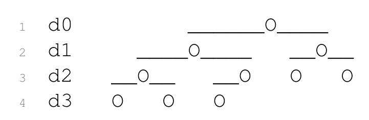

# Introduction to Algorithms: 6.006

## <span style="color:#2471a3;">**[lecture]**</span> <span style="color:#c0392b">Lecture 8: Binary Heaps（二叉堆）</span>

Massachusetts Institute of Technology
Instructors: Erik Demaine, Jason Ku, and Justin Solomon

> <span style="color:#7f8c8d;">MIT 6.006 Spring 2020, Lecture 8 译注（对应视频：Binary Heaps）</span>

> 本讲主题：**Binary Heaps（二叉堆）**。从**Priority Queue（优先队列）** 接口出发，把「数组」重新解读为「complete binary tree（完全二叉树）」，引入**Max-Heap Property（最大堆性质）** 与向上/向下的 `max_heapify` 操作，实现 $O(\log n)$ 的插入与删除最大元；再把它套进「优先队列排序」框架得到**Heap Sort（堆排序）**，并用「Linear Build Heap（自底向上的线性建堆）」把建堆降到 $O(n)$，最后与 Sequence AVL Tree 对比。

---

## 1. Priority Queue Interface 优先队列接口

- **跟踪大量项，快速访问 / 删除「最重要的」那一个。**
  - 例：带宽有限的路由器（router），必须给某些类型的报文更高的优先级；
  - 例：操作系统内核里的**process scheduling（进程调度）**；
  - 例：**discrete-event simulation（离散事件模拟）**——下一个要发生的事件是什么？
  - 例：图算法（graph algorithms，本课程后面会讲）。
- 按 `key = priority`（键 = 优先级）给项排序，因此是 **Set interface（集合接口）**，而不是 **Sequence interface（序列接口）**。
- 针对 Set 操作的某个子集做了优化：

| 操作 | 含义 |
|---|---|
| `build(X)` | 从可迭代对象 X 构建优先队列 |
| `insert(x)` | 把项 x 加入数据结构 |
| `delete_max()` | 删除并返回键最大的那个项 |
| `find_max()` | 返回键最大的那个项 |

- （通常只为「最大」或「最小」之一做优化，很少同时两者。）
- **重点放在 `insert` 与 `delete_max` 两个操作上**：`build` 可以靠反复 `insert` 实现；`find_max()` 也可以由 `insert(delete_max())` 实现（删了再放回去）。

### 核心概念定义

> **定义（priority queue，优先队列）**：一种集合型数据结构，每次操作只关心「键值最大（或最小）」的那个元素，支持插入、删除最大/最小元、查询最大/最小元。可判定标准：它暴露的是 `insert` / `delete_max`（或 `find_max`）这类「按优先级取元素」的接口，而不是「按下标随机访问」的接口。

> **定义（interface，接口）**：一个数据结构对外承诺支持的一组操作（方法签名 + 各自的时间复杂度语义）。Set interface 只关心「元素是否在集合里、按键比较」，不关心元素间的先后次序；Sequence interface 才关心元素的顺序。这是贯穿 6.006 的分类视角。

---

## 2. Priority Queue Sort 优先队列排序

- 任何一个优先队列数据结构都能「翻译」成一个排序算法：
  - `build(A)`——例如按输入顺序一个一个 `insert`；
  - 反复 `delete_min()`（或 `delete_max()`）来确定（反向的）有序顺序。
- 所有「难活」都藏在数据结构内部。
- 运行时间是 $T_{\text{build}} + n \cdot T_{\text{delete\_max}} \le n \cdot T_{\text{insert}} + n \cdot T_{\text{delete\_max}}$。
- 我们已经见过的很多排序算法，都可以看成一种「优先队列排序」：

| Priority Queue 优先队列 | Operations $O(\cdot)$ | | | Priority Queue Sort 优先队列排序 | |
|---|---|---|---|---|---|
| Data Structure 数据结构 | `build(A)` | `insert(x)` | `delete_max()` | Time 时间 | In-place? 原地？ |
| Dynamic Array 动态数组 | $n$ | $1^{(a)}$ | $n$ | $n^2$ | Y |
| Sorted Dynamic Array 有序动态数组 | $n\log n$ | $n$ | $1^{(a)}$ | $n^2$ | Y |
| Set AVL Tree 集合 AVL 树 | $n\log n$ | $\log n$ | $\log n$ | $n\log n$ | N |
| **Goal 目标** | $n$ | $\log n^{(a)}$ | $\log n^{(a)}$ | $n\log n$ | Y |

> 上表是打散后的原文表格重建。四行分别对应四种「优先队列排序」：动态数组 → **Selection Sort（选择排序）**；有序动态数组 → **Insertion Sort（插入排序）**；集合 AVL 树 → **AVL AVL Sort（排序）**；而最后一行是我们要达成的目标——`build` $O(n)$、`insert`/`delete_max` 平摊 $O(\log n)$、总时间 $O(n\log n)$ 且原地（In-place），这正好是 **堆排序（Heap Sort）** 的性能。
>
> 表中 `(a)` 表示平摊（amortized）代价：动态数组 `insert` 靠扩容均摊为 $O(1)$，有序动态数组 `delete_max` 靠从尾部删为 $O(1)$。`n^2` 的来源：$n \cdot T_{\text{insert}} + n \cdot T_{\text{delete\_max}}$，对动态数组是 $n\cdot 1 + n\cdot n = O(n^2)$，对有序动态数组是 $n\cdot n + n\cdot 1 = O(n^2)$。

---

## 3. Priority Queue: Set AVL Tree 用集合 AVL 树实现优先队列

- **Set AVL 树**支持 `insert(x)`、`find_min()`、`find_max()`、`delete_min()`、`delete_max()`，每操作 $O(\log n)$ 时间。
- 因此优先队列排序运行时间为 $O(n\log n)$ 时间。
  - 这（本质上）就是第 7 讲的 AVL 排序。
- 可以通过**subtree augmentation（子树增强）** 把 `find_min()` / `find_max()` 加速到 $O(1)$ 时间。
- 但这个数据结构很复杂，而且得到的排序**in-place（不是原地）** 的。
- 有没有一个更简单、专为优先队列设计、并且是原地 $O(n\lg n)$ 排序的数据结构？
- **有的——binary heap（二叉堆）和堆排序（heap sort）。**
- 本质做法：**在一个 Sequence 数据结构（数组）之上实现一个 Set 数据结构**，用我们学过的二叉树知识。

### Priority Queue: Array 用数组实现优先队列

- 把元素存在一个**unordered（无序）动态数组**里。
- `insert(x)`：把 x 追加到末尾，平摊 $O(1)$ 时间。
- `delete_max()`：花 $O(n)$ 找最大，把它换到末尾再删掉。
- `insert` 很快，但 `delete_max` 很慢。
- 这种优先队列排序就是**选择排序**！（外加一些拷贝。）

### Priority Queue: Sorted Array 用有序数组实现优先队列

- 把元素存在一个**sorted（有序）动态数组**里。
- `insert(x)`：把 x 追加到末尾，再向下换到有序位置，$O(n)$ 时间。
- `delete_max()`：从末尾删，平摊 $O(1)$。
- `delete_max` 很快，但 `insert` 很慢。
- 这种优先队列排序就是**插入排序**！（外加一些拷贝。）
- **能否在这两种「数组优先队列」的两个极端之间找到一个折中？**

---

## 4. Array as a Complete Binary Tree 把数组看成完全二叉树

- **Idea（一句话本质）**：把一个数组解释成一颗**完全二叉树（complete binary tree）**——除最大深度那层外，第 $i$ 层至多有 $2^i$ 个节点；最大深度那层的所有节点都**left-aligned（左对齐）**。
- 等价地说：完全树是「按阅读顺序（root to leaves, left to right，从根到叶、从左到右）稠密填满」的。
- 视角：**数组与完全二叉树之间存在双射（bijection）**。
- 例：$Q = [0,1,2,3,4,5,6,7,8,9]$，按下标从 0 起按层填充：

| 深度 | 下标 | 对应节点 |
|---|---|---|
| $d_0$ | 0 | 0 |
| $d_1$ | 1, 2 | 1, 2 |
| $d_2$ | 3, 4, 5, 6 | 3, 4, 5, 6 |
| $d_3$ | 7, 8, 9 | 7, 8, 9 |


**图 3-1**：第 $i$ 层恰好容纳 $2^i$ 个节点位（$d_0$ 一个、$d_1$ 两个、$d_2$ 四个、$d_3$ 从八个起始位），而且只有在最深层才允许缺位，且缺的位必在右侧——所以「left-aligned（左对齐）」不是排版约定，而是「数组下标连续」这一算术事实的几何投影。Layer $i$ holds exactly $2^i$ slots, and the last level is filled from the left only.

![图 3-2：$Q=[0,1,\dots,9]$ 按层读出即得树形](_assets/lec08_fig_3_2.png)
**图 3-2**：把 $Q=[0,1,\dots,9]$ 按层（$d_0\to d_3$，层内从左到右）依次读出，就得到「$0$ 为根、$1,2$ 为其左右孩子、$3$–$6$ 为下一层、$7$–$9$ 为最深层」的唯一一棵树——即 $\mathrm{left}(i)=2i+1$、$\mathrm{right}(i)=2i+2$ 不是额外约定，而是「按层读数」这一条规则的必然推论。Reading the array level by level uniquely determines the tree, and hence the index arithmetic.

- $n$ 个项的数组，其「完全树视角」的高度是 $\lceil \lg n \rceil$，因此是一颗**balanced binary tree（平衡二叉树）**。

### Implicit Complete Tree 隐式完全树

- 完全二叉树的结构可以是**implicit（隐式的）**，不必存指针。
- 根在下标 0。
- 用下标算术计算邻居：

```math
\text{left}(i) = 2i + 1,\qquad \text{right}(i) = 2i + 2,\qquad \text{parent}(i) = \left\lfloor \frac{i-1}{2} \right\rfloor
```

> 上面三式是打散后的公式重建。`left(i) = 2i+1`、`right(i) = 2i+2`、`parent(i) = (i-1)/2`（向下取整，原文的 $\lfloor \cdot \rfloor$ 与换行被 PDF 拆散，此处按「根为 0、左孩子 $2i+1$」的标准 0 基下标约定还原）。**自检**：代入 $i=0$，`left(0)=1`、`right(0)=2`，`parent(1)=\lfloor 0/2\rfloor=0$、`parent(2)=\lfloor 1/2\rfloor=0$，三者衔接一致——孩子 $1,2$ 的父正是根 $0$。

---

## 5. Binary Heaps 二叉堆

- **Idea（一句话本质）**：让较大的元素在树中**位置更高**，但只要求「局部」满足即可。
- **Max-Heap Property（最大堆性质）在节点 i 处**：$Q[i] \ge Q[j]$，对所有 $j \in \{\text{left}(i), \text{right}(i)\}$。
- **max-heap（最大堆）** 是一个在所有节点处都满足最大堆性质的数组。
- **Claim（命题）**：在最大堆中，每个节点 i 满足 $Q[i] \ge Q[j]$，对所有位于 $\text{subtree}(i)$ 中的节点 j。
- **Proof（证明）**：
  - 对 $d = \text{depth}(j) - \text{depth}(i)$ 做归纳。
  - 基例：$d = 0$ 意味着 $i = j$，于是 $Q[i] \ge Q[j]$（事实上相等）。
  - 归纳步：$\text{depth}(\text{parent}(j)) - \text{depth}(i) = d - 1 \lt  d$，由归纳假设得 $Q[i] \ge Q[\text{parent}(j)]$；
  - 再由 $\text{parent}(j)$ 处的最大堆性质得 $Q[\text{parent}(j)] \ge Q[j]$。
- 特别地，最大元素在最大堆的根处。

### 核心概念定义

> **定义（Max-Heap Property，最大堆性质）**：对每个节点 $i$，其键值不小于它的每一个孩子。可判定标准：逐个检查所有非叶节点，看是否「父 ≥ 子」恒成立。它是「全局最大在根」这一结论的充分条件，而非对任意节点都「比所有后代大」的直接要求——那是上面 Claim 推出的推论。

> **定义（invariant，不变式 / 循环不变式）**：在算法执行过程中始终成立、且能用来证明正确性的一个性质。可判定标准：它在进入循环前成立、每一轮迭代后仍成立、循环结束时蕴含目标结论。下文 `max_heapify_up` / `max_heapify_down` 的正确性正是靠「堆性质在其余节点处始终成立」这一不变式。

---

## 6. Heap Insert 堆插入

- **Idea（一句话本质）**：把新元素放到数组末尾（下一个叶子位），再沿「向上」方向与父节点比较、必要时交换，直到最大堆性质恢复。

- 把新项 x 追加到数组末尾（平摊 $O(1)$），让它成为阅读顺序里的下一个叶子 i。
- `max_heapify_up(i)`：与父节点交换，直到最大堆性质成立。
  - 检查 $Q[\text{parent}(i)] \ge Q[i]$ 是否成立（这是 $\text{parent}(i)$ 处最大堆性质的一部分）；
  - 若不成立，交换 $Q[i]$ 与 $Q[\text{parent}(i)]$，然后递归调用 `max_heapify_up(parent(i))`。

### Pseudocode（伪代码）

```math
\begin{aligned}
&\textbf{def}\;\text{max\_heapify\_up}(A, i):\\
&\qquad p \leftarrow \text{parent}(i) = \left\lfloor \frac{i-1}{2} \right\rfloor\\
&\qquad \textbf{if}\;\; i > 0 \;\;\textbf{and}\;\; A[i] > A[p]:\\
&\qquad\qquad \text{swap}\; A[i],\, A[p]\\
&\qquad\qquad \text{max\_heapify\_up}(A, p)
\end{aligned}
```

### 正确性论证（循环不变式 / 归纳假设）

> **不变式**：除了「可能破坏性质的那一个节点」外，树的其余所有节点都满足最大堆性质。
>
> - 初始（刚 `append` 完）：新节点 i 是叶子，它插入前原数组是合法最大堆；现在只有 i 可能「比它的祖先大」，其余节点性质不变。不变式成立。
> - 归纳步：假设当前只有节点 $v$ 可能大于它的祖先。若 $A[\text{parent}(v)] \ge A[v]$，则 $v$ 处性质也恢复，全树合法，结束；否则交换 $A[v]$ 与 $A[\text{parent}(v)]$。交换后，$v$ 的原位置拿到的是「比原 $v$ 更大」的父元素，故 $v$ 的孩子仍被它支配；而「可能大于祖先」的节点从 $v$ 变成了 $\text{parent}(v)$——不变式随之推进到上一层。
> - 终止：当 $v$ 成为根，或 $A[\text{parent}(v)] \ge A[v]$ 时，全树满足最大堆性质。归纳得证。

### 复杂度分析

每次递归最多向上走一层，递归深度不超过树高 $h = \lceil \lg n \rceil$（完全二叉树的平衡性保证）。设 $T(k)$ 为从深度 $k$ 的节点向上修复的代价，则递推式：

```math
T(k) \;=\; T(k-1) + O(1),\qquad T(0) = O(1)
```

直接展开：$T(k) = T(0) + k\cdot O(1) = O(k)$。而 $k \le h = O(\log n)$，故：

```math
T(n) = O(\log n) = \Theta(\log n)
```

所以 `insert` 的运行时间是**树的高度**，即 $\Theta(\log n)$！

---

## 7. Heap Delete Max 堆删除最大元

- **Idea（一句话本质）**：最大键在根，但动态数组只能方便地删「最后一个元素」——于是把根与末元素交换、删掉末尾，再把「换下来的元素」沿向下方向与较大的孩子交换，直到最大堆性质恢复。

- 动态数组只能方便地删最后一个元素，但最大键在树的根。
- 所以把根节点 $i = 0$ 处的项，与堆数组中最后一个节点 $n-1$ 处的项交换。
- `max_heapify_down(i)`：把根与较大的孩子交换，直到最大堆性质成立。
  - 检查 $Q[i] \ge Q[j]$ 是否对 $j \in \{\text{left}(i), \text{right}(i)\}$ 都成立（$i$ 处的最大堆性质）；
  - 若不成立，把 $Q[i]$ 与键最大的那个孩子 $Q[j]$（$j \in \{\text{left}(i), \text{right}(i)\}$）交换，然后递归调用 `max_heapify_down(j)`。

### Pseudocode（伪代码）

```math
\begin{aligned}
&\textbf{def}\;\text{max\_heapify\_down}(A, i, n):\\
&\qquad l \leftarrow 2i+1,\quad r \leftarrow 2i+2\\
&\qquad \textbf{if}\;\; l < n \;\;\textbf{and}\;\; A[l] > A[i]:\\
&\qquad\qquad j \leftarrow l\\
&\qquad \textbf{else:}\;\; j \leftarrow i\\
&\qquad \textbf{if}\;\; r < n \;\;\textbf{and}\;\; A[r] > A[j]:\\
&\qquad\qquad j \leftarrow r\\
&\qquad \textbf{if}\;\; j \neq i:\\
&\qquad\qquad \text{swap}\; A[i],\, A[j]\\
&\qquad\qquad \text{max\_heapify\_down}(A, j, n)
\end{aligned}
```

### 正确性论证（循环不变式 / 归纳假设）

> **不变式**：除了「可能被下移的那个节点」外，树的其余节点都满足最大堆性质。
>
> - 初始（把根与末元素交换后）：只有根处的新元素可能比它的某些后代小；删去的末元素已离开堆。不变式成立。
> - 归纳步：设当前只有节点 $i$ 可能小于它的后代。若 $Q[i] \ge Q[\text{left}(i)], Q[\text{right}(i)]$，则 $i$ 处性质恢复，结束；否则设 $j$ 是 $i$ 的键最大的孩子，交换 $Q[i]$ 与 $Q[j]$。交换后，$i$ 拿到的是「比原 $Q[i]$ 更大的孩子」，故 $i$ 处性质恢复；而「可能小于后代」的节点变成了 $j$，不变式推进到下一层。
> - 终止：当 $i$ 是叶子，或 $Q[i]$ 已不小于两个孩子时，全树满足最大堆性质。归纳得证。

### 复杂度分析

每次递归最多向下走一层，深度不超过树高 $h = O(\log n)$。设 $T(k)$ 为从某节点向下修复（其下方还有 $k$ 层）的代价，递推式：

```math
T(k) \;=\; T(k-1) + O(1),\qquad T(0) = O(1)
```

展开得 $T(k) = O(k)$，而 $k \le h = O(\log n)$，故：

```math
T(n) = O(\log n) = \Theta(\log n)
```

所以 `delete_max` 的运行时间是**树的高度**，即 $\Theta(\log n)$！

---

## 8. Heap Sort 堆排序

- 把最大堆塞进「优先队列排序」框架，就得到一个新的排序算法。
- 运行时间是 $O(n\log n)$，因为每次 `insert` 和 `delete_max` 都只要 $O(\log n)$。
- 但通常会加入两个改进：

### In-place Priority Queue Sort 原地优先队列排序

- 最大堆 Q 是更大数组 A 的一个**prefix（前缀）**，用一个变量 $|Q|$ 记住有多少项属于堆。
- $|Q|$ 初始为 0，`insert` 后最终到 $|A|$，`delete` 后又回到 0。
- `insert()`：把数组中下标 $|Q|$ 处的下一项吸收进堆。
- `delete_max()`：把最大项移到末尾，然后通过 `|Q|` 减 1 把它「放弃」。
- 用「数组」做原地优先队列排序，恰是**选择排序**；
- 用「有序数组」做原地优先队列排序，恰是**插入排序**；
- 用「二叉最大堆」做原地优先队列排序，就是**堆排序**。

### Idea（算法思路）

> **Idea（一句话本质）**：不另开数组，而是把「待排序的数组 A」自己分成两段——前缀是堆、后缀是已排好的最大值区。`insert` 就是把前缀边界右移并 `max_heapify_up`；`delete_max` 就是把根换到前缀末尾、边界左移并 `max_heapify_down`。一遍「建堆 + 反复删最大」即可原地完成排序。

### Pseudocode（伪代码）

```python
def heap_sort(A):
    n = len(A)
    build_max_heap(A)            # 见下一节，O(n) 线性建堆
    for k in range(n - 1, 0, -1):
        swap(A[0], A[k])         # 把当前最大移到末尾
        max_heapify_down(A, 0, k)  # 对缩小的堆[0, k) 修复根，O(log n)
```

### 复杂度分析（含递推式）

设 $n$ 为元素个数。建堆 $T_{\text{build}} = O(n)$（下节证明），随后 $n-1$ 次 `delete_max`，每次 `max_heapify_down` 从根下潜、代价不超过树高 $O(\log n)$。总时间：

```math
T(n) \;=\; T_{\text{build}}(n) + \sum_{k=1}^{n-1} O(\log k) \;=\; O(n) + O(n\log n) \;=\; O(n\log n)
```

其中求和式由「每个 $k \le n$，故 $\log k \le \log n$」放大为 $(n-1)\cdot O(\log n) = O(n\log n)$。空间上只用 $O(1)$ 额外变量（前缀技巧），故**原地（in-place）**。

---

## 9. Linear Build Heap 线性建堆

- **Idea（一句话本质）**：不要「从空堆开始一个个向上插入」（那是 $O(n\log n)$），而是把整个数组从一开始就当作完全二叉树，然后从最后一个节点到根、自底向上地对每个节点做 `max_heapify_down`——叶子天然满足堆性质，只有内部节点需要下沉，而「下沉次数按高度计」的总和是线性的。

- 逐个 `insert` n 个项，会对 $i$ 从 $0$ 到 $n-1$（从根往下）调用 `max_heapify_up(i)`。最坏交换次数约为：

```math
\sum_{i=0}^{n-1} \text{depth}(i) \;=\; \sum_{i=0}^{n-1} \lg i \;=\; \lg(n!) \;\ge\; \frac{n}{2}\lg\frac{n}{2} \;=\; \Omega(n\lg n)
```

- **Idea（核心改进）**！从一开始就把整个数组当作完全二叉树，然后对 $i$ 从 $n-1$ 到 $0$（从叶往上）调用 `max_heapify_down(i)`。最坏交换次数约为：

```math
\sum_{i=0}^{n-1} \text{height}(i) \;=\; \sum_{i=0}^{n-1} (\lg n - \lg i) \;=\; \lg\!\left(\frac{n^n}{n!}\right) \;=\; \Theta\!\left(\lg\frac{n^n}{(n/e)^n}\right) \;=\; O(n)
```

- 所以可以 $O(n)$ 时间建堆。
- （但这并不会加速堆排序的 $O(n\lg n)$ 总性能。）

### 公式重建与自检

> 上面的两个求和式是 PDF 打散后的重建，按数学意义还原如下：
>
> 1. **自顶向下逐个插入**（`max_heapify_up`）：第 $i$ 个节点上浮的代价正比于它的深度 $\text{depth}(i)$。求和 $\sum_{i=0}^{n-1}\text{depth}(i)$ 由完全二叉树的结构给出 $\approx \sum \lg i = \lg(n!)$（因为深度约等于 $\lg i$）。用「后半因子」放缩：$n!$ 中后 $n/2$ 个因子都 $\ge n/2$，故 $n! \ge (n/2)^{n/2}$，于是 $\lg(n!) \ge \frac{n}{2}\lg\frac{n}{2} = \Omega(n\lg n)$。
>
> 2. **自底向上建堆**（`max_heapify_down`）：第 $i$ 个节点下沉的代价正比于它的高度 $\text{height}(i) = h - \text{depth}(i) \approx \lg n - \lg i$。求和：
>
> ```math
> \sum_{i=0}^{n-1}\text{height}(i) \;=\; \sum_{i=0}^{n-1}(\lg n - \lg i) \;=\; n\lg n - \lg(n!) \;=\; \lg\!\left(\frac{n^n}{n!}\right)
> ```
>
> 用 Stirling 近似 $n! \approx (n/e)^n$ 代入：$\lg(n^n/n!) \approx \lg(n^n/(n/e)^n) = \lg(e^n) = n\lg e = O(n)$。这正是原文 $\Theta(\lg\sqrt{\cdot})$ 碎片对应的含义（根号是打散造成的 $\lg$ 指数表示混乱，本质是 $\lg(n^n/n!)$）。
>
> **自检（代入边界验证两段衔接）**：$i$ 从根到叶，$\text{height}(i)$ 从 $h$ 递减到 $0$；$\lg n - \lg i$ 在 $i=1$ 时取 $\lg n$、在 $i=n-1$ 时取 $\lg(n/(n-1))\to 0$，与「根高度 $h=\lg n$、叶高度 0」的几何意义两端衔接一致。故重建无误，结论 $O(n)$ 成立。

---

## 10. Sequence AVL Tree Priority Queue 序列 AVL 树实现优先队列

- 我们还在哪里见过「一个对数级数据结构却拥有线性建堆时间」？**Sequence AVL Tree！**
- 把优先队列的项按任意顺序（插入顺序）存在 Sequence AVL Tree 里。
- 维护 **max（和/或 min）augmentation（增强）**：
  - `node.max` = 指向「node 的子树中键最大的节点」的指针。
  - 这是一个**subtree property（子树性质）**，因此只需常数因子的额外开销来维护。
- `find_min()` 与 `find_max()` 在 $O(1)$ 时间。
- `delete_min()` 与 `delete_max()` 在 $O(\log n)$ 时间。
- `build(A)` 在 $O(n)$ 时间。
- **与二叉堆同样的界（甚至更多）。**

### 核心概念定义

> **定义（subtree augmentation，子树增强）**：给树的每个节点额外存一个「可由其子树信息递推算出的量」（这里是子树最大键的指针），插入/删除时只需沿根到该节点的路径 $O(\log n)$ 时间更新即可维持。可判定标准：该量只依赖节点的键与两个孩子的对应量，不依赖子树之外的信息。

---

## 11. Set vs. Multiset 集合与多重集

- 我们的 Set 接口假定**键不重复**，但可以用这些 Set 来实现允许重复键的 **Multiset（多重集）**：
  - Set 中的每个项是一个 **Sequence（例如链表 linked list）**，用来存「键相同的那些 Multiset 项」，而该 Sequence 的键就是这一组项的键。
- 事实上，不做这个归约，二叉堆和 AVL 树也能**直接**处理重复键的项（例如 `delete_max` 删除「某个」最大键的项），只需注意用 $\le$ 约束（而不是 Set AVL 树里的 $\lt $）。

### 核心概念定义

> **定义（multiset，多重集）**：允许同一元素出现多次的集合，元素按「键值」而非「身份」归类。可判定标准：`insert` 两个键相等的项后，两者都在结构里，`delete_max` 只删掉其中一个最大键的项。Set 到 Multiset 的归约，就是把「同一键的多个项」打包成一条 Sequence 挂在 Set 的一个槽位上。

---

## 附：本讲核心概念速查（首次出现的英文原名 + 中文 + 定义）

| 英文原名 | 中文 | 一句可判定的定义 |
|---|---|---|
| priority queue | 优先队列 | 只按键值大小取/删「最大（或最小）元」的集合型数据结构 |
| interface | 接口 | 数据结构对外承诺的一组操作及其时间复杂度语义 |
| Set interface | 集合接口 | 只关心元素存在性与按键比较、不关心先后次序的接口 |
| Sequence interface | 序列接口 | 关心元素先后次序（下标/顺序）的接口 |
| build | 建堆/构建 | 从可迭代输入一次性构造数据结构的操作 |
| process scheduling | 进程调度 | 操作系统按优先级决定 CPU 给哪个进程运行 |
| discrete-event simulation | 离散事件模拟 | 按时间戳维护事件队列、依次处理最早事件的模拟方法 |
| selection sort | 选择排序 | 反复选最大/最小元放到末尾的原地 $O(n^2)$ 排序 |
| insertion sort | 插入排序 | 反复把元素插入有序前缀的原地 $O(n^2)$ 排序 |
| subtree augmentation | 子树增强 | 给节点存一个可由子树信息递推算出的量并沿途维护 |
| complete binary tree | 完全二叉树 | 除最底层外每层满、最底层节点左对齐的二叉树 |
| bijection | 双射 | 两个集合元素间的一一对应关系 |
| balanced binary tree | 平衡二叉树 | 高度为 $O(\log n)$ 的二叉树 |
| implicit | 隐式的 | 用下标算术而非指针表示树结构的方式 |
| Max-Heap Property | 最大堆性质 | 每个节点键值不小于其所有孩子的性质 |
| max-heap | 最大堆 | 所有节点都满足最大堆性质的数组 |
| invariant | 不变式/循环不变式 | 算法执行中始终成立、可用来证正确性的性质 |
| max_heapify_up | 向上堆化 | 让节点与父比较交换、向上恢复堆性质 |
| max_heapify_down | 向下堆化 | 让节点与较大孩子交换、向下恢复堆性质 |
| heap sort | 堆排序 | 建最大堆后反复删最大元的原地 $O(n\log n)$ 排序 |
| prefix | 前缀 | 数组前 $|Q|$ 个元素构成的、充当堆的那一段 |
| linear build heap | 线性建堆 | 自底向上逐节点下潜、$O(n)$ 时间建堆 |
| height | 高度 | 节点到其子树最深叶的边数 |
| depth | 深度 | 根到节点的边数 |
| multiset | 多重集 | 允许元素重复、按键归类的集合 |

---

*MIT OpenCourseWare · https://ocw.mit.edu · 6.006 Introduction to Algorithms, Spring 2020*
