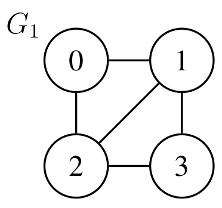
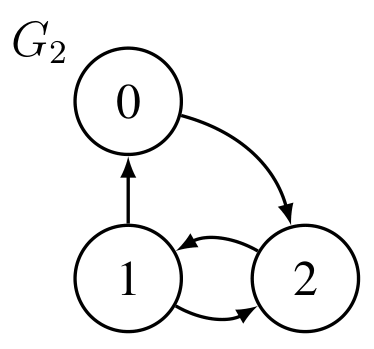
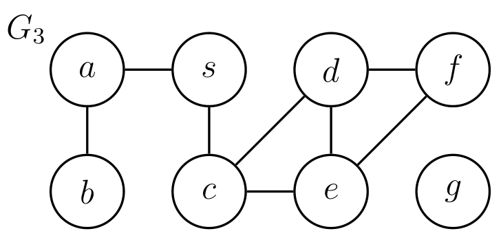

# Introduction to Algorithms: 6.006

## <span style="color:#2471a3;">**[lecture]**</span> <span style="color:#c0392b">Lecture 9: Breadth-First Search（广度优先搜索）</span>

Massachusetts Institute of Technology
Instructors: Erik Demaine, Jason Ku, and Justin Solomon

> <span style="color:#7f8c8d;">MIT 6.006 Spring 2020, Lecture 9 译注（对应视频：Breadth-First Search）</span>

---

## 新单元：Graphs（图）！

- 下周的 Quiz 1（测验 1）覆盖 L01–L08 讲，内容为 Data Structures（数据结构）与 Sorting（排序）。
- 今天开启新单元：L09–L14，主题为 Graph Algorithms（图算法）。

### Graph Applications（图的应用）

- **Why?（为什么研究图？）** Graphs are everywhere（图无处不在）！
- 任何 network system（网络系统）都与图有直接对应关系：
  - 例如 road networks（道路网络）、computer networks（计算机网络）、social networks（社交网络）。
- 任何 discrete system（离散系统）的 state space（状态空间）都可以用一个 transition graph（转移图）来表示：
  - 例如 puzzle & games（谜题与游戏）：Chess（国际象棋）、Tetris（俄罗斯方块）、Rubik's cube（魔方）。
  - 例如 application workflows（应用工作流）、specifications（规格说明）。

---

## Graph Definitions（图的定义）

```
G1: 0 — 1 — 2 — 3
G2: 0 → 1 → 2
G3: a-b, s-a, s-c, c-d, c-e, d-e, d-f, e-f, g(孤立)
```


**图 1-1**：$G_1$ 是无向图，4 个顶点、5 条边，并含三角形 $\{0,1,2\}$，因此 $G_1$ 不是二分图（bipartite）——「图」与「树」的最短反例就体现在这里：树恒为二分图，而这个 4 顶点图不是。$G_1$ has 5 edges and a triangle, so it is bipartite-free.


**图 1-2**：$G_2$ 是有向图，且 $1\rightleftarrows 2$ 构成长度为 2 的环，所以 $G_2$ 不是 DAG；同一组顶点若把边当无向处理则是连通的——「有向」这一位信息本身就会改变可达性的含义，这也是为什么 BFS 只对有向边的方向敏感。$G_2$ contains a 2-cycle, hence it admits no topological order.


**图 1-3**：$G_3$ 的顶点 $g$ 不连任何边，于是 $\mathrm{Adj}(g)=\varnothing$、$\delta(s,g)=\infty$，而 $|V|$ 仍然把 $g$ 计入——这正是 BFS 中「到不了就把 $\delta$ 置为 $\infty$」这条规则存在的理由：距离未定义与顶点不存在是两件事。$g$ is isolated: $\mathrm{Adj}(g)=\varnothing$ yet $g\in V$.

- Graph（图）$G=(V,E)$ 是一个 vertex（顶点）集合 $V$ 和一个顶点对集合 $E\subseteq V\times V$。
  - $V$ 是顶点集，$E$ 是边集，每条边是 $V$ 中两个顶点构成的对。
- Directed edges（有向边）是有序对，例如 $(u,v)$，其中 $u,v\in V$。
- Undirected edges（无向边）是无序对，例如 $\{u,v\}$，其中 $u,v\in V$；也即 $(u,v)$ 与 $(v,u)$ 等价。
- 本课程假设所有图都是 simple（简单图）：
  - Edges are distinct（边不重复）：例如 $(u,v)$ 在 $E$ 中只出现一次（但 $(v,u)$ 仍可能出现）；
  - Edges are pairs of distinct vertices（边连接不同顶点）：对所有 $(u,v)\in E$，$u\neq v$。
- Simple（简单性）蕴含 $|E|=O(|V|^2)$，因为对 undirected（无向图）有 $|E|\le\binom{|V|}{2}$，对 directed（有向图）有 $|E|\le 2\binom{|V|}{2}=|V|(|V|-1)$。

> **公式重建说明**：原文该处被打散为「$|V|$ 在分子、$2$ 在分母」「无向 $\le$ 与有向 $\le 2$ 分行」。按组合意义重建：无向图最多边的上界是从 $|V|$ 个顶点中任选 2 个顶点的组合数 $\binom{|V|}{2}=\dfrac{|V|(|V|-1)}{2}$；有向图每条无序对可对应两条相反方向的有向边，故上界翻倍为 $|V|(|V|-1)$。二者均为 $O(|V|^2)$，与原文结论自洽。

---

## Neighbor Sets / Adjacencies（邻居集合 / 邻接关系）

- 顶点 $u\in V$ 的 outgoing neighbor set（出边邻居集合）为
  ```math
  \mathrm{Adj}^{+}(u)=\{\,v\in V \mid (u,v)\in E\,\}
  ```
- 顶点 $u\in V$ 的 incoming neighbor set（入边邻居集合）为
  ```math
  \mathrm{Adj}^{-}(u)=\{\,v\in V \mid (v,u)\in E\,\}
  ```
- 顶点 $u$ 的 out-degree（出度）为 $\deg^{+}(u)=|\mathrm{Adj}^{+}(u)|$。
- 顶点 $u$ 的 in-degree（入度）为 $\deg^{-}(u)=|\mathrm{Adj}^{-}(u)|$。
- 对 undirected graphs（无向图），$\mathrm{Adj}^{-}(u)=\mathrm{Adj}^{+}(u)$ 且 $\deg^{-}(u)=\deg^{+}(u)$。
- 省略上标时默认取 outgoing（出边方向）：即 $\mathrm{Adj}(u)=\mathrm{Adj}^{+}(u)$、$\deg(u)=\deg^{+}(u)$。

---

## Graph Representations（图的存储表示）

- 要存储图 $G=(V,E)$，需要为所有 $u\in V$ 存储其出边 $\mathrm{Adj}(u)$。
- 首先需要一个 Set（集合）数据结构 $\mathrm{Adj}$，把 $u$ 映射到 $\mathrm{Adj}(u)$；
- 然后对每个 $u$，把 $\mathrm{Adj}(u)$ 存到另一个名为 adjacency list（邻接表）的数据结构里。
- 通常用 direct access array（直接寻址数组）或 hash table（哈希表）实现 $\mathrm{Adj}$，因为需要按顶点快速查找；
- 通常用 array（数组）或 linked list（链表）实现每个 $\mathrm{Adj}(u)$，因为一般只需迭代遍历。[^1]
- 对常见表示，$\mathrm{Adj}$ 的大小为 $\Theta(|V|)$，每个 $\mathrm{Adj}(u)$ 的大小为 $\Theta(\deg(u))$。
- 由 handshaking lemma（握手引理）$\sum_{u\in V}\deg(u)\le 2|E|$，图可用 $\Theta(|V|+|E|)$ 的空间存储。
- 因此，对于图上的算法，linear time（线性时间）意味着 $\Theta(|V|+|E|)$（与图的规模成线性）。

[^1]: 为每个 $\mathrm{Adj}(u)$ 用哈希表，可使检查某条边 $(u,v)\in E$ 在 $O(1)$ 期望时间内完成。

### Examples（示例）

- 示例 1、2 假设顶点被标记为 $\{0,1,\dots,|V|-1\}$，故可用 direct access array 实现 $\mathrm{Adj}$，并用 array 存 $\mathrm{Adj}(u)$。示例 3 用 hash table 实现 $\mathrm{Adj}$。

**Ex 1（无向图）**
```math
G_1 = \begin{aligned}
&[2,1],        &&\#\,0\\
&[2,0,3],      &&\#\,1\\
&[1,3,0],      &&\#\,2\\
&[1,2]         &&\#\,3
\end{aligned}
```

**Ex 2（有向图）**
```math
G_2 = \begin{aligned}
&[2],          &&\#\,0\\
&[2,0],        &&\#\,1\\
&[1],          &&\#\,2
\end{aligned}
```

**Ex 3（无向图，用哈希表）**
```math
G_3 = \{\, a:[s,b],\ b:[a],\ s:[a,c],\ c:[s,d,e],\ d:[c,e,f],\ e:[c,d,f],\ f:[d,e],\ g:[\,] \,\}
```

- 注意：在 undirected graph 中，连接是对称的——每条无向边都会作为两条出边各出现一次（即在两个端点的邻接表中各出现一次）。

---

## Paths（路径）

- 一条 path（路径）是一个顶点序列 $p=(v_1,v_2,\dots,v_k)$，其中对所有 $1\le i\lt k$ 都有 $(v_i,v_{i+1})\in E$。
- 一条路径是 simple（简单路径），当且仅当它不重复经过顶点。[^2]
- 路径 $p$ 的 length（长度）$\ell(p)$ 是该路径中边的条数。
- 从 $u\in V$ 到 $v\in V$ 的 distance（距离）$\delta(u,v)$ 是从 $u$ 到 $v$ 任意路径的最小长度，即一条 shortest path（最短路）的长度。
  - 按约定，若 $u$ 与 $v$ 不连通，则 $\delta(u,v)=\infty$。

[^2]: 6.006 中的 “path” 对应 6.042 中的 “walk”；6.042 中的 “path” 对应 6.006 中的 simple path。

### Graph Path Problems（图的路径问题）

关于图中路径，你可能想解决如下问题：

- **SINGLE PAIR REACHABILITY（单对可达性）** $\text{REACH}(G,s,t)$：图 $G$ 中从 $s\in V$ 到 $t\in V$ 是否存在路径？
- **SINGLE PAIR SHORTEST PATH（单对最短路）** $\text{SP}(G,s,t)$：返回距离 $\delta(s,t)$，以及 $G=(V,E)$ 中从 $s$ 到 $t$ 的一条最短路。
- **SINGLE SOURCE SHORTEST PATHS（单源最短路）** $\text{SSSP}(G,s)$：对每个 $v\in V$ 返回 $\delta(s,v)$，以及一棵 shortest-path tree（最短路树），其中包含从 $s$ 到每个 $v\in V$ 的最短路（定义见下）。

- 上述每个问题至少与其上方的问题一样难（即可以用一个解决较低层问题的黑箱来解决任意较高层的问题）。
- 我们不会逐一给出解决所有这些问题的算法；
- 相反，只给出一个算法，在 $O(|V|+|E|)$ 时间内解决最难的（SSSP）。

### Shortest Paths Tree（最短路树）

- 如何为图中每个顶点返回一条从源点 $s$ 出发的最短路？
- 多条路径的长度可能达 $\Omega(|V|)$，返回所有路径可能需 $\Omega(|V|^2)$ 时间。
- 改为：对每个 $v\in V$，只存储其 parent（父节点）$P(v)$：即从 $s$ 到 $v$ 最短路上倒数第二个顶点。
- 令 $P(s)=\text{null}$（从 $s$ 到 $s$ 的最短路上没有「倒数第二个顶点」）。
- 这些 parent 组成一棵大小为 $O(|V|)$ 的 shortest paths tree（最短路树）！
  - 即从 $s$ 可达的每个顶点「反向回溯到 $s$」的最短路集合构成一棵树。

---

## Breadth-First Search（广度优先搜索，BFS）

- 如何计算所有 $v\in V$ 的 $\delta(s,v)$ 与 $P(v)$？
- 用 Set 数据结构存储 $\delta(s,v)$ 与 $P(v)$，把顶点 $v$ 映射到其距离和父节点。
- 若从 $s$ 到 $v$ 无路径，则不存储 $v$ 的 $P$，并把 $\delta(s,v)$ 置为 $\infty$。

### Idea（一句话本质）

按与源点距离的**递增顺序**逐层向外探索：先处理完所有距离为 $i$ 的顶点，再处理距离为 $i+1$ 的顶点，直到没有新的可达顶点为止。

- **Goal（目标）**：计算 level sets（层集合）
  ```math
  L_i = \{\, v \mid v\in V \text{ 且 } d(s,v)=i \,\}
  ```
  （即所有距离为 $i$ 的顶点）。
- **Claim（命题）**：每个顶点 $v\in L_i$ 必与某个 $u\in L_{i-1}$ 相邻（即 $v\in \mathrm{Adj}(u)$）。
- **Claim（命题）**：任何在某个 $L_j$（$j\lt i$）中的顶点不会再次出现在 $L_i$ 中。

### Invariant（循环不变式）

对任意 $j\lt i$，所有 $v\in L_j$ 的 $\delta(s,v)$ 与 $P(v)$ 均已正确计算。

- **Base case（基例，$i=1$）**：$L_0=\{s\}$，$\delta(s,s)=0$，$P(s)=\text{None}$。
- **Inductive step（归纳步）**：为计算 $L_i$：
  - 对每个顶点 $u\in L_{i-1}$：
    - 对每个不在任何 $L_j$（$j\lt i$）中出现的顶点 $v\in \mathrm{Adj}(u)$：
      - 把 $v$ 加入 $L_i$，置 $\delta(s,v)=i$，并置 $P(v)=u$。
- 对递增的 $i$，从 $L_j$（$j\lt i$）反复计算 $L_i$，直到 $L_i$ 为空集。
- 对任意未设置 $\delta(s,v)$ 的顶点 $v\in V$，置 $\delta(s,v)=\infty$。

**正确性论证（归纳）**：归纳假设是「对 $j\lt i$，所有 $v\in L_j$ 的 $\delta(s,v)$ 与 $P(v)$ 均正确」。基例 $L_0=\{s\}$ 显然成立。归纳步中，设 $v$ 被加入 $L_i$，它来自 $u\in L_{i-1}$ 的邻点；由于 $\delta(s,u)=i-1$ 正确，且边 $(u,v)$ 存在，故 $\delta(s,v)\le i$。又因 $v$ 尚未出现在任何 $L_j$（$j\lt i$），$\delta(s,v)\ge i$（若 $\delta(s,v)\lt i$，则 $v$ 早该在更早层被加入）。于是 $\delta(s,v)=i$，且 $P(v)=u$ 给出了一条经 $u$ 的最短路。归纳完成，BFS 正确计算所有 $\delta(s,v)$ 与 $P(v)$。

### Running Time Analysis（运行时间分析）

- 把每个 $L_i$ 存入支持 $\Theta(|L_i|)$ 时间迭代、$O(1)$ 时间插入的数据结构（即 dynamic array（动态数组）或 linked list）。
- 检查某顶点 $v$ 是否在任何 $L_j$（$j\lt i$）中，等价于检查 $v$ 是否在 $P$ 中。
- 用支持 $O(1)$ dictionary ops（字典操作）的 Set 数据结构维护 $\delta$ 与 $P$（即 direct access array 或 hash table）。
- 算法把每个顶点 $u$ 加入至多 1 层，并对每个 $v\in\mathrm{Adj}(u)$ 花 $O(1)$ 时间。
- 总工作量上界：
  ```math
  O(1)\times\sum_{u\in V}\deg(u) = O(|E|)
  ```
  （由 handshake lemma 得）。
- 最后花 $\Theta(|V|)$ 时间为所有从 $s$ 不可达的顶点 $v\in V$ 赋值 $\delta(s,v)=\infty$。
- **结论**：BFS 在 linear time（线性时间）内运行，即 $O(|V|+|E|)$。

---

*本讲义取自 MIT OpenCourseWare：https://ocw.mit.edu —— 6.006 Introduction to Algorithms, Spring 2020。*
