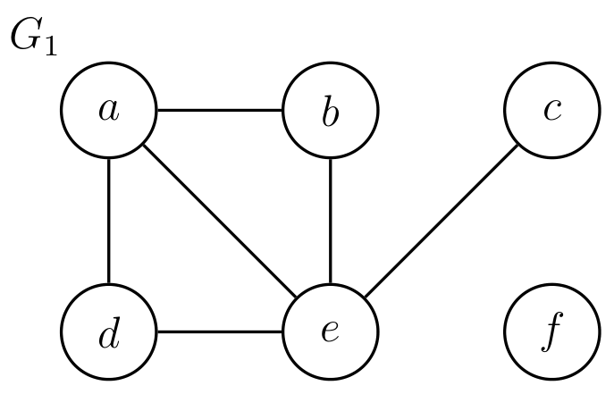
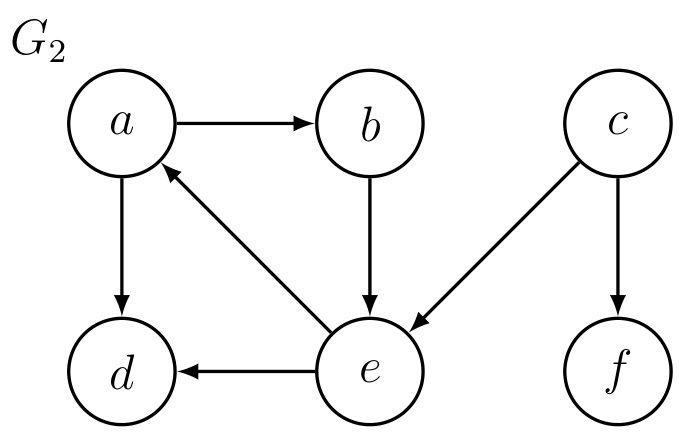
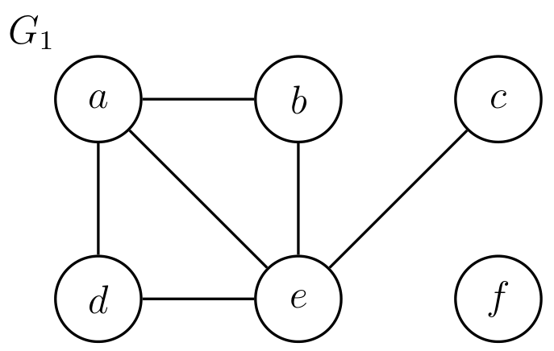
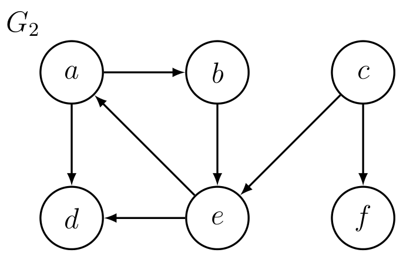

# Introduction to Algorithms: 6.006

## <span style="color:#2471a3;">**[lecture]**</span> <span style="color:#c0392b">Lecture 10: Depth-First Search（深度优先搜索）</span>

Massachusetts Institute of Technology
Instructors: Erik Demaine, Jason Ku, and Justin Solomon

> <span style="color:#7f8c8d;">MIT 6.006 Spring 2020, Lecture 10 译注（对应视频：Depth-First Search）</span>

---

## 一、Previously（先前回顾）

进入本讲之前，先回顾此前建立起来的一组图论概念与问题：

- **graph definitions（图的定义）**：有向图 / 无向图（directed / undirected）、simple（简单图）、neighbors（邻点）、度（degree）；
- **graph representations（图的表示）**：用**Set（集合）**把顶点映射到其**adjacency list（邻接表）**；
- **path（路径）**与**simple path（简单路径）**、**path length（路径长度）**、**distance（距离）**、**shortest path（最短路径）**；
- **graph path problems（图上的路径问题）**，共四类：
  - **Single Pair Reachability（单对可达性）** $\text{Reachability}(G, s, t)$：问 $t$ 是否从 $s$ 可达；
  - **Single Source Reachability（单源可达性）** $\text{Reachability}(G, s)$：找出从 $s$ 可达的所有顶点；
  - **Single Pair Shortest Path（单对最短路径）** $\text{ShortestPath}(G, s, t)$：求 $s$ 到 $t$ 的最短路径；
  - **Single Source Shortest Paths（单源最短路径，SSSP）** $\text{SSSP}(G, s)$：求 $s$ 到所有顶点的最短路径；
- **Breadth-First Search（广度优先搜索，BFS）**：
  - 一个解决**SSSP（单源最短路径）**的算法；
  - 配合适当的数据结构，运行时间为 $O(|V| + |E|)$（对输入规模线性）。

> **图论术语回顾（首次出现给定义）**
> - **图（graph）**：$G = (V, E)$，其中 $V$ 是顶点（vertex）集合，$E$ 是边（edge）集合；每条边连接两个顶点。
> - **adjacency list（邻接表）**：为每个顶点维护一个链表，存它所有「出邻点」。若用哈希表把顶点映射到邻接表，则遍历某顶点全部出邻点的时间与它的出度成正比。
> - **reachable（可达）**：若图中存在一条从 $u$ 到 $v$ 的路径，则称 $v$ 从 $u$ 可达。
> - **度（degree）**：无向图中与某顶点相连的边数；有向图中分**in-degree（入度）**与**out-degree（出度）**。

### Examples（示例图）

本讲所有算法都在下面两张示例图 $G_1$、$G_2$ 上演示（顶点的相邻关系用行内箭头/连线给出）：

- $G_1$：边集为 $\{ (a,d),\ (a,b),\ (b,e),\ (c,f) \}$ 及各自可能的有向/无向连边（顶点 $a,b,c,d,e,f$）；
- $G_2$：顶点同为 $a,b,c,d,e,f$，但连边不同。

> 注：原讲义中 $G_1$、$G_2$ 以图形式呈现，PDF 文字层仅保留了顶点名而无坐标。下文的算法演示不依赖具体边的方向，故以文字与伪代码为主展开。


**图 1-1**：$G_1$ 有 6 个顶点、6 条边（$a$–$b$、$a$–$d$、$a$–$e$、$b$–$e$、$c$–$e$、$d$–$e$），顶点 $f$ 一条边都不连——所以即便按无向图看，Full-BFS / Full-DFS 也必须在 $\{a,b,c,d,e\}$ 之后对 $f$ 单独再启动一次，连通分量数为 2。这 6 条边与「$f$ 孤立」的事实无法从 PDF 文字层（只有顶点名）恢复。$G_1$ has 6 edges and $f$ isolated, giving 2 components.


**图 1-2**：$G_2$ 是有向图：$a\to d$ 与 $e\to a$ 同时存在而 $d$ 没有出边，于是从 $e$ 能到 $d$（$e\to a\to d$）、从 $d$ 却到不了 $e$——可达性不对称，这正是 DFS 只能给出「以起点为根」的 parent tree、不能反过来解释的原因。Reachability in $G_2$ is not symmetric.

> **补图修正**：上面那条「PDF 文字层仅保留顶点名而无坐标」的说明已过时——边与方向存在于 PDF 的 vector drawings 层，两图即由该层每个图簇的 bbox 裁出，方向可直接从图中箭头读出。


---

## 二、Depth-First Search（深度优先搜索，DFS）

### 2.1 What is DFS（是什么）

**DFS（深度优先搜索）**与 BFS 类似，都是从一个源点 $s$ 出发搜图，但有两点关键区别：

- 它解决的是**单源可达性（Single Source Reachability）**，而**不是** SSSP（最短路径）；但它对解决其他问题很有用（见后文拓扑排序、找环）；
- 它返回一棵**parent tree（父指针树）**，即每个可达顶点指向其父节点、最终回溯到 $s$ 的指针集合——但**不保证是最短路径树**（每条 $s \to v$ 路径不一定是 $s$ 到 $v$ 的最短路径）。

### 2.2 Idea（一句话本质）

**一句话本质**：从一个顶点出发，**沿某条路径一直往前走，直到走不动（卡住）为止；然后回溯（backtrack），直到发现一条尚未探索过的路径，再沿它继续走下去**。

更形式化地说：**递归地访问每个「出邻点」，但绝不重复访问任何一个顶点**。

具体地：

1. 先置 $P(s) = \text{None}$（$s$ 是根，无父节点），然后调用 $\text{visit}(s)$；
2. 递归函数 $\text{visit}(u)$ 做如下事情：
   - 对**每一个** $v \in \text{Adj}(u)$（$u$ 的所有出邻点），若 $v$ **尚未出现在 $P$ 中**（即还没被访问过）：
     - 置 $P(v) = u$（记录 $v$ 的父节点是 $u$）；
     - **递归调用** $\text{visit}(v)$；
   - （当上述 for 循环走完，$\text{visit}(u)$ 返回，表示 DFS **完成了对 $u$ 的访问**——这个「完成时刻」后文拓扑排序还要用到。）

### 2.3 Pseudocode（伪代码）

```math
\text{def DFS}(G, s): \\
\quad P(s) = \text{None} \\
\quad \text{visit}(s)
```

```math
\text{def visit}(u): \\
\quad \text{for each } v \in \text{Adj}(u): \\
\quad \quad \text{if } v \notin P: \\
\quad \quad \quad P(v) = u \\
\quad \quad \quad \text{visit}(v)
```

> **数据结构说明**：这里 $P$ 是一个「父指针」映射。判断 $v \notin P$ 需要 $O(1)$ 时间的成员查询，可用**hash table（哈希表）**或**direct access array（直接寻址数组）**（把顶点编号映射到其父指针）来实现。`visit` 结束时隐式记录「$u$ 的访问完成」，用于拓扑排序。

**示例**：从 $a$ 出发在 $G_1$ / $G_2$ 上跑一遍 DFS，观察它如何「一头扎到底、再回溯」。

---

## 三、Correctness（正确性）

**Claim（断言）**：对于每一个从 $s$ 可达的顶点 $v$，DFS 都会访问到 $v$，并且**正确地**设置 $P(v)$。

**证明**：对「$v$ 距离 $s$ 的层数」做归纳。更精确地，对每个 $k \ge 0$，我们证明归纳命题：

> **归纳假设 $H(k)$**：凡满足 $\delta(s, v) = k$（$v$ 到 $s$ 的最短距离为 $k$）的顶点 $v$，都会被访问，且 $P(v)$ 被正确设置。

- **基例（$k = 0$）**：唯一满足 $\delta(s, v) = 0$ 的顶点是 $s$ 本身。算法初始置 $P(s) = \text{None}$ 并调用 $\text{visit}(s)$，故 $s$ 被访问且 $P(s)$ 设置正确。$H(0)$ 成立。

- **归纳步**：设 $H(k_0)$ 已成立（对所有距离 $\le k_0$ 的顶点成立）。现考虑任意顶点 $v$，满足 $\delta(s, v) = k_0 + 1$。

  - 取某条从 $s$ 到 $v$ 的**最短路径**，记其上「倒数第二个顶点」为 $u$，即路径形如 $s \rightsquigarrow u \to v$，且 $\delta(s, u) = k_0$（因为若 $u$ 比 $k_0$ 更远，$v$ 就会比 $k_0 + 1$ 更远，矛盾）。
  - 由归纳假设 $H(k_0)$，DFS **会访问 $u$** 并正确设置 $P(u)$。
  - 当 DFS 正在访问 $u$ 时，它会在 `for each v ∈ Adj(u)` 中考察到 $v$（因为 $v \in \text{Adj}(u)$）。
  - 此时有两种情况：
    - **要么 $v$ 已在 $P$ 中**：说明 $v$ 此前已被访问过（可能被别的路径先访问），那么 $v$ 确实被访问过；
    - **要么 $v$ 不在 $P$ 中**：则算法会置 $P(v) = u$ 并递归 `visit(v)`，于是 $v$ 在此时被访问。

  - 无论哪种情况，$v$ 都被访问、且被正确地加入 $P$。故 $H(k_0 + 1)$ 成立。

由数学归纳法，$H(k)$ 对所有 $k$ 成立，即**凡从 $s$ 可达的顶点都被访问并正确设置父指针**。∎

> **要点**：归纳是「按最短距离层数」进行的，而不是按 DFS 的实际访问顺序——这样即使 DFS 走了「非最短」的路径先访问到某个顶点，命题依然成立。

---

## 四、Running Time（运行时间）

- 算法对**每个顶点 $u$ 最多访问一次**，并且对其邻接表中**每个** $v \in \text{Adj}(u)$ 都只花 $O(1)$ 时间（一次「是否已在 $P$ 中」的查询 + 可能的赋值与递归）；
- 于是总工作量上界为：

```math
O(1) \times \sum_{u \in V} \deg(u) = O(|E|)
```

- 这里用到了**handshaking lemma（握手引理）**：无向图中 $\sum_{u \in V} \deg(u) = 2|E|$；有向图则 $\sum_{u} \deg^{\text{out}}(u) = |E|$。因此累加所有顶点的度，量级为 $O(|E|)$。

**结论**：与 BFS 不同，DFS **不为每个顶点返回距离**，所以它总运行时间为 $O(|E|)$（严格说，若把「遍历到所有顶点」也算上，是 $O(|V| + |E|)$；这里只算从 $s$ 出发的那部分，故写 $O(|E|)$ 即可——因为被访问的顶点数不会超过被扫描的边数加一）。

---

## 五、Full-BFS and Full-DFS（完整 BFS 与完整 DFS）

### 5.1 Idea（一句话本质）

**一句话本质**：单次 BFS/DFS 只探索「从一个顶点可达」的部分；若想探索**整张图**（包括那些与 $s$ 不相连的顶点），就在**尚未访问的顶点**上反复套用这个搜索算法，直到所有顶点都被访问过。

具体算法：

- 反复执行以下步骤，直到所有顶点都被访问：
  - **任选**一个尚未访问的顶点 $s$；
  - 用算法 $A$ 探索所有从 $s$ 可达的顶点（并标记它们为已访问）。

- 记这个「反复套用」得到的新算法为 **Full-A**（完整版 A）：
  - 若 $A$ 是 BFS，就叫 **Full-BFS**；
  - 若 $A$ 是 DFS，就叫 **Full-DFS**。

### 5.2 复杂度

每个顶点恰被访问一次，因此 **Full-BFS 和 Full-DFS 都运行在 $O(|V| + |E|)$ 时间**（这里的 $O(|V|)$ 项来自「为每个尚未访问的顶点选它作为新的起点」这一步，$O(|E|)$ 项来自所有搜索过程扫描的边）。

**示例**：在 $G_1$ / $G_2$ 上跑一遍 Full-DFS / Full-BFS，观察它如何把若干个连通分量依次「点亮」。


**图 3-1**：与 §Examples 的 $G_1$ 是同一张图（原书在此处为就近查阅重印一次）。从 $a$ 出发的一次 DFS 只能点亮 $\{a,b,c,d,e\}$ 这 5 个顶点，$f$ 必然留到下一轮——「连通分量 = 2」由图的形状直接给出，而不是由算法推导出来。One DFS run from $a$ lights only 5 of 6 vertices.


**图 3-2**：与 §Examples 的 $G_2$ 同一张图。$G_2$ 中 $f$ 没有出边，所以它必然最早完成；在 reverse finishing order 里它排在最后——「完成顺序的逆序是拓扑序」这条 claim 可以在这一张图上肉眼核对。$f$ finishes first, so it is last in the reverse finishing order.


---

## 六、Graph Connectivity（图的连通性）

- **connected（无向图连通）**：若图中**任意一对顶点之间都存在一条路径**，则称该无向图连通。
- 在有向图中，$u$ 可能从 $v$ 可达，但 $v$ 未必从 $u$ 可达——因此「连通性」在有向图中更复杂（本课不展开讨论）。
- 由此定义两个问题：
  - **连通性判定 $\text{Connectivity}(G)$**：无向图 $G$ 是否连通？
  - **连通分量 $\text{Connected Components}(G)$**：给定无向图 $G = (V, E)$，返回 $V$ 的一个**划分**（partition），把它分成若干子集 $V_i \subseteq V$（每个 $V_i$ 是一个**connected component（连通分量）**），满足：
    - 每个 $V_i$ 在 $G$ 中内部连通；
    - **不同连通分量之间没有边相连**。

> **核心概念（首次出现给定义）**
> - **connected component（连通分量）**：无向图中，一个「极大」的连通顶点子集——即内部任意两点连通，且无法再加入任何外部顶点而仍保持连通。它给出顶点集的一个划分。

### 6.1 用 A 求解连通分量

- 设 $A$ 是任意一个能解决**单源可达性**的图算法；
- **Claim（断言）**：$A$ 可以用来求解 Connected Components。
- **证明**：运行 Full-A。Full-A 会执行若干轮 $A$；**每一轮** $A$ 访问到的顶点恰好构成一个连通分量，把它们收集进同一个集合即可。

> **为什么一轮 A 恰好是一个连通分量？** 一轮 A 从 $s$ 出发访问到的，正是「所有从 $s$ 可达的顶点」。在无向图中，「从 $s$ 可达」等价于「与 $s$ 在同一个连通分量里」（因为可达关系在无向图中是对称的）。而不同轮次起点之间没有边相连，否则后一轮的起点就会在前一轮被访问到。故每一轮对应且仅对应一个连通分量。

---

## 七、Topological Sort（拓扑排序）

### 7.1 基础定义

- **Directed Acyclic Graph（有向无环图，DAG）**：不含**directed cycle（有向环）**的有向图。
- **Topological Order（拓扑序）**：图 $G = (V, E)$ 的一个拓扑序，是顶点上的一个排序 $f$，满足：对**每一条**边 $(u, v) \in E$，都有 $f(u) \lt  f(v)$（即每条边的起点都排在终点之前）。

> **Exercise（练习）**：证明一个有向图**存在拓扑序，当且仅当它是 DAG**。（提示：「仅有 DAG 有拓扑序」——若含环，环上顶点无法排出严格大小序；「DAG 一定有拓扑序」——可用下面的 Full-DFS 方法构造。）

### 7.2 Finishing Order（完成顺序）

- **Finishing Order（完成顺序）**：Full-DFS **完成访问每个顶点**的先后顺序（即 `visit(u)` 返回的时刻，$u$ 在哪个时刻被「完成」）。

### 7.3 Claim（核心断言）

**若 $G = (V, E)$ 是 DAG，则「完成顺序的逆序」就是一个拓扑序。**

### 7.4 Proof（证明）

要证明：对每一条边 $(u, v) \in E$，$u$ 都排在 $v$ 之前；即「对 $v$ 的访问**先于**对 $u$ 的访问**完成**」（因为逆序之后，先完成者在拓扑序里靠后）。分两种情况：

**情况一：$u$ 先于 $v$ 被访问。**
- 在 `visit(u)` 完成之前，算法必然会访问 $v$（要么经由边 $(u,v)$，要么经由别的路径，但总之 $v$ 会在 $u$ 的访问完成之前被访问到）；
- 因此「对 $v$ 的访问」在「对 $u$ 的访问」完成之前就完成了。∎

**情况二：$v$ 先于 $u$ 被访问。**
- 由于图是**acyclic（无环的）**，$u$ **不可能**从 $v$ 可达（否则 $v \rightsquigarrow u$ 加上边 $u \to v$ 就构成一个环）；
- 因此 $v$ 的访问无法「触达」$u$——对 $v$ 的访问在完全结束时，$u$ 仍未被访问（也不会在 $v$ 这棵 DFS 子树里被访问到）；
- 所以「对 $v$ 的访问」依然在「对 $u$ 的访问」之前完成。∎

> **直觉**：完成顺序的逆序，等价于「把先『走完所有后继』的顶点排在后面」。这正是拓扑序的要求——一个顶点的所有出邻点都在它之后，而 DFS 的「完成时刻」天然满足「子节点比父节点先完成」。

---

## 八、Cycle Detection（环检测）

### 8.1 Idea（一句话本质）

**一句话本质**：先用 Full-DFS 得到一个（可能是拓扑序的）完成顺序逆序；**如果它不是拓扑序，图里必有环**——再用一次线性扫描把它找出来（甚至返回环本身）。

具体分两步：

1. **判定是否无环**：对每条边 $(u, v)$，检查在「完成顺序的逆序」中，$v$ 是否排在 $u$ 之前（若是，则该边违背拓扑序，说明图含环）；
   - 这一步用**哈希表（hash table）**或**直接寻址数组（direct access array）**（把顶点映射到它在逆序中的位置）实现，对每条边 $O(1)$，总计 $O(|E|)$ 时间。

2. **返回环本身**（当需要时）：在 Full-DFS 过程中，额外维护**「回到 $s$ 的路径上的祖先集合」**（ancestors，即 DFS 递归栈上的顶点）。

### 8.2 Claim（关键断言）

**若 $G$ 含环，则 Full-DFS 一定会遍历到一条「从某顶点 $v$ 指向 $v$ 的一个祖先」的边。**

### 8.3 Proof（证明）

设 $G$ 中含环 $(v_0, v_1, \dots, v_k, v_0)$（即边 $v_0 \to v_1 \to \cdots \to v_k \to v_0$）。

- **Without loss of generality（不失一般性）**，设 $v_0$ 是 Full-DFS 在该环上**第一个被访问**的顶点。
- 对每个 $v_i$：在 `visit(v_i)` 完成之前，会访问 $v_{i+1}$ 并完成它（因为边 $(v_i, v_{i+1})$ 会被考察到，而 $v_{i+1}$ 若尚未访问，此刻就会被访问并递归完成）。
- 于是，在 `visit(v_0)` 完成之前，会依次访问 $v_1, v_2, \dots, v_k$，最终访问到 $v_k$（且由 $v_0$ 是「环上第一个被访问」的假设，$v_k$ 是**第一次**被访问）。
- 因此在 `visit(v_k)` 完成之前，会考察边 $(v_k, v_0)$，而此时 $v_0$ 正在递归栈上——**$v_0$ 是 $v_k$ 的一个祖先**。

故存在一条从 $v_k$ 指向其祖先 $v_0$ 的边。∎

> **怎么用它找环**：当 Full-DFS 发现这样一条「回到祖先」的边 $(v, a)$（$a$ 是 $v$ 的祖先）时，从 $a$ 沿父指针 $P$ 一路走到 $v$，再把边 $v \to a$ 补上，就拼出整个环。

### 8.4 复杂度

- 判定无环：$O(|E|)$（逐边检查）；
- 返回环：Full-DFS 本身 $O(|V| + |E|)$，维护祖先集合每次 $O(1)$；
- 综上，环检测整体为 $O(|V| + |E|)$。

---

## 九、Summary（本讲小结）

| 算法 / 概念 | 解决的问题 | 关键思想 | 时间复杂度 |
|---|---|---|---|
| **DFS（深度优先搜索）** | 单源可达性 | 沿路径走到卡住再回溯 | $O(\lvert E\rvert)$ |
| **Full-BFS / Full-DFS** | 探索整张图 | 在未访问顶点上反复套用搜索 | $O(\lvert V\rvert + \lvert E\rvert)$ |
| **Connected Components** | 无向图连通分量划分 | Full-A 的每一轮 = 一个分量 | $O(\lvert V\rvert + \lvert E\rvert)$ |
| **Topological Sort** | DAG 的拓扑序 | 完成顺序的逆序 | $O(\lvert V\rvert + \lvert E\rvert)$ |
| **Cycle Detection** | 判断/返回有向环 | 检查「回到祖先」的边 | $O(\lvert V\rvert + \lvert E\rvert)$ |

> **贯穿本讲的一条主线**：DFS 的「完成时刻」携带了结构信息——它天然满足「子节点先于父节点完成」，这一性质正是拓扑排序与环检测的根基。

---

*讲义来源：MIT OpenCourseWare — 6.006 Introduction to Algorithms, Spring 2020, https://ocw.mit.edu*
