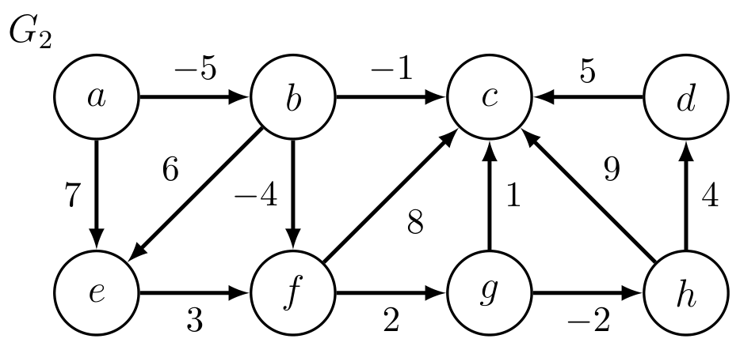

# Introduction to Algorithms: 6.006

## <span style="color:#2471a3;">**[lecture]**</span> <span style="color:#c0392b">Lecture 11: Weighted Shortest Paths（加权最短路径）</span>

Massachusetts Institute of Technology
Instructors: Erik Demaine, Jason Ku, and Justin Solomon

> <span style="color:#7f8c8d;">MIT 6.006 Spring 2020, Lecture 11 译注（对应视频：Weighted Shortest Paths）</span>

---

## Review（回顾）

上一阶段我们建立了几种基于**无权图**（unweighted graph）的遍历与搜索工具：

- **Single-Source Shortest Paths（单源最短路径，SSSP）** 用 **BFS（Breadth-First Search，广度优先搜索）** 可在 $O(|V| + |E|)$ 时间内求出每个顶点到源点的最短距离。
- **Single-Source Reachability（单源可达性）** 用 BFS 或 **DFS（Depth-First Search，深度优先搜索）** 在 $O(|E|)$ 时间内只返回可达顶点。
- **Connected Components（连通分量）** 用 Full-BFS 或 Full-DFS 在 $O(|V| + |E|)$ 时间内求出。
- **Topological Sort（拓扑排序）**：对 **DAG（Directed Acyclic Graph，有向无环图，即不含任何有向环的有向图）** 用 Full-DFS 在 $O(|V| + |E|)$ 时间内求出。
- 此前，**distance（距离）** 的定义是「路径中的边数」；今天起，我们把它推广为更一般的「路径权值」。

---

## Weighted Graphs（加权图）

- 一张**加权图**（weighted graph）是一个图 $G = (V, E)$，并附带一个权值函数（weight function）$w : E \to \mathbb{Z}$。
- 也就是说，它为每条边 $e = (u, v) \in E$ 赋一个整数权值：$w(e) = w(u, v)$。
- 边权在图中有一系列实际应用：
  - 道路网络中的**距离**（distances in a road network）
  - 网络连接中的**时延**（latency in network connections）
  - 社交网络中关系的**强度**（strength of a relationship in a social network）
- 计算上表示权值有两种常见方式：
  - **并入图的表示**：在邻接表（adjacency list）中，把边权与每个顶点一起存储；
  - **单独存一个 Set 结构**：用一个**映射**（mapping，把每条边映到它的权值的查找结构）把每条边对应到它的权值。
- 我们假设所用的表示允许在 $O(1)$ 时间内查询某条边的权值。

> **核心概念——Set / mapping**：这里的 Set 数据结构的英文全称是 **set data structure（集合数据结构）**，即一个支持「给定键（key）快速查值（value）」的抽象结构；在本语境下它是一个把每条边 $(u,v)$ 映射到整数权值的查找表，查询复杂度为 $O(1)$。

### Examples（示例）

讲义给出了两个示例图 $G_1$ 与 $G_2$，顶点为 $a,b,c,d,e,f,g,h$，边上的整数权值（含负数）如 $6, 8, -2, 5, 9, -5, 7, 3, 2, -1, -4, 1, 4$ 等。其中 $G_1$ 里存在一个负权环（negative-weight cycle，见下文）。


**图 1-1**：$G_1$ 中 $b\to f\to g\to c\to b$ 构成总权 $(-4)+2+1+(-1)=-2$ 的负权环，因此 $\delta(b,b)=-\infty$——这就是讲义用 $\inf$ 而非 $\min$ 定义 $\delta$ 的唯一理由；环上每条边的方向与权值都由图中箭头与数字同时给出。$G_1$ contains a negative-weight cycle of total weight $-2$.


**图 1-2**：$G_2$ 与 $G_1$ 的唯一差别，是 $b$–$c$ 之间那条权 $-1$ 的边方向相反（$b\to c$ 而非 $c\to b$）。这一条边一改，上面那个环就不存在了，$G_2$ 成为 DAG——「有没有负权环」可以由一条边的方向决定，DAG Relaxation（拓扑扫描一遍即得 $\delta$）与 Bellman-Ford（需要 $|V|\cdot|E|$ 才能兜住负权）的分工正建立在这个差别上。Flipping one edge turns $G_1$ into the acyclic $G_2$.


---

## Restrictions（限制条件与算法全景）

| SSSP 算法 | 图类型 | 权值约束 | 名称 | 运行时间 $O(\cdot)$ | 讲次 |
|---|---|---|---|---|---|
| General Unweighted | 一般图 | 无权 | BFS | $\|V\| + \|E\|$ | L09 |
| DAG | DAG | 任意（Any） | DAG Relaxation | $\|V\| + \|E\|$ | L11（今天） |
| General | 一般图 | 任意（Any） | Bellman-Ford | $\|V\| \cdot \|E\|$ | L12 |
| General | 一般图 | 非负（Non-negative） | Dijkstra | $\|V\| \log \|V\| + \|E\|$ | L13 |

---

## Weighted Paths（加权路径）

- 加权图中一条路径 $\pi$ 的**权值** $w(\pi)$，等于该路径上所有边的权值之和。
- 从 $s \in V$ 到 $t \in V$ 的**（加权）最短路径**，是从 $s$ 到 $t$ 的权值最小的路径。
- $\delta(s, t) = \inf\{w(\pi) \mid \text{path } \pi \text{ from } s \text{ to } t\}$ 称为从 $s$ 到 $t$ 的**最短路径权值**（shortest-path weight）。
- （在加权图中，常用「distance，距离」来指最短路径权值，而不再指边数。）
- 与无权图类似：
  - 若从 $s$ 到 $t$ 不存在路径，则 $\delta(s, t) = \infty$。
  - 最短路径的**子路径**仍是最短路径（否则可把一条更短的路径「拼接」进去）。
- **为什么用下确界 $\inf$ 而不用最小值 $\min$？** 因为可能存在「不存在有限长的最小权值路径」的情况。
- 什么时候会发生？当图中存在**负权环**（negative-weight cycle）时。例：$G_1$ 中的环 $(b, f, g, c, b)$。
- **负权环**是一条起点与终点相同的路径 $\pi$，且满足 $w(\pi) \lt  0$。
- 若存在一条从 $s$ 到 $t$、且经过某个负权环上顶点的路径，则 $\delta(s, t) = -\infty$。
- 出现这种情况时，我们不再追求「最短路径」，而可能只想要「找出那个负权环」本身。

> **核心概念——relaxation / 三角不等式（先预告）**：这里出现的负权环是加权最短路之所以复杂的根本原因，后续「relaxation（松弛）」与「三角不等式」都围绕它展开（详见 DAG Relaxation 一节）。

---

## Weighted Shortest Paths Algorithms（加权最短路算法总览）

- 接下来的四讲，讲求加权图中最短路径权值的算法。
- （暂不维护 parent pointer，父指针；在求出全部距离之后，可以在线性时间内重建最短路树，见下一节。）
- 我们已经会一个算法：**BFS**！它在如下情形下只需 $O(|V| + |E|)$ 时间：
  - 图的权值为正，且**所有边的权值都相同**；
  - 图的权值为正，且**所有边权之和至多为 $O(|V| + |E|)$**。
- 对**一般加权图**，我们还不知道如何在 $O(|V| + |E|)$ 时间内解 SSSP。
- 但如果你的图是 **DAG（有向无环图）**，那就可以！

---

## Shortest-Paths Tree（最短路径树）

- 对 BFS，我们在搜索过程中就记录了父指针。另一种做法是：**事后**再计算它们！
- 若已知所有顶点 $v \in V$ 的 $\delta(s, v)$，就能在 $O(|V| + |E|)$ 时间内构造出最短路径树。
- 对从 $s$ 出发的加权最短路，只需为那些 $\delta(s, v)$ finite（有限）的顶点 $v$ 记录父指针。
- 初始化一个空的父指针表 $P$，并设 $P(s) = \text{None}$。
- 对每个 $\delta(s, v)$ 有限的顶点 $u \in V$：
  - 对每个出邻接点（outgoing neighbor）$v \in \text{Adj}^+(u)$：
    - 若 $P(v)$ 尚未赋值，且 $\delta(s, v) = \delta(s, u) + w(u, v)$：
      - 则存在一条经过边 $(u, v)$ 的最短路径，故设 $P(v) = u$。
- 父指针可能形成**零权环**（cycles of zero weight）。mark（标记）这种环上的每个顶点。
- 对每个**未标记**顶点 $u \in V$（包括之后才被取消标记的顶点）：
  - 对每个满足「$v$ 已被标记，且 $\delta(s, v) = \delta(s, u) + w(u, v)$」的 $v \in \text{Adj}^+(u)$：
    - 沿父指针从 $v$ 回溯，取消标记包含 $v$ 的环上的顶点；
    - 设 $P(v) = u$，从而**打破**该环。
- **练习**：证明该算法能在线性时间内正确算出父指针。
- 由于父指针可以事后计算，我们接下来只需专注于**计算距离**。

---

## DAG Relaxation（DAG 松弛算法）

### Idea（一句话本质）

**维护每个顶点的距离估计值 $d(s, v)$（初始为 $\infty$），它始终是真实最短路径权值 $\delta(s, v)$ 的上界；一旦某条边违反三角不等式，就把这条边「松弛」，压低估计值，直到它等于真实值。**

### 前置概念

- 为每个顶点 $v \in V$ 维护一个**距离估计值**（distance estimate）$d(s, v)$，初始为 $\infty$，它始终**上界**真实的 $\delta(s, v)$，随后逐步降低，直到 $d(s, v) = \delta(s, v)$。
- 什么时候降低？当某条边**违反三角不等式**（triangle inequality）时！
- **三角不等式**：从 $u$ 到 $v$ 的最短路径权值，不可能大于「从 $u$ 到 $v$ 途经另一顶点 $x$」的最短路，即对所有 $u, v, x \in V$：

```math
\delta(u, v) \le \delta(u, x) + \delta(x, v)
```

- 若对某条边 $(u, v)$ 有 $d(s, v) > d(s, u) + w(u, v)$，则三角不等式被违反（:(）。
- 修复方式：把 $d(s, v)$ 降低为 $d(s, u) + w(u, v)$，即**relax（松弛）**边 $(u, v)$，以使其满足被违反的约束。

> **核心概念——relaxation（松弛）**：对边 $(u,v)$ 做松弛，是指当 $d(s,v) > d(s,u)+w(u,v)$ 时，令 $d(s,v) \leftarrow d(s,u)+w(u,v)$；其本质是「尝试用『先到 $u$ 再沿边走到 $v$』这条路径去改进对 $v$ 的当前距离估计」。

### Relaxation 安全性（Claim + Proof）

- **Claim（命题）**：松弛是安全的（safe）——它保持「对每个 $v \in V$，$d(s, v)$ 都是某条到 $v$ 的路径的权值（或为 $\infty$）」这一性质。
- **Proof（证明）**：假设对所有 $v_0 \in V$，$d(s, v_0)$ 都是某条路径的权值（或 $\infty$）。松弛某条边 $(u, v)$ 会把 $d(s, v)$ 设为 $d(s, u) + w(u, v)$，而这正是一条「从 $s$ 到 $v$ 途经 $u$」的路径的权值。故性质保持。∎

### Pseudocode（伪代码）

```
初始化：对所有 v ∈ V 设 d(s, v) = ∞；然后设 d(s, s) = 0
按 G 的拓扑排序（topological sort）顺序处理每个顶点 u：
    对每个出邻接点 v ∈ Adj^+(u)：
        若 d(s, v) > d(s, u) + w(u, v)：
            松弛边 (u, v)，即设 d(s, v) = d(s, u) + w(u, v)
```

用 LaTeX 逐行表达其核心（缩进用 $\quad$）：

```math
d(s, v) = \infty \quad \forall v \in V;\qquad d(s, s) = 0
```

```math
\text{for each } u \in V \text{ in topological order:}
```

```math
\qquad \text{for each } v \in \mathrm{Adj}^{+}(u):
```

```math
\qquad\qquad \text{if } d(s, v) > d(s, u) + w(u, v):
```

```math
\qquad\qquad\qquad d(s, v) \leftarrow d(s, u) + w(u, v)
```

- **示例**：在 $G_2$ 上从顶点 $a$ 出发运行 DAG Relaxation。

---

## Correctness（正确性证明）

### 命题

- **Claim**：DAG Relaxation 结束时，对所有 $v \in V$ 有 $d(s, v) = \delta(s, v)$。

### 证明（对拓扑序中的前缀做归纳）

对 $k$ 归纳：**拓扑序中前 $k$ 个顶点的 $d(s, v) = \delta(s, v)$**。

- **Base case（基例）**：顶点 $s$ 以及拓扑序中位于 $s$ 之前的每个顶点，在初始时就满足命题。
- **Inductive step（归纳步）**：假设前 $k_0$ 个顶点满足命题，令 $v$ 为第 $k_0 + 1$ 个顶点。
  - 考虑一条从 $s$ 到 $v$ 的最短路径，令 $u$ 为该路径上 $v$ 的前驱顶点。
  - $u$ 在拓扑序中位于 $v$ 之前，故由归纳假设 $d(s, u) = \delta(s, u)$。
  - 处理 $u$ 时，$d(s, v)$ 被设为「不大于（$\le$）」$\delta(s, u) + w(u, v) = \delta(s, v)$。
  - 但由「松弛安全性」，$d(s, v) \ge \delta(s, v)$，故 $d(s, v) = \delta(s, v)$。∎

### 另一种证明视角

- 对任意顶点 $v$，DAG Relaxation 会把 $d(s, v)$ 设为：

```math
d(s, v) = \min\{\, d(s, u) + w(u, v) \mid u \in \mathrm{Adj}^{-}(v) \,\}
```

- 到 $v$ 的最短路径必经过某个入邻接点（incoming neighbor）$u$。
- 故若由归纳假设对所有 $u \in \mathrm{Adj}^{-}(v)$ 都有 $d(s, u) = \delta(s, u)$，则 $d(s, v) = \delta(s, v)$。

---

## Running Time（运行时间 / 复杂度分析）

- **初始化**（Initialization）花费 $O(|V|)$ 时间；**拓扑排序**（Topological Sort）花费 $O(|V| + |E|)$ 时间。
- 处理阶段额外的工作量，由每个顶点 $u$ 的出度 $\deg^{+}(u)$ 之和界定：

```math
O(1) \times \sum_{u \in V} \deg^{+}(u) = O(|E|)
```

- 递推式（recursion / 求和）推导：处理每个顶点的每条出边至多做一次松弛，每次松弛 $O(1)$；而所有顶点的出度之和恰为边数：

```math
\sum_{u \in V} \deg^{+}(u) = |E|
```

- 故总运行时间（total running time）是线性的：

```math
O(|V|) + O(|V| + |E|) + O(|E|) = O(|V| + |E|)
```

---

*MIT OpenCourseWare — 6.006 Introduction to Algorithms, Spring 2020.*
