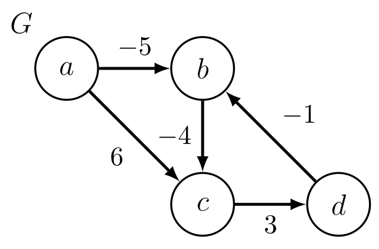
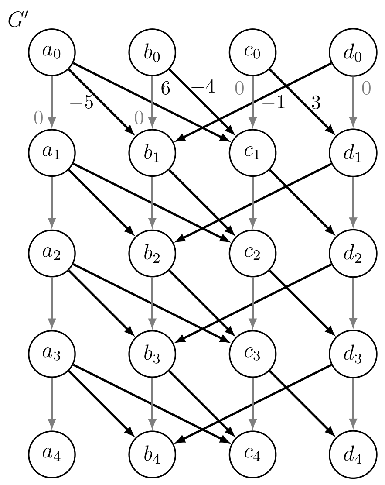

# Introduction to Algorithms: 6.006

## <span style="color:#2471a3;">**[lecture]**</span> <span style="color:#c0392b">Lecture 12: Bellman-Ford（贝尔曼-福特算法）</span>

Massachusetts Institute of Technology
Instructors: Erik Demaine, Jason Ku, and Justin Solomon

> <span style="color:#7f8c8d;">MIT 6.006 Spring 2020, Lecture 12 译注（对应视频：Bellman-Ford）</span>

> 本讲译注：中文主体 + 英文术语行内嵌入，公式按数学意义重建完整。

---

## 0. 概览：四种 SSSP 算法的定位

**SSSP（Single-Source Shortest Paths，单源最短路径）问题**：给定带权图 $G=(V,E)$ 与源点 $s$，求 $s$ 到每个顶点 $v$ 的最短路径权值 $\delta(s,v)$（若 $v$ 经负权环可达则为 $-\infty$）。

下表给出本课程四个场景与对应算法（Running Time 列 `O(·)`）：

| 图类型（Graph） | 权值（Weights） | 算法（Name） | 运行时间（Running Time） | 讲次（Lecture） |
|---|---|---|---|---|
| General（一般图） | Unweighted（无权） | **BFS（广度优先搜索）** | $O(\lvert V\rvert+\lvert E\rvert)$ | L09 |
| DAG（有向无环图） | Any（任意） | **DAG Relaxation（DAG 松弛）** | $O(\lvert V\rvert+\lvert E\rvert)$ | L11 |
| General（一般图） | Any（任意） | **Bellman-Ford** | $O(\lvert V\rvert\cdot\lvert E\rvert)$ | L12（今日） |
| General（一般图） | Non-negative（非负） | **Dijkstra（迪杰斯特拉）** | $O(\lvert V\rvert\log\lvert V\rvert+\lvert E\rvert)$ | L13 |

**Previously（上一讲回顾）**：

- weighted graph（带权图）、shortest-path weight（最短路径权值）$\delta(s,v)$、negative-weight cycle（负权环）的定义；
- 如何由最短路径权值在 $O(\lvert V\rvert+\lvert E\rvert)$ 时间内构造最短路径树（shortest-path tree）；
- **DAG Relaxation**：在带权 DAG 上以 $O(\lvert V\rvert+\lvert E\rvert)$ 时间求解 SSSP 的算法；
- 带负权边的 SSSP 目标：对每个 $v\in V$ 求出 $\delta(s,v)$（若 $v$ 经负权环可达则为 $-\infty$）；若存在从 $s$ 可达的负权环，则返回其中一个。

---

## 1. Warmups（热身题）

**练习 1**：给定**无向图** $G$，判断 $G$ 是否含负权环。

**解**：若 $G$ 中任一条边的权值为负，则立即返回 Yes——因为无向图中一条负权边正反各走一次即构成权值为负的环；否则返回 No。全程只需扫描所有边，时间 $O(\lvert E\rvert)$。

> 由此结论，本讲之后**只讨论有向图**（undirected graph 的负权边问题已被平凡解决）。

**练习 2**：给定一个运行时间为 $O(\lvert V\rvert(\lvert V\rvert+\lvert E\rvert))$ 的 SSSP 算法 $A$，说明如何用它实现 $O(\lvert V\rvert\lvert E\rvert)$ 时间的 SSSP。

**解**：

1. 先跑一次 BFS/DFS 找出从 $s$ 可达的顶点，耗时 $O(\lvert E\rvert)$；
2. 对每个不可达顶点 $v$ 标记 $\delta(s,v)=\infty$，耗时 $O(\lvert V\rvert)$；
3. 仅保留可达顶点，构造子图 $G'=(V',E')$，耗时 $O(\lvert V\rvert+\lvert E\rvert)$；
4. 在 $G'$ 上从 $s$ 运行算法 $A$；
5. $G'$ 连通，故 $\lvert V'\rvert=O(\lvert E'\rvert)=O(\lvert E\rvert)$，于是 $A$ 的运行时间为 $O(\lvert V\rvert\lvert E\rvert)$。

**今日目标**：找到一种对一般图（general graph，含负权边、甚至负权环）都成立、且具有上述 $O(\lvert V\rvert\lvert E\rvert)$ 运行时间的 SSSP 算法——这就是 Bellman-Ford。

---

## 2. Simple Shortest Paths（简单最短路径）

- 若图含环且带负权，则可能含负权环（麻烦所在）；
- 但若图**不含**负权环，则最短路径一定是**简单路径**（simple path，即不重复经过任何顶点）。

**Claim 1（声明 1）**：若 $\delta(s,v)$ 有限，则存在一条到 $v$ 的**简单**最短路径。

**证明（反证法，by contradiction）**：

- 假设不存在简单最短路径，令 $\pi$ 为一条**顶点数最少**的最短路径；
- $\pi$ 非简单，故其中含某个环 $C$；由于 $\delta(s,v)$ 有限，$C$ 的权值必为非负（否则 $\delta(s,v)=-\infty$）；
- 从 $\pi$ 中删去环 $C$，得到顶点更少的路径 $\pi'$，其权值满足 $w(\pi')\le w(\pi)$；
- 与「$\pi$ 是顶点最少的最短路径」矛盾。

**推论**：简单路径不能重复顶点，故有限的最短路径至多含 $\lvert V\rvert-1$ 条边。

---

## 3. Negative Cycle Witness（负环见证顶点）

**定义——k-Edge Distance（$k$ 边距离）** $\delta_k(s,v)$：从 $s$ 到 $v$、使用**至多 $k$ 条边**的路径的最小权值。

**核心 idea（本质）**：如果能同时算出 $\delta_{\lvert V\rvert-1}(s,v)$ 和 $\delta_{\lvert V\rvert}(s,v)$ 两个量并比较它们，就能判定 $v$ 是否「被负权环拉低到 $-\infty$」。

- 若 $\delta(s,v)\neq-\infty$，则 $\delta(s,v)=\delta_{\lvert V\rvert-1}(s,v)$（因为此时最短路径是简单路径，至多 $\lvert V\rvert-1$ 条边，多给一条边也不会更短）；
- 若 $\delta_{\lvert V\rvert}(s,v)\lt \delta_{\lvert V\rvert-1}(s,v)$：
  - 说明存在一条到 $v$ 的更短的**非简单**路径，故 $\delta(s,v)=-\infty$；
  - 称这样的 $v$ 为**（负环）见证顶点（negative cycle witness，简称 witness）**。
- 注意：可能存在最短路径权值为 $-\infty$、但本身**不是** witness 的顶点（它们是被 witness 传播到 $-\infty$ 的）。

**Claim 2（声明 2）**：若 $\delta(s,v)=-\infty$，则 $v$ 可从某个 witness 到达。

**证明**：只需证——每个从 $s$ 可达的负权环中都含有一个 witness。

- 考虑从 $s$ 可达的负权环 $C$。对 $v\in C$，记 $v'\in C$ 为 $v$ 在环 $C$ 中的前驱，且满足

```math
\sum_{v\in C} w(v',v) < 0
```

（即环 $C$ 的总权值为负，这是 $C$ 为负权环的前提。）

- 对任意 $v\in C$，有

```math
\delta_{\lvert V\rvert}(s,v)\ \le\ \delta_{\lvert V\rvert-1}(s,v')+w(v',v)
```

（右侧是某条使用至多 $\lvert V\rvert$ 个顶点的路径的权值。）

- 对上式在 $v\in C$ 上求和：

```math
\sum_{v\in C}\delta_{\lvert V\rvert}(s,v)\ \le\ \sum_{v\in C}\delta_{\lvert V\rvert-1}(s,v')+\sum_{v\in C}w(v',v)\ <\ \sum_{v\in C}\delta_{\lvert V\rvert-1}(s,v)
```

- 最后一步严格小于用到了 $\sum_{v\in C}w(v',v)\lt 0$（环总权为负），且 $\sum_{v\in C}\delta_{\lvert V\rvert-1}(s,v')=\sum_{v\in C}\delta_{\lvert V\rvert-1}(s,v)$（下标重排）。
- 若 $C$ 中不含 witness，则对每个 $v\in C$ 都有 $\delta_{\lvert V\rvert}(s,v)\ge\delta_{\lvert V\rvert-1}(s,v)$，与上面严格小于的不等式矛盾。

因此每个负权环必含 witness，凡 $\delta(s,v)=-\infty$ 的 $v$ 都从某 witness 可达。∎

---

## 4. Bellman-Ford 算法

**核心 idea（本质）**：用「graph duplication（图的复制）」把「边数限制」变成「层数限制」——造出 $\lvert V\rvert+1$ 层，第 $k$ 层的顶点 $v_k$ 表示「用至多 $k$ 条边从 $s$ 到达 $v$」。因为边只会从低层指向高层，复制后的图是一个 **DAG**，于是可以直接套用上一讲的 DAG Relaxation 求解。

**构造**：从 $G=(V,E)$ 构造新 DAG $G'=(V',E')$：

- $G'$ 有 $\lvert V\rvert(\lvert V\rvert+1)$ 个顶点 $v_k$，其中 $v\in V$，$k\in\{0,\dots,\lvert V\rvert\}$；
- $G'$ 的边有两类：
  - **同顶点逐层直连边**：对每个 $v\in V$ 与 $k\in\{1,\dots,\lvert V\rvert\}$，边 $(v_{k-1},v_k)$ 权值为 $0$（表示「停在这一层，不加边」）；
  - **原边跨层复制边**：对每条 $(u,v)\in E$ 与 $k\in\{1,\dots,\lvert V\rvert\}$，边 $(u_{k-1},v_k)$ 权值为 $w(u,v)$（表示「再走一条原图的边，层数 $+1$」）。

**Pseudocode（伪代码，LaTeX 版）**：

```math
\begin{aligned}
&\text{Bellman-Ford}(G,s):\\
&\quad G'\leftarrow \text{构造图复制得到的 DAG（如上，}\lvert V\rvert(\lvert V\rvert+1)\text{ 个顶点）}\\
&\quad \text{在 }G'\text{ 上从 }s_0\text{ 运行 DAG Relaxation，求出所有 }\delta(s_0,v_k)\\
&\quad \text{对每个 }v\in V:\quad d(s,v)\leftarrow \delta(s_0,v_{\lvert V\rvert-1})\\
&\quad \text{对每个 witness }u\in V\text{（即 }\delta(s_0,u_{\lvert V\rvert})<\delta(s_0,u_{\lvert V\rvert-1})\text{）}:\\
&\quad\quad \text{对每个在 }G\text{ 中从 }u\text{ 可达的 }v:\quad d(s,v)\leftarrow -\infty\\
&\quad \text{return }d
\end{aligned}
```

**复杂度分析（递推式）**：

- $G'$ 的规模：顶点数 $\lvert V'\rvert=\lvert V\rvert(\lvert V\rvert+1)$；边数 $\lvert E'\rvert=\lvert V\rvert\cdot\lvert V\rvert+\lvert V\rvert\cdot\lvert E\rvert=\lvert V\rvert(\lvert V\rvert+\lvert E\rvert)$。构造 $G'$ 同样耗时 $O(\lvert V\rvert(\lvert V\rvert+\lvert E\rvert))$。
- 在 DAG 上运行 DAG Relaxation 的时间是 $G'$ 规模的线性函数，故为 $O(\lvert V\rvert(\lvert V\rvert+\lvert E\rvert))$。
- 对每个 witness 可达的顶点做 $O(1)$ 处理，找出一个 witness 的可达集需 $O(\lvert E\rvert)$，witness 至多 $O(\lvert V\rvert)$ 个，故为 $O(\lvert V\rvert\lvert E\rvert)$。（也可用一个超级源点 $x$ 以 $0$ 权边连向所有 witness，从 $x$ 做一次线性遍历，总时间 $O(\lvert E\rvert)$。）

**关键剪枝**：一开始就把 $G$ 剪成「仅含从 $s$ 可达顶点的子图」，则 $\lvert V\rvert=O(\lvert E\rvert)$，于是总时间 $T(n)$ 满足

```math
T(\lvert V\rvert,\lvert E\rvert)=O(\lvert V\rvert(\lvert V\rvert+\lvert E\rvert))=O(\lvert V\rvert\lvert E\rvert)
```

即 **Bellman-Ford 运行时间为 $O(\lvert V\rvert\lvert E\rvert)$**。

---

### 4.1 Example（例题）

原图 $G$ 与复制图 $G'$（此处 $a,b,c,d$ 四顶点，权值含 $-5,-1,-4,6,3$）：



**图 3-1**：原图 $G$ 的边集可从图上逐条读出为 $\{(a,b,-5),\ (a,c,6),\ (b,c,-4),\ (d,b,-1),\ (c,d,3)\}$，共 5 条边；把这 5 条边代入 $k$ 边距离递推可算出 $\delta_3(a,b)=-5$ 而 $\delta_4(a,b)=-7$，所以 witness 只能是 $b$，$a$ 的 $\delta$ 恒为 0——若图上任一条边的端点或权值与这个集合不符，下面表格末行 $\delta(a,v)=(0,-\infty,-\infty,-\infty)$ 的结论就不成立。



**图 3-2**：$G'$ 有 $k=0,\dots,4$ 共 5 层、每层 4 个顶点，合计 20 个顶点 $v_k$；灰色 0 权边 $(v_{k-1},v_k)$ 与本图的每条黑边（原边在第 $k$ 层的复制 $(u_{k-1},v_k)$）都只从小层指向大层，因此「$G'$ 是 DAG」是构造的直接结果，与 $G$ 本身是否含环无关。

> 原译稿此处有一块 ASCII 示意图，其拓扑（$a\to b$ 权 $6$、$b\to c$ 权 $-5$）与原文图 3-1 的边集不符，且原书并无 ASCII 版本；已按原图删除，图形以图 3-1 为准。

复制成 5 层（$k=0,1,2,3,4$），层间按上面两条规则连边。逐层松弛得到的 $k$ 边距离表如下：

| $k\backslash v$ | $a$ | $b$ | $c$ | $d$ |
|---|---|---|---|---|
| 0 | 0 | $\infty$ | $\infty$ | $\infty$ |
| 1 | 0 | $-5$ | 6 | $\infty$ |
| 2 | 0 | $-5$ | $-9$ | 9 |
| 3 | 0 | $-5$ | $-9$ | $-6$ |
| 4 | 0 | $-7$ | $-9$ | $-6$ |

对比第 3 层（$\delta_{\lvert V\rvert-1}=\delta_3$）与第 4 层（$\delta_{\lvert V\rvert}=\delta_4$）：

- 顶点 $a$：$\delta_4=0=\delta_3$，未变，$\delta(a,a)=0$；
- 顶点 $b$：$\delta_4=-7\lt \delta_3=-5$，是 **witness**；
- 顶点 $c$：$\delta_4=-9=\delta_3$，未变；
- 顶点 $d$：$\delta_4=-6=\delta_3$，未变。

由 Claim 2，凡从 witness $b$ 可达的顶点都被拉低到 $-\infty$。最终结果：

```math
\delta(a,a)=0,\qquad \delta(a,b)=\delta(a,c)=\delta(a,d)=-\infty
```

即表格最后一行 `δ(a, v) = 0, −∞, −∞, −∞`。

---

## 5. Correctness（正确性）

**Claim 3（声明 3）**：对所有 $v\in V$ 与 $k\in\{0,\dots,\lvert V\rvert\}$，有 $\delta(s_0,v_k)=\delta_k(s,v)$。

**证明（对 $k$ 归纳）**：

- **Base case（基例）** $k=0$：$G'$ 中从 $s_0$ 出发、走 $0$ 条边只能到达 $s_0$ 自身，即仅 $v=s$ 时 $\delta(s_0,s_0)=0$，其余为 $\infty$，与 $\delta_0(s,v)$ 的定义一致。
- **Inductive Step（归纳步）**：假设对一切 $k\lt k_0$ 命题成立，证明 $k=k_0$ 时成立。由 DAG Relaxation 的松弛方程（relaxation，即按入边取最小候选值）：

```math
\delta(s_0,v_{k_0})\ =\ \min\{\ \delta(s_0,u_{k_0-1})+w(u_{k_0-1},v_{k_0})\ \mid\ u_{k_0-1}\in \operatorname{Adj}^{-}(v_{k_0})\ \}
```

把 $v_{k_0}$ 的入边分为「来自同顶点 $v_{k_0-1}$ 的 0 权边」与「来自其他 $u_{k_0-1}$ 的原边复制」两类：

```math
=\ \min\Big\{\ \{\delta(s_0,u_{k_0-1})+w(u,v)\ \mid\ u\in\operatorname{Adj}^{-}(v)\}\ \cup\ \{\delta(s_0,v_{k_0-1})\}\ \Big\}
```

由归纳假设 $\delta(s_0,u_{k_0-1})=\delta_{k_0-1}(s,u)$ 与 $\delta(s_0,v_{k_0-1})=\delta_{k_0-1}(s,v)$：

```math
=\ \min\Big\{\ \{\delta_{k_0-1}(s,u)+w(u,v)\ \mid\ u\in\operatorname{Adj}^{-}(v)\}\ \cup\ \{\delta_{k_0-1}(s,v)\}\ \Big\}\ =\ \delta_{k_0}(s,v)
```

最后一步正是 $k$ 边距离的递推定义：至多 $k_0$ 条边的最短路径，要么最后一条边是 $(u,v)$（前段用至多 $k_0-1$ 条边到 $u$），要么根本不用最后一条边（直接用至多 $k_0-1$ 条边到 $v$）。∎

**Claim 4（声明 4）**：Bellman-Ford 结束时 $d(s,v)=\delta(s,v)$。

**证明**：

- 由 Claim 3，算法正确算出所有顶点的 $\delta_{\lvert V\rvert-1}(s,v)$ 与 $\delta_{\lvert V\rvert}(s,v)$；
- 若 $\delta(s,v)\neq-\infty$，则算法令 $d(s,v)=\delta_{\lvert V\rvert-1}(s,v)=\delta(s,v)$（由简单路径性质）；
- 对每个 witness 可达的 $v$ 令 $d(s,v)=-\infty$，由 Claim 2 这正是正确的。∎

---

## 6. Running Time（运行时间）

- $G'$ 规模 $O(\lvert V\rvert(\lvert V\rvert+\lvert E\rvert))$，构造耗时同阶；
- 在 $G'$ 上运行 DAG Relaxation 的时间是 $G'$ 规模的线性；
- 对每个 witness 可达的顶点做 $O(1)$ 工作；
- 求一个 witness 的可达集需 $O(\lvert E\rvert)$，witness 至多 $O(\lvert V\rvert)$ 个，故为 $O(\lvert V\rvert\lvert E\rvert)$；
- （另一种做法：用超级源点 $x$ 以 0 权边连到所有 witness，从 $x$ 做一次线性搜索，$O(\lvert E\rvert)$。）
- 开局把 $G$ 剪成仅含从 $s$ 可达顶点的子图，得到 $O(\lvert V\rvert\lvert E\rvert)$ 时间算法。

---

## 7. 附加：返回负权环 与 空间优化（Extras）

**Claim 5（声明 5）**：对任一 witness $v$，其最短 $s_0$—$v_{\lvert V\rvert}$ 路径 $\pi$ 在 $G$ 中含一个负权环。

**证明**：$\pi$ 含 $\lvert V\rvert+1$ 个顶点，故必含至少一个环 $C$；该环 $C$ 权值为负——否则删去 $C$ 得到顶点更少、权值 $w(\pi')\le w(\pi)$ 的路径 $\pi'$，这与 $v$ 是 witness（即 $\delta_{\lvert V\rvert}(s,v)\lt \delta_{\lvert V\rvert-1}(s,v)$）矛盾。∎

（据此可额外返回一个负权环。）

**空间优化**：只需 $O(\lvert V\rvert)$ 空间——逐层 $k=1,\dots,\lvert V\rvert$ 计算时，仅存储 $\delta(s_0,v_{k-1})$ 与 $\delta(s_0,v_k)$ 两层即可。

- 传统的 Bellman-Ford 每个顶点只存一个值，在 $\lvert V\rvert$ 轮内尝试松弛所有边；但这些估计值并不对应 $k$ 边距离，正确性分析更难。
- 但这类空间优化**不返回**负权环。

---

## 8. 一页速记（关键结论）

1. **无向图**含负权边 ⇔ 含负权环，故本讲只关注**有向图**。
2. 不含负权环时，最短路径是**简单路径**，至多 $\lvert V\rvert-1$ 条边。
3. **$k$ 边距离** $\delta_k(s,v)$ 是 Bellman-Ford 的数学支柱；$\delta_{\lvert V\rvert}(s,v)\lt \delta_{\lvert V\rvert-1}(s,v)$ 时 $v$ 为 **witness**。
4. **图复制**把「至多 $k$ 条边」变成「第 $k$ 层」，得到 DAG，套 DAG Relaxation 即得解。
5. 运行时间 $O(\lvert V\rvert\lvert E\rvert)$，并能额外返回负权环；可压缩到 $O(\lvert V\rvert)$ 空间。

---

*材料来源：MIT OpenCourseWare, 6.006 Introduction to Algorithms, Spring 2020 — https://ocw.mit.edu*
