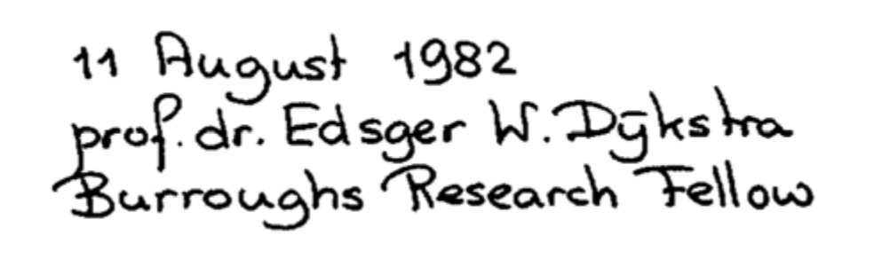
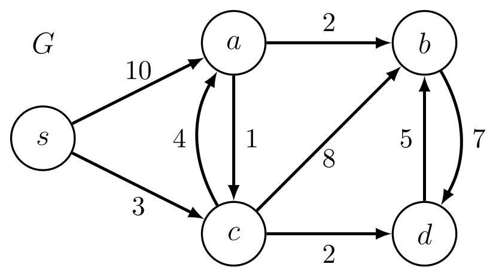

# Introduction to Algorithms: 6.006

## <span style="color:#2471a3;">**[lecture]**</span> <span style="color:#c0392b">Lecture 13: Dijkstra's Algorithm（Dijkstra 算法）</span>

Massachusetts Institute of Technology
Instructors: Erik Demaine, Jason Ku, and Justin Solomon

> <span style="color:#7f8c8d;">MIT 6.006 Spring 2020, Lecture 13 译注（对应视频：Dijkstra's Algorithm）</span>

> 本讲义为中英行内双语译注，正文以中文为主，英文术语首次出现时标注 `English（中文）`，之后直接用 `English`。算法部分补足 idea、LaTeX 伪代码与复杂度分析，公式已按数学意义重建并自检。

---

## Review（回顾）

- **Single-Source Shortest Paths（单源最短路径，SSSP）** on weighted graphs（带权图）
- 此前：对**小正权值**或 **DAG**（Directed Acyclic Graph，有向无环图）有 $O(|V|+|E|)$ 时间算法
- 上次课：**Bellman-Ford**，对**带负权边**的一般图是 $O(|V|\cdot|E|)$ 时间算法
- 今天：对**边权非负**的一般图（即对每条边 $e\in E$，$w(e)\ge 0$）给出更快算法

下表总结 SSSP 算法的适用场景（Graph 图类型 / Weights 权值 / Name 算法名 / Running Time 运行时间）：

| Restrictions（限制条件） | SSSP Algorithm（算法） | Running Time $O(\cdot)$ | Lecture（讲次） |
|---|---|---|---|
| General（一般） | Unweighted（无权） | BFS（广度优先搜索） | $|V|+|E|$ | L09 |
| DAG（有向无环图） | Any（任意权值） | DAG Relaxation（DAG 松弛） | $|V|+|E|$ | L11 |
| General | Any | Bellman-Ford | $|V|\cdot|E|$ | L12 |
| General | Non-negative（非负权值） | Dijkstra | $|V|\log|V|+|E|$ | **L13（今天）** |

---

## Non-negative Edge Weights（非负边权）

- **Idea（一句话本质）**：把 BFS 的做法推广到带权图：
  - 以源点 $s$ 为球心，逐步"扩张一个球"（grow a sphere）
  - 反复先探索**更近**的顶点，再探索更远的顶点
  - 但问题来了：如果事先不知道距离，怎么"先探索更近的"？ :(

- **Observation 1（观察 1）**：若边权非负，沿最短路径距离**单调不减**
  - 即：若顶点 $u$ 出现在 $s$ 到 $v$ 的某条最短路径上，则 $\delta(s,u)\le\delta(s,v)$
  - 令 $V_x\subset V$ 为从 $s$ 出发、距离 $\le x$ 可达的顶点集合
  - 若 $v\in V_x$，则 $s$ 到 $v$ 的任何最短路径上只包含 $V_x$ 中的顶点
  - 也许可以**一次扩张一个顶点**来构造 $V_x$！（但若权值很大，逐个 $x$ 扩张太慢）

- **Observation 2（观察 2）**：若已知顶点按"到 $s$ 距离递增"的次序，就能快速解 SSSP
  - 删掉"逆序"的边（因为它们不可能出现在最短路径上）
  - 若存在零权边，可能仍有环：反复把环**收缩成单个顶点**（collapse）
  - 然后对每个 $v\in V$ 用 **DAG Relaxation** 在 $O(|V|+|E|)$ 时间内算出 $\delta(s,v)$

---

## Dijkstra’s Algorithm（Dijkstra 算法）

> 以荷兰计算机科学家 **Edsger Dijkstra**（本名拼作 Dÿkstra）命名。



**图 2-1**：这段题词在 PDF 里是位图而非排版文本，像素内容为三行手写「11 August 1982 / prof. dr. Edsger W. Dijkstra / Burroughs Research Fellow」，其中姓氏保留了手写的重音符号 Dÿkstra；任何 `get_text()` 抽取都拿不到这几个字，删掉这张图等于从讲义里删掉一段只能由像素承载的史料。

- **Idea（一句话本质）**：按"到源点 $s$ 的距离递增"的次序，对每个顶点做边松弛（relaxation）。
- **Idea**：用一个数据结构高效找出次序中的下一个顶点。

### Changeable Priority Queue（可变更优先队列）

Dijkstra 依赖一个支持**按键值动态变更**的优先队列 $Q$，其 item（元素）带 key（键）与唯一 ID（标识符），支持三种操作：

- $Q.\text{build}(X)$ —— 用迭代器 $X$ 中的 item 初始化 $Q$
- $Q.\text{delete\_min}()$ —— 删除键值最小的 item 并返回它
- $Q.\text{decrease\_key}(id, k)$ —— 找到 ID 为 $id$ 的 item，把它的 key 改为 $k$

**实现方式**：把一个 Priority Queue $Q'$ 与一个把 ID 映射到 $Q'$ 中位置的 **Dictionary（字典）** $D$ 交叉链接（cross-link）。假定顶点 ID 是从 $0$ 到 $|V|-1$ 的整数，于是 $D$ 可用**直接寻址数组**（direct access array）实现。为简洁，把 item $x$ 记为元组 $(x.id, x.key)$。

### Pseudocode（伪代码）

```math
\begin{aligned}
&\text{Initialize:}\\
&\quad d(s,v) = \infty \quad \forall v \in V\\
&\quad d(s,s) = 0\\
&\quad Q.\text{build}(\{ (v,\ d(s,v)) : v \in V \})\\
&\text{While } Q \ne \emptyset:\\
&\quad (u,\ d(s,u)) = Q.\text{delete\_min}()\\
&\quad \text{For } v \in \text{Adj}^{+}(u):\\
&\quad\quad \text{If } d(s,v) > d(s,u) + w(u,v):\\
&\quad\quad\quad d(s,v) = d(s,u) + w(u,v) \quad(\text{relax edge } (u,v))\\
&\quad\quad\quad Q.\text{decrease\_key}(v,\ d(s,v))
\end{aligned}
```

其中 $\text{Adj}^{+}(u)$ 表示 $u$ 的**出边邻接表**（outgoing adjacencies）。

### 算法含义（不只是字面）

- **relaxation（松弛）**：对边 $(u,v)$ 检查"绕经 $u$ 能否把 $v$ 的当前估计距离 $d(s,v)$ 变小"，若变小就更新。每次松弛只能使估计值**单调下降**，且保证 $d(s,v)$ 始终是某条 $s\!\to\!v$ 路径的真实权（或 $\infty$）。
- **delete_min 的次序**：每次取出的 $u$ 是当前估计距离最小的未定顶点，这一"贪心"选择正是非负权下正确的关键。

---

## Example（示例）

在如下带权图上运行 Dijkstra（顶点 $\{s,a,b,c,d\}$，边权已标在图上）：



**图 3-1**：按图上权值可逐条验算 $\delta(s,\cdot)=(0,7,9,3,5)$——$s\to a$ 直连要 10，而 $s\to c\to a$ 只要 $3+4=7$；$b$ 取 $7+2=9$；$d$ 取 $3+2=5$。$b$ 与 $d$ 之间那对 7/5 的双向边不改变任何最短路，因为 $9\le 5+7$；若某处记录与这组最短距离冲突，以本图上的边权为准。

- 初始：$Q$ 中含 $(s,0),(a,\infty),(b,\infty),(c,\infty),(d,\infty)$
- 依序 delete_min，逐步松弛出边，得到各顶点的 $\delta(s,v)$ 与最终 $d(s,v)$：

| 顶点 $v$ | $\delta(s,v)$ | 松弛过程中的 $d(s,v)$ 序列 | 最终 $d(s,v)$ |
|---|---|---|---|
| $s$ | 0 | 0 | 0 |
| $a$ | 7 | $\infty \to 10 \to 7$ | 7 |
| $b$ | 9 | $\infty \to \infty \to 11 \to 10 \to 9$ | 9 |
| $c$ | 3 | $\infty \to 3$ | 3 |
| $d$ | 5 | $\infty \to \infty \to 5$ | 5 |

> 注：原文示例页的表格与图被 PDF 提取打散（顶点距离列与图上边权 $4,7,5,8,3,2,5$ 等交错），上表为按"delete_min 次序松弛"规则重建的结果，演示"每个顶点被取出时其 $d$ 值即最终 $\delta$ 值"。

> 校订：原译稿把 $\delta(s,d)$ 误记为 2；按原书表格末行 $\delta(s,v)=(0,7,9,3,5)$ 与图上边 $c\to d$ 权 $2$ 验算，$\delta(s,d)=3+2=5$，已更正。

---

## Correctness（正确性证明）

**Claim（断言）**：Dijkstra 算法结束时，对一切 $v\in V$ 有 $d(s,v)=\delta(s,v)$。

**Proof（证明）**，用**循环不变式 / 归纳假设**而非"显然"：

- **第一步**：说明只需在"顶点从 $Q$ 被取出"那一刻验证等式即可。
  - 松弛只会使估计值 $d(s,v)$ **单调下降**。
  - 松弛是**safe（安全）**的：始终维持每个 $d(s,v)$ 是某条到 $v$ 的路径的权（或 $\infty$）。
  - 因此若某次松弛把 $d(s,v)$ 置为 $\delta(s,v)$，则此后 $d(s,v)$ 不会变化，算法结束时仍等于 $\delta(s,v)$。

- **第二步**：对**最先从 $Q$ 取出的前 $k$ 个顶点**做归纳，证明取出时刻 $d(s,v)=\delta(s,v)$。

  - **Base Case（基础情形，$k=1$）**：$s$ 是第一个被取出的顶点，且 $d(s,s)=0=\delta(s,s)$。成立。

  - **Inductive Step（归纳步）**：假设对 $k\lt k_0$ 都成立，考察第 $k_0$ 个被取出的顶点 $v_0$。
    - 取一条从 $s$ 到 $v_0$ 的最短路径 $\pi$，其权 $w(\pi)=\delta(s,v_0)$。
    - 令 $(x,y)$ 为 $\pi$ 上**第一条**"$y$ 不在前 $k_0-1$ 个已取出顶点中"的边（可能 $y=v_0$）。
    - 当 $x$ 被取出时，由归纳假设有 $d(s,x)=\delta(s,x)$，于是：

```math
d(s,y)
\;\le\; \delta(s,x) + w(x,y)          \quad(\text{取出 } x \text{ 时已松弛过边 } (x,y))
\;=\; \delta(s,y)                       \quad(\text{最短路径的子路径也是最短路径})
\;\le\; \delta(s,v_0)                   \quad(\text{边权非负})
\;\le\; d(s,v_0)                        \quad(\text{松弛是安全的})
\;\le\; d(s,y)                          \quad(v_0 \text{ 是 } Q \text{ 中 } d \text{ 值最小的顶点})
```

    于是不等式链两端夹逼，得 $d(s,v_0)=\delta(s,v_0)$，归纳成立。$\blacksquare$

> 自检：中间两步用到的关键事实——"最短路径的子路径仍是子路径端点间的最短路径"（否则可拼接出更短路径，矛盾）；"边权非负"保证 $\delta(s,y)\le\delta(s,v_0)$（因为 $y$ 在 $\pi$ 上位于 $v_0$ 之前）。

---

## Running Time（运行时间）

统计可变更优先队列 $Q$（含 $n$ 个 item）上的操作次数：

| Operation（操作） | Time（单次时间） | Occurrences in Dijkstra（Dijkstra 中的次数） |
|---|---|---|
| $Q.\text{build}(X)$ | $B_n$（$n=|X|$） | 1 |
| $Q.\text{delete\_min}()$ | $M_n$ | $|V|$ |
| $Q.\text{decrease\_key}(id,k)$ | $D_n$ | $|E|$ |

总运行时间：

```math
O\big(B_{|V|} \;+\; |V|\cdot M_{|V|} \;+\; |E|\cdot D_{|V|}\big)
```

进一步假定已把图**剪枝**为只含从源点可达的顶点，则 $|V|=O(|E|)$。

### 不同底层 $Q'$ 实现的复杂度（$n=|V|=O(|E|)$）

| Priority Queue $Q'$ 实现 | `build(X)` | `delete_min()` | `decrease_key(id,k)` | Dijkstra 总时间 |
|---|---|---|---|---|
| Array（数组） | $n$ | $n$ | $1$ | $O(|V|^2)$ |
| Binary Heap（二叉堆） | $n$ | $\log n$ | $\log n$ | $O(|E|\log|V|)$ |
| Fibonacci Heap（斐波那契堆） | $n$ | $\log n$ | $1$（摊还） | $O(|E|+|V|\log|V|)$ |

**复杂度分析（写出递推并解）**：

- **Array**：$B_n=n$，$M_n=n$，$D_n=1$。代入
  ```math
  B_{|V|}+|V|\cdot M_{|V|}+|E|\cdot D_{|V|}
  = |V| + |V|\cdot|V| + |E|\cdot 1
  = O(|V|^2)
  ```
  （因为 $|E|\le |V|^2$，主导项为 $|V|^2$。）

- **Binary Heap**：$B_n=n$，$M_n=D_n=\log n$。代入
  ```math
  B_{|V|}+|V|\cdot M_{|V|}+|E|\cdot D_{|V|}
  = |V| + |V|\log|V| + |E|\log|V|
  = O\big((|V|+|E|)\log|V|\big)
  ```

- **Fibonacci Heap**：$B_n=n$，$M_n=\log n$，$D_n=1$（**amortized analysis，摊还分析**意义下）。代入
  ```math
  B_{|V|}+|V|\cdot M_{|V|}+|E|\cdot D_{|V|}
  = |V| + |V|\log|V| + |E|\cdot 1
  = O(|E|+|V|\log|V|)
  ```

**结论（何时选哪种）**：

- 若图是**稠密图**（dense），即 $|E|=\Theta(|V|^2)$，用 **Array** 作 $Q'$，得 $O(|V|^2)$。
- 若图是**稀疏图**（sparse），即 $|E|=\Theta(|V|)$，用 **Binary Heap** 作 $Q'$，得 $O(|V|\log|V|)$。
- **Fibonacci Heap** 理论上在所有情形下都好，但实践中很少用。
- 6.006 不讨论 Fibonacci Heap（详见 6.854 或 CLRS 第 19 章）。
- 在理论题中，默认 Dijkstra 运行时间为 $O(|E|+|V|\log|V|)$。

---

## Summary: Weighted Single-Source Shortest Paths（总结：带权单源最短路径）

| Restrictions（限制条件） | SSSP Algorithm（算法） | Running Time $O(\cdot)$ |
|---|---|---|
| General / Unweighted | BFS | $|V|+|E|$ |
| DAG / Any | DAG Relaxation | $|V|+|E|$ |
| General / Non-negative | Dijkstra | $|V|\log|V|+|E|$ |
| General / Any | Bellman-Ford | $|V|\cdot|E|$ |

- 那 **All-Pairs Shortest Paths（全源最短路径，APSP）** 呢？
- 把某个 SSSP 算法跑 $|V|$ 次其实已经不错了，因为输出本身就有 $O(|V|^2)$ 规模。
- 对带负权的一般图，能否优于 $|V|\cdot O(|V|\cdot|E|)$？——下次课！

---

### 参考

MIT OpenCourseWare, 6.006 Introduction to Algorithms, Spring 2020 — https://ocw.mit.edu
