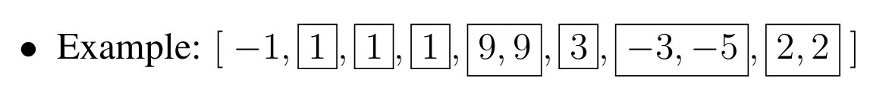
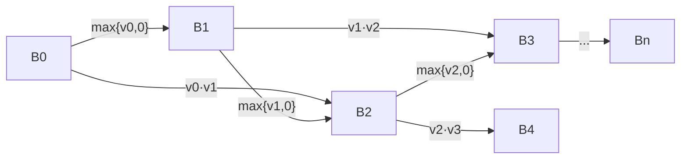
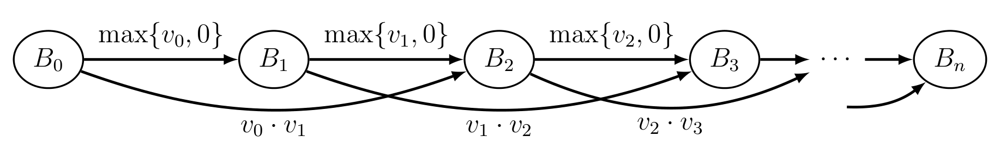

# Introduction to Algorithms: 6.006

## <span style="color:#2471a3;">**[lecture]**</span> <span style="color:#c0392b">Lecture 15: Dynamic Programming, Part 1 — SRT BOT, Fibonacci, DAGs, Bowling（动态规划第一讲）</span>

Massachusetts Institute of Technology
Instructors: Erik Demaine, Jason Ku, and Justin Solomon

---

## <span style="color:#2471a3;">**[section]**</span> <span style="color:#c0392b">引言：从"会用算法"到"设计算法"</span>

讲师点明课程转折：前半学期是 **existing algorithms（已有算法）**——排序、graph algorithms（图算法）、data structures（数据结构），你学会用它们解题；从今天开始进入 **algorithmic design（算法设计）**——面对一个从未见过的问题，从零构思 polynomial time algorithm（多项式时间算法）。

原书在这里用三栏清单把"已知问题"的库存全部摊开（LNotes 15 p1 的 tabular 排版，正文可逐格重建，故以表格而非位图补回）：

| Search Data Structures | Sort Algorithms | Graph Algorithms |
|---|---|---|
| Array | Insertion Sort | Breadth First Search |
| Linked List | Selection Sort | DAG Relaxation (DFS + Topo) |
| Dynamic Array | Merge Sort | Dijkstra |
| Sorted Array | Counting Sort | Bellman-Ford |
| Direct-Access Array | Radix Sort | Johnson |
| Hash Table | AVL Sort | |
| AVL Tree | Heap Sort | |
| Binary Heap | | |

三栏**互不对齐**：8 / 7 / 5 项，行数不同，说明这是三个**正交**的知识库存，选哪一栏取决于输入是 set、是 sequence、还是 graph —— 而不是"同一问题的三种解法"。


核心思想是 **recursive algorithm design（递归算法设计）**：
- 我们想要 constant-sized code（恒定大小的代码）解决 arbitrary size problems（任意规模的问题）
- recursive view（递归视图）特别契合 induction technique（归纳法证明）——这门课一直在用的证明技术
- 递归调用构成 **subproblem graph（子问题图）**，这是分析递归算法的核心工具

递归算法按**子问题依赖图的形状**分类，原书这张双列小表（LNotes 15 p1）同样是可逐格重建的 tabular：

| Class | Graph |
|---|---|
| Brute Force | Star |
| Decrease & Conquer | Chain |
| Divide & Conquer | Tree |
| Dynamic Programming | DAG |
| Greedy/Incremental | Subgraph |

5 类对 5 形，是**双射**：判据是图的形状，与时间复杂度无关，也与是否真的写成递归无关。


> <span style="color:#1e8449;">**[note] Note（译者注）:**</span> 这条注要回答的设计问题是：为什么“从零设计一个 polynomial time algorithm（多项式时间算法）”是一种能被单独训练的能力，而不是“多刷题就会”的副产品。
>
> 前半学期的 existing algorithms（已有算法）本质是查表：拿到问题先归约到自己认识的结构——排序、图搜索、数据结构——再调用现成解法，可靠性只依赖归约的正确性。设计阶段没有表可查，你必须同时交出三样东西：完整的解空间描述、能在多项式时间内走完它的过程、以及“没有漏掉最优解”的论证。缺任何一样，算法要么错要么慢。
>
> 机制上，这三样被 SRT BOT 收束成一条因果链。先固定子问题集合 X，它决定解空间有多大；再要求每个子问题只依赖严格更小的子问题，它决定依赖图有没有环、能不能用拓扑序一遍算完；最后用 work 求和给出界。关键在于界不是事后估出来的，而是被结构锁死的：X 是多项式大小、每个状态转移是常数分支，界就只能是多项式。反过来，任何“想不清怎么设计”的困境，诊断方法都一样——问自己“如果我已经知道某个中间结论，问题会不会变小”，把那个结论参数化，它就是子问题。
>
> Demaine 在开场时用一个对照点明了这次转折，原话是：🎥 *Demaine*："Today we start a totally new section of the class, on how to from scratch come up with a polynomial time algorithm."（翻译：今天我们开始课程的一个全新部分，讲如何从零开始构造一个多项式时间算法。）注意他用的词是 from scratch——不是“选一个合适的已知算法”，而是“在没有现成解法的地方造一个出来”。
>
> 给一个可手算的量级对比。n = 10^6 个元素排序：merge sort（归并排序）约做 n·log2 n = 10^6 × 19.93 ≈ 1.99×10^7 次比较；insertion sort（插入排序）最坏约 n^2/2 = 5×10^11 次比较。按每秒 10^9 次基本操作估，前者 0.02 秒，后者 500 秒，差三个数量级以上。再往外推：n = 10^9 时 log2 n 只有 29，binary search（二分搜索）三十步定位，线性扫描要走十亿步。这就是 polynomial（多项式）在工程上的真实含义——它保证你能靠堆硬件解决问题，指数级保证你不能。
>
> 跨课程连接一：6.042J 的 induction（归纳法）。递归算法的正确性证明与结构归纳是同一件事的两种写法——归纳假设“对所有更小子问题，x(j) 已是最优值”就是 optimal substructure（最优子结构）假设。区别在于归纳法证明的是命题为真，而 DP 还需要一个归纳法给不出的额外前提：最优解能拆成子问题的最优解；这个前提来自问题结构，写不出来时算法就是错的。跨课程连接二：CSAPP 第 6 章 cache（缓存）层次。同一份数据、同一段指令，访存模式不同能差十倍以上，说明渐近界只锁定“结构层面的数量级”，常数因子由存储层次决定。区别在于 cache 的常数来自硬件参数（行大小 64 字节、L1 32 KB），算法的常数来自你写了多少次循环。
>
> 还有一个容易被忽略的点：设计能力不能靠“枚举算法空间”获得。所有可能的程序是无穷的，你无法逐个试；能试的只有“结构”——把问题写成子问题依赖图，然后在这个有限的族里挑。这也解释了为什么本课的分类表按依赖图的形状划分：star 是暴力、chain 是 decrease and conquer、tree 是 divide and conquer、DAG 是 DP、subgraph 是 greedy（贪心）。五类对应五种形状，判据只是形状，与代码是否写成递归无关——你把归并排序写成三层 while 循环，它仍然是 tree 型。所以看到一个新问题时，先把“候选形状”过一遍，比空想“有没有什么巧妙算法”有效得多。
>
> 收束：判断自己会不会设计，标准不是能背出六步，而是拿到新问题能在十分钟内说清“子问题是什么、它依赖谁、为什么没有环”。这三句说得出，剩下的都是填空。

---

## <span style="color:#2471a3;">**[section]**</span> <span style="color:#c0392b">SRT BOT 框架——递归算法设计的六步法</span>

SRT BOT（读作 **SortBot**）是本讲的核心框架。🎥 *Ku 调侃说这是他们苦思冥想编出的 acronym（缩写词），便于记忆完整的递归算法设计规范。* 按顺序执行以下六步，就能完整定义任何递归算法：

### <span style="color:#2471a3;">**[step]**</span> <span style="color:#c0392b">Step 1: Subproblems（子问题定义）</span>

> <span style="color:#1e8449;">**[note] Note（译者注）:**</span> 这条注要回答的是：为什么“子问题的选取”被公认为递归设计里最难也最有创造性的一步，好的子问题究竟在满足什么约束。
>
> 把选择翻译成四个可检验的条件，机制就清楚了。第一，完备性：解空间必须被覆盖，任何合法解都要能沿递推被构造出来。第二，紧致性：状态数 |X| 必须是输入规模的多项式，否则表都存不下。第三，信息充分：子问题携带的信息要刚好够决定后续决策——少一个字段，Relation 就写不出来。第四，无环性：依赖边必须能拓扑排序。前三条互相拉扯，这才是它难的原因：太细，状态爆炸；太粗，信息丢失。好的子问题集合是“信息量的最紧上界”。
>
> 用手算说明“太细”的代价。n = 10^4 的序列输入：prefixes（前缀）给 10^4 个状态，suffixes（后缀）同样 10^4 个，contiguous substrings（连续子串）给 n(n+1)/2 = 5.0005×10^7 个状态；而 subsequences（子序列）有 2^n 个——单是 2^64 就已是 1.84×10^19，按每秒十亿次也要 584 年，而 10^4 个元素的子序列连下标都写不出来。所以“永远不要拿子序列当子问题空间”不是风格建议，是复杂度红线：5×10^7 个状态 0.05 秒算完，2^10000 连枚举的第一步都没有。
>
> “太粗”的失败更隐蔽。切杆只记“当前杆长 ℓ”是对的；但若解 bowling（保龄球）时只记“还剩几个瓶”而不记位置，就没法判断相邻配对，递推立刻写不出来——相邻关系是位置信息，被聚合掉就再也拿不回来。实用判据是：问“知道这个子问题的最优值之后，下一步决策还缺什么信息”，缺的那个量就该进参数。这也解释为什么 LIS 只记“到 i 为止的最长长度”就够，而要重建方案时必须加 parent pointer（父指针）——输出要求变了，信息充分性就变了。
>
> 跨课程连接一：CLRS 的 binary search（二分搜索）。它是极端压缩的例子——每次砍一半，子问题只有一个，状态数 log2 n；能压到这么小，是因为决策互斥（只剩左半或右半）且不需要回看历史。DP 之所以通常要更多状态，正是因为决策之间要共享信息。跨课程连接二：Strang 的矩阵分解。LU 分解、QR 分解都是把复杂算子拆成结构已知的简单算子，与“把问题拆成子问题”是同一种降复杂度策略。区别在于矩阵分解是精确等式、对任意输入成立，而 DP 的分解式只在最优处成立：你写的是“最优值等于子问题最优值的某个组合”，不是对所有方案成立的恒等式。
>
> 还有一层结构性的事实值得记住：子问题的形状与依赖图的形状是双射——子问题取后缀，依赖图是一条链；取子串，依赖图是一张二维网格；取“V 的一个子集”，依赖图就是超立方体。所以“选子问题”不是抽象灵感，而是“选一张你愿意在上面做拓扑排序的图”。这张图有两个可测量的量：节点数决定空间，最大出度决定每步的枚举代价，两者的乘积就是时间。你要做的只是在这两个量里找一个都够小的折中——这正是 SRT BOT 第六步在做的事，只不过它在设计完成之后才被执行。
>
> 收束：选子问题本质是给“未来还需要什么信息”下判断；这种判断力只能靠反复做失败案例长出来，背模板换不来。

描述子问题的含义，明确 parameters（参数）。

### <span style="color:#2471a3;">**[step]**</span> <span style="color:#c0392b">Step 2: Relate（递推关系）</span>

```math
x(i) = f\big(x(j), \dots\big) \text{ for one or more } j < i
```

将较大子问题通过较小子问题表达。🎥 *一个实用的设计原则：对于 suffix-based 子问题，考虑**第一个元素**能做什么；对于 prefix-based 子问题，考虑**最后一个元素**能做什么。*

### <span style="color:#2471a3;">**[step]**</span> <span style="color:#c0392b">Step 3: Topological order（拓扑序）</span>

Subproblem dependencies（子问题依赖）必须构成 DAG。如果有 cycle（循环），递归调用永不终止。🎥 *Ku 说*："Often it's just a for loop. Just do it in this order."

### <span style="color:#2471a3;">**[step]**</span> <span style="color:#c0392b">Step 4: Base cases（基例）</span>

递推关系的 termination condition（终止条件）。任何递归结构都必须有 base cases。

### <span style="color:#2471a3;">**[step]**</span> <span style="color:#c0392b">Step 5: Original problem（原问题）</span>

说明如何从子问题解组装出原问题解。可能需要 parent pointers（父指针）恢复 actual solution（实际方案）而非仅 objective function（目标函数）值。

### <span style="color:#2471a3;">**[step]**</span> <span style="color:#c0392b">Step 6: Time analysis（时间复杂度分析）</span>

```math
\sum_{x \in X} \text{work}(x)
```

若对所有子问题 $\text{work}(x) = O(W)$ 则简化为 $|X| \cdot O(W)$。$\text{work}(x)$ 只衡量**非递归**工作量，递归调用视为 $O(1)$。

---

## <span style="color:#2471a3;">**[section]**</span> <span style="color:#c0392b">案例一：归并排序的 SRT BOT 表达</span>

🎥 *将熟悉的 Merge Sort（归并排序）套入 SRT BOT 框架作为第一个示范。*

- **Subproblems:** $S(i, j) =$ sorted array on $A[i : j]$ for $0 \le i \le j \le n$
- **Relation:** $S(i, j) = \text{merge}\big(S(i, m), S(m, j)\big)$ where $m = \lfloor (i + j)/2 \rfloor$
- **Topo. order:** Increasing $j - i$（按子数组长度递增）
- **Base cases:** $S(i, i + 1) = [A[i]]$
- **Original:** $S(0, n)$
- **Time:** $T(n) = 2 T(n/2) + O(n) = O(n \log n)$

> 子问题 DAG 是 tree（树型）——divide & conquer（分治）。归并排序的子问题**不重叠**，因此不需要 memoization。

---

## <span style="color:#2471a3;">**[section]**</span> <span style="color:#c0392b">案例二：斐波那契数列——Memoization 的威力</span>

### <span style="color:#2471a3;">**[example]**</span> <span style="color:#c0392b">朴素递归：指数级灾难</span>

Fibonacci 数列由递推 $F_n = F_{n-1} + F_{n-2}$ 定义，🎥 *Demaine 说*："This is a recurrence, so it seems very natural to write it as a recursive algorithm."

```python
def fib(n):
    if n < 2: return n
    return fib(n-1) + fib(n-2)
```

按 SRT BOT：
- **Subproblems:** $F(i) = F_i$ for $i \in \{0, \dots, n\}$
- **Relation:** $F(i) = F(i-1) + F(i-2)$
- **Topo. order:** Increasing $i$
- **Base cases:** $F(0)=0, F(1)=1$
- **Original:** $F(n)$
- **Time:** $T(n) = T(n-1) + T(n-2) + O(1)$

$T(n)$ 的递推式与 Fibonacci 本身相同，$T(n) = \Theta(\phi^n)$，其中 $\phi = (1+\sqrt{5})/2 \approx 1.618$——**指数级**。🎥 *Demaine 戏谑地说*："That's bad. Exponential growth is bad."

### <span style="color:#2471a3;">**[insight]**</span> <span style="color:#c0392b">问题根源：子问题重复计算</span>

🎥 *Demaine 生动地描述道*："So to compute $F(n-1)$, I need $F(n-3)$. And also to compute $F(n-2)$, I need $F(n-3)$. So why are we computing it twice? Let's just do it once."

递归展开后，$F(k)$ 被重复计算了 $F(n-k)$ 次——本质上是在把 DAG 展开成 tree 来遍历。

### <span style="color:#2471a3;">**[section]**</span> <span style="color:#c0392b">Memoization（记忆化）——DP 的核心思想</span>

🎥 *Demaine 强调*："It's not a big idea. It **IS** the big idea of dynamic programming. ... Instead of memorization, it's **memoization**, because we're going to write things down in a memo pad."

核心就一件事：**remember and reuse solutions to subproblems**（记住并复用于问题解）。用一个 dictionary（备忘录）记录已计算的子问题结果，下次直接查表。

```python
def fib(n):
    memo = {}
    def F(i):
        if i < 2: return i
        if i not in memo:
            memo[i] = F(i-1) + F(i-2)
        return memo[i]
    return F(n)
```

> <span style="color:#1e8449;">**[note] Note（译者注）:**</span> 这条注解释 memoization（记忆化）为什么把指数搬成线性，以及“只有左链真递归”这个图像为什么是准确的。
>
> 先看递归树。fib(n) 的调用树每层分两支，第 k 层约有 F(k) 个节点，总数是指数级。但真实依赖是 DAG（有向无环图）：F(i) 只需要 F(i-1) 和 F(i-2)，同一个 F(i) 会被不同路径反复请求。memo 把一个 dictionary（字典）挂上去，第二次请求同一状态时不再展开子树，直接返回记录值。于是代价从“树的节点数”变成“DAG 的节点数 × 每节点工作量”。
>
> 可算的例子。朴素 fib(30) 的调用次数是 2·F(31) − 1 = 2,692,537 次；memo 版只解 31 个状态，i 从零到三十，每个状态两次加法，约 60 次加法，比值约 89,751。推到 fib(40)：朴素 2·F(41) − 1 = 331,160,281 次，memo 仍是 41 个状态，比值升到约 8,279,007。注意比值本身随 n 指数增长——这就是“指数对线性”的定量形态，而不是一句形容词。
>
> 再解释为什么“只有左链在递归”。调用 F(n) 时先算 F(n−1)，它一路向左钻到 F(1)，边回填边返回；回到上层，右分支 F(n−2) 一查表已在，O(1) 返回。所以递归深度是 n，真正展开的新状态也是 n 个，其余全是查表。这个图像有一个前提：求值顺序是先左后右。若把加法两边交换、写成 F(n−2) + F(n−1)，左链变成跨两步的链，展开的状态略多但仍线性——因为每个状态只被首次展开一次，这一点由 memo 保证，与顺序无关。
>
> 跨课程连接一：CSAPP 第 6 章 cache（缓存）。memo 表和 cache 是同一笔交易——用更快的存储换掉重复计算，代价是空间与查表开销。区别很关键：cache 的替换由硬件决定、可能 miss、内容可能被逐出；memo 表由拓扑序保证“需要时一定在”，没有概率性失效。跨课程连接二：6.042J 的等价关系。把树折回 DAG，就是把“会产生相同结果的不同调用”归成一类，状态是这个等价类的代表元，商集就是新的状态空间——这正是等价关系的标准用法。区别在于这里的等价由函数定义天然给出（同样的输入必得同样结果），不需要另证自反、对称、传递三条性质。
>
> 还该补一个容易被忽略的代价项。Fibonacci 数本身增长到 Θ(n) bits，早就超过一个字长 w，于是每次加法不再是 O(1)，而是 O(ceil(n/w))——总代价变成 O(n · ceil(n/w)) = O(n + n^2/w)。对照朴素递归：它做了 2,692,537 次加法，每次也都要付同样的“大整数加法”成本，所以并没有更便宜，只是次数多了九个数量级。这提醒一件事：word RAM 下把“一个数是 O(1)”当成默认，只在数值装得进一个字时成立；一旦数值本身随 n 增长，位数就该回到复杂度里。
>
> 最后把 top-down 与 bottom-up 的关系说清。两者算的是同一个 DAG 上的同一组值，只是遍历方向不同：top-down 从入口出发、只碰可达状态，用 dictionary 存；bottom-up 按拓扑序填一整张表，用数组存。可达状态少时前者省，稠密时后者省（没有哈希开销、没有递归栈）。判断标准是可测量的——若你估得出可达状态数远小于 |X|，就用 top-down；否则 bottom-up。本讲的 bowling 与 Fibonacci 都属于后者。
>
> 收束：memoization 只有一句话——同一个子问题只算一次；但它成立的前提是纯函数性（无副作用），一旦递归依赖外部可变状态，同一输入不再保证同一结果，表就失效。

**Bottom-up 版本（按拓扑序迭代）：**

```python
def fib(n):
    F = {}
    F[0], F[1] = 0, 1
    for i in range(2, n + 1):
        F[i] = F[i-1] + F[i-2]
    return F[n]
```

> <span style="color:#7f8c8d;">**subtlety（微妙之处）：** Fibonacci 数增长到 $\Theta(n)$ bits，可能超过 word size $w$。每次加法需 $O(\lceil n/w\rceil)$ 时间，总代价为 $O(n \lceil n/w\rceil) = O(n + n^2 / w)$。</span>

---

## <span style="color:#2471a3;">**[section]**</span> <span style="color:#c0392b">动态规划的本质</span>

"Dynamic Programming" 这个名字是 Richard Bellman 为了申请政府资助而故意起的"酷炫"名字——他需要掩盖自己在做数学的事实。"Programming" 指制定计划（如 linear programming），"Dynamic" 指更新。

**三个核心特征：**
1. Recursion exists（存在递归解）——子问题可分解
2. Overlapping subproblems（子问题重叠）——DAG 中 in-degree $> 1$
3. Optimal substructure（最优子结构）——最优解由子问题最优解构成

Demaine 对 DP 的经典描述：**"Careful brute force"（精巧的暴力）**。

> <span style="color:#1e8449;">**[note] Note（译者注）——第一性原理洞察：** DP 为什么是"精巧的暴力"? 传统 brute force（暴力搜索）尝试所有可能性，每层 $\times$ 分支，指数爆炸。DP 也是尝试所有可能性，但关键差异在于它事先定义了一个**多项式大小的子问题空间**，并保证**每一步的局部决策只依赖于这些子问题的解**。指数级的搜索路径被压缩到多项式时间——因为"精心地"选择了子问题来捕获所有必要信息。这不是魔法，而是选择了正确的 abstraction level（抽象层级）。</span>

---

## <span style="color:#2471a3;">**[section]**</span> <span style="color:#c0392b">子问题设计工具箱：序列输入的三种模式</span>

🎥 *Ku 提供了针对 sequence（序列）输入的子问题设计模板：*

| 模式 | 定义 | 数量 | 思考方式 |
|---|---|---|---|
| **Prefixes（前缀）** | $x[0:i]$ for all $i$ | $\Theta(n)$ | 考虑**最后一个元素** |
| **Suffixes（后缀）** | $x[i:n]$ for all $i$ | $\Theta(n)$ | 考虑**第一个元素** |
| **Substrings（子串）** | $x[i:j]$ for all $i \le j$ | $\Theta(n^2)$ | 考虑**中间某个元素** |

> <span style="color:#c0392b;">**🚨 禁止：** Subsequences（子序列）有 $2^n$ 种，永远不要用它作为子问题空间。</span>

Prefixes 和 suffixes 通常够用且是线性数量，比二次型的 substrings 更优。本节保龄球问题用 suffixes 即可解决。

---

## <span style="color:#2471a3;">**[section]**</span> <span style="color:#c0392b">案例三：DAG 最短路径——作为 DP 的图算法</span>

将 DAG SSSP（单源最短路径）重新解释为 DP：

- **Subproblems:** $\delta(s, v)$ for all $v \in V$
- **Relation:** $\delta(s, v) = \min\big\{\delta(s, u) + w(u, v) \mid u \in \text{Adj}^-(v)\big\} \cup \{\infty\}$
- **Topo. order:** Topological order of $G$
- **Base cases:** $\delta(s, s) = 0$
- **Original:** All subproblems
- **Time:** $\displaystyle\sum_{v \in V} O(1 + |\text{Adj}^-(v)|) = O(|V| + |E|)$

> **两种视角的等价性：** DAG Relaxation 是"从 $u$ 出发推送到邻居"（$\text{Adj}^+$ 视角），SRT BOT 版 DP 是"从 $v$ 收集所有入边"（$\text{Adj}^-$ 视角）。数学上完全等价。

---

## <span style="color:#2471a3;">**[section]**</span> <span style="color:#c0392b">案例四：保龄球问题——完整 DP 设计</span>

### <span style="color:#2471a3;">**[problem]**</span> <span style="color:#c0392b">问题描述</span>

🎥 *Demaine 介绍：* "Bowling is popular in Boston... Today we're going to play an even more unusual bowling game, one that I made up based on a puzzle Henry Dudeney made up in 1908."

给定 $n$ 个 bowling pins（球瓶）排成一行，球瓶 $i$ 有分值 $v_i$（可正可负）。一次投球可击倒：
- **1 个球瓶** $i$，得 $v_i$ 分
- **2 个相邻球瓶** $i$ 和 $i+1$，得 $v_i \cdot v_{i+1}$ 分

可跳过不击，每瓶只能击一次。**目标：** 最大化总得分。

**示例：** $v = [-1, 1, 1, 1, 9, 9, 3, -3, -5, 2, 2]$



**图 15-5-1**：方框的**宽度**编码一次投球覆盖的球瓶数——单格是单独击倒（取 $v_i$），双格是相邻两瓶一起击倒（取 $v_i \cdot v_{i+1}$）。可被反驳的主张：`[9, 9]`、`[2, 2]`、`[-3, -5]` 被框成对，而 `-1`、`3` 各自成单格，说明"配对"是一个**分组决策**而不是序列上的固定切分——这正是 $B(i)$ 递推里要 guess 的那一步；若配对是固定的，递推只剩一个分支，$\Theta(n)$ 会退化成平凡扫描。


> 例中 $9 \times 9 = 81$ 很诱人，$-5 \times -5 = 25$ 也值得。相邻负数相乘反而赚分。

### <span style="color:#2471a3;">**[solution]**</span> <span style="color:#c0392b">SRT BOT 设计</span>

**Subproblems:** $B(i) =$ 仅考虑球瓶 $i, i+1, \dots, n-1$ 的最大得分（suffix）

**Relation:** 考虑第一个球瓶 $i$ 的三种选择。🎥 *Demaine 的核心洞见：* "The big idea here is to just think about... what could I do to pin i?"

1. **跳过** $i$：$B(i+1)$
2. **单独击倒** $i$：$v_i + B(i+1)$
3. **与 $i+1$ 一起击倒**：$v_i \cdot v_{i+1} + B(i+2)$

```math
B(i) = \max\big\{B(i+1),\; v_i + B(i+1),\; v_i \cdot v_{i+1} + B(i+2)\big\}
```

**Topo. order:** Decreasing $i$（从 $n$ 递减到 $0$）

**Base cases:** $B(n) = B(n+1) = 0$

**Original:** $B(0)$

**Time:** $\Theta(n)$ 子问题 $\times \Theta(1)$ 每个 $= \Theta(n)$

**子问题 DAG（maximum-weight path）：**





**图 15-6-1**：每个 $B_i$ 只有两条出边——上行"跳过或单瓶"权重 $\max\{v_i, 0\}$ 连到 $B_{i+1}$，下行"连击"权重 $v_i \cdot v_{i+1}$ 连到 $B_{i+2}$。可被反驳的主张：$B_0 \to B_n$ 的一条路径与一种打球策略**一一对应**，路径权重和等于总得分，所以 $B(i)$ 的递推式就是这张 DAG 上的 Bellman 方程，`max` 的三个分支正好对应"不走 / 走一步 / 走两步"三种出边选择。


> <span style="color:#1e8449;">**[note] Note（译者注）——Local Brute Force（局部暴力枚举）：** 这个术语是本节课的核心洞见。我们只对**第一个球瓶**进行 local brute force（三种选择），不需要同时考虑所有球瓶。因为一旦决定了第一个球瓶的命运，剩下的仍然是同一个问题的更小实例（suffix）。这种"局部暴力 + 全局复用"的模式正是 DP 的精髓。🎥 *Demaine 对此颇为感慨：* "This is almost a trivial algorithm. It's amazing that this solves the bowling problem. Normally if I tried all the options... that would be exponential, $3 \times 3 \times 3$, that's bad. But because I can reuse these subproblems, it turns out to only be linear time. It's almost like magic."</span>

### <span style="color:#2471a3;">**[code]**</span> <span style="color:#c0392b">代码实现</span>

**Top-down（recursion + memoization）：**

```python
def bowl(v):
    memo = {}
    def B(i):
        if i >= len(v): return 0
        if i not in memo:
            memo[i] = max(B(i+1),
                         v[i] + B(i+1),
                         v[i] * v[i+1] + B(i+2))
        return memo[i]
    return B(0)
```

**Bottom-up（迭代——讲师推荐写法）：**

🎥 *Demaine 明确推荐 bottom-up 实现：* "If I were going to implement this algorithm, I would write it this way. Because this is super fast. No recursive calls, just one for loop."

```python
def bowl(v):
    B = {}
    B[len(v)] = 0
    B[len(v)+1] = 0
    for i in reversed(range(len(v))):
        B[i] = max(B[i+1],
                   v[i] + B[i+1],
                   v[i] * v[i+1] + B[i+2])
    return B[0]
```

---

## <span style="color:#2471a3;">**[section]**</span> <span style="color:#c0392b">方法论总结：如何写出递推关系</span>

🎥 *Demaine 总结出写递推关系的通用范式：*

1. **Identify a feature（识别关键特征）**：如果知道了某个 key decision（关键决策），就能归约到更小的子问题
2. **Local brute force（局部暴力）**：枚举该决策的所有可能，取 best
3. **Polynomial constraint（多项式约束）**：确保决策空间是多项式级

>Suffix 问题的标准技巧：**考虑第一个元素，枚举它能做的所有事。** Prefix 问题同理：考虑最后一个元素。

> <span style="color:#1e8449;">**[note] Note（译者注）——跨课程连接 CLRS 第 15 章：** 保龄球问题本质上是 CLRS 中 rod cutting（钢条切割）的变体。两者都是 suffix-based DP，递推形式一致：$B(i) = \max_k\{\text{value}_k + B(i+k)\}$。区别在于保龄球多了一个"跳过"选项。这种"第一个元素怎么处理"的 pattern 是 suffix-based DP 的标志性结构，在 CLRS 的 DP 章节中反复出现。</span>

---

> <span style="color:#7f8c8d;">*MIT OpenCourseWare* | *https://ocw.mit.edu* | *6.006 Introduction to Algorithms, Spring 2020*</span>
> <span style="color:#7f8c8d;">*Lecture video: "24-15. Dynamic Programming, Part 1" on Bilibili (DownKyi download)*</span>
