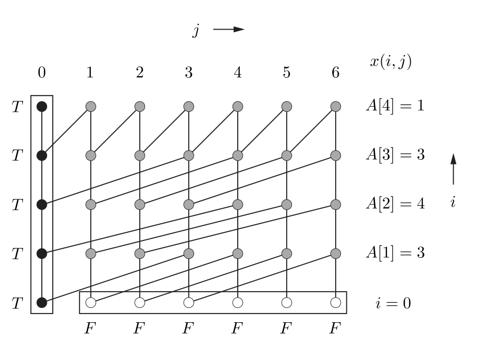
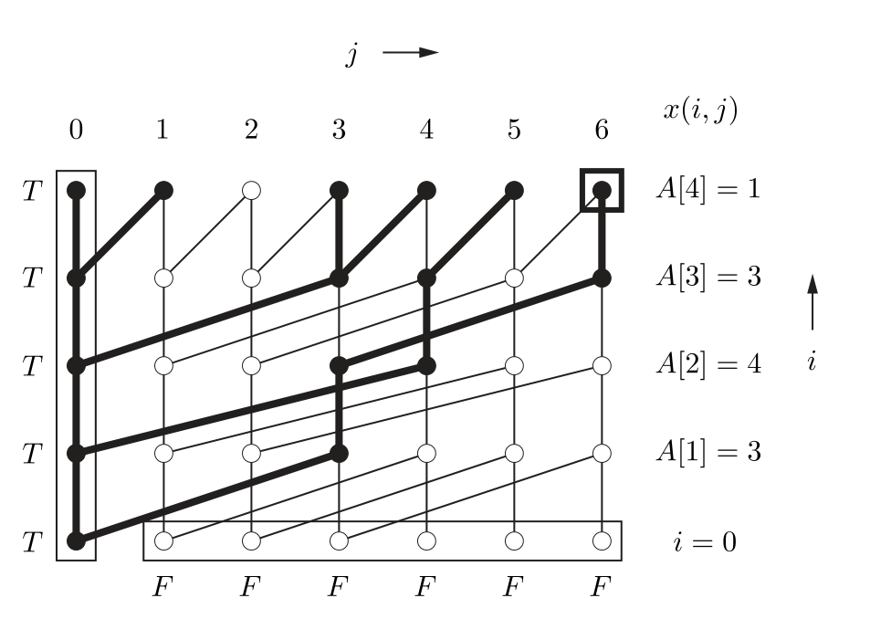
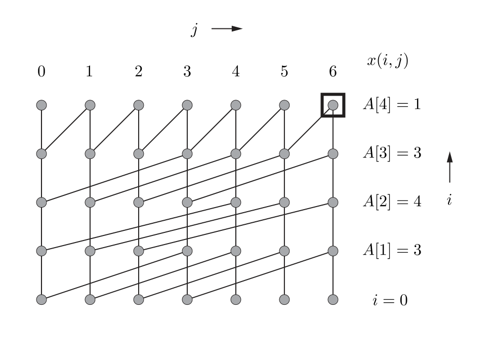
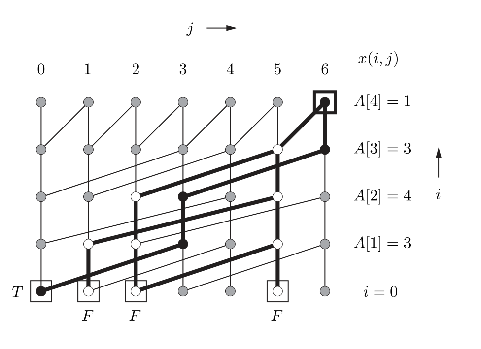
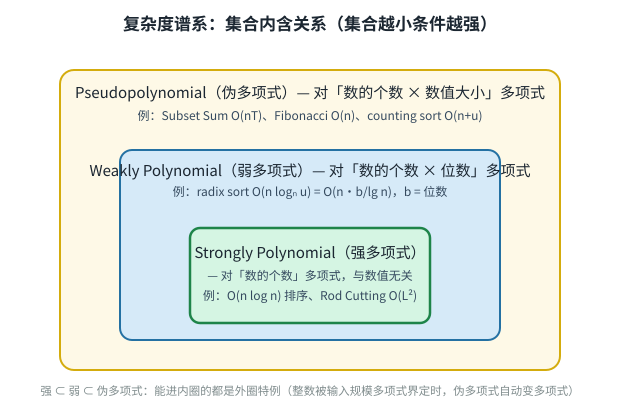

# Introduction to Algorithms: 6.006

## <span style="color:#2471a3;">**[lecture]**</span> <span style="color:#c0392b">Lecture 18: Pseudopolynomial — Rod Cutting, Subset Sum（动态规划第四讲：伪多项式时间——切杆、子集和）</span>

Massachusetts Institute of Technology
Instructors: Erik Demaine, Jason Ku, and Justin Solomon

> <span style="color:#7f8c8d;">MIT 6.006 Spring 2020, Lecture 18 讲义（对应视频：Dynamic Programming, Part 4 — Rods, Subset Sum, Pseudopolynomial）</span>

---

## <span style="color:#2471a3;">**[section]**</span> <span style="color:#c0392b">Dynamic Programming Steps（SRT BOT 六步法回顾）</span>

本讲是 dynamic programming（动态规划）四讲中的**最后一讲**，主题转向一个新的复杂度概念——pseudopolynomial time（伪多项式时间）。🎥 *Demaine 开场点明本讲主线*："This is going to lead us to a new notion called pseudopolynomial time."（翻译：这会把我们引向一个叫伪多项式时间的新概念。） *他随即强调，本课一贯视 polynomial time（多项式时间）为好的运行时间，而 pseudopolynomial（伪多项式）同样是相当不错的运行时间——并预告今天只讲两个新例子 rod cutting（切杆）与 subset sum（子集和），随后从"对角线视角"回顾全课所有 DP 例子。*

先快速回顾 SRT BOT 框架的六步：

**Step 1: Subproblem definition（子问题定义）**——子问题 $x \in X$：

- 用参数描述子问题的含义
- 通常取输入的 subsets（子集）：sequences（序列）的 prefixes（前缀）、suffixes（后缀）、contiguous substrings（连续子串）
- 对多个输入，常取各子集空间的 product（笛卡尔积）
- 常记录 partial state（部分状态）：通过递增辅助变量扩展子问题
- **常取比给定整数更小的整数**（今日焦点）

**Step 2: Relate subproblem solutions recursively（递归关联子问题解）**

```math
x(i) = f(x(j), \ldots) \quad \text{for one or more } j < i
```

- 找出一个关于子问题解的 question（问题）：如果知道它的答案，就能把当前子问题归约为更小的子问题
- 对问题的所有可能答案做 locally brute-force（局部暴力枚举）

**Step 3: Topological order（拓扑序）**——论证递推关系是无环的，子问题构成 DAG（有向无环图）

**Step 4: Base cases（基础情形）**

- 给出所有（可达的）独立子问题的解——递推关系在这些子问题上不再适用

**Step 5: Original problem（原问题）**

- 说明如何从子问题的解计算原问题的解
- 可能要用 parent pointers（父指针）恢复实际方案，而不只是目标函数值

**Step 6: Time analysis（时间分析）**

```math
\sum_{x \in X} \text{work}(x) \quad \text{；若对所有 } x \in X \text{ 有 } \text{work}(x) = O(W)，\text{则总时间为 } |X| \cdot O(W)
```

- $\text{work}(x)$ 度量递推中的非递归工作量；递归调用视为 $O(1)$ 时间

> <span style="color:#7f8c8d;">SRT BOT 框架六步的完整叙述见 L15（lec15-recursive-algorithms.bilingual.md）；子问题扩展专题见 L16/L17。</span>

---

## <span style="color:#2471a3;">**[section]**</span> <span style="color:#c0392b">Rod Cutting（切杆问题）</span>

- **输入**：一根长度为 $L$ 的 rod（杆），以及每段长度 $\ell$ 的价值 $v(\ell)$，对所有 $\ell \in \{1, 2, \ldots, L\}$
- **目标**：切割这根杆，使切出的各段价值之和最大
- **例子**：$L = 7$，$v = [0, 1, 10, 13, 18, 20, 31, 32]$

```text
  ℓ = 0   1    2    3    4    5    6    7
```

- 也许可以贪心地选单位长度价值最高的切法？
- **不行！** $\arg\max_{\ell} v[\ell]/\ell = 6$，而切成 $[6, 1]$ 得到 $32$，并非最优！
- **最优解**：$v[2] + v[2] + v[3] = 10 + 10 + 13 = 33$
- 这是一个在 partition（划分）上的 maximization problem（最大化问题）

### <span style="color:#2471a3;">**[step]**</span> <span style="color:#c0392b">1. Subproblems（子问题）</span>

- $x(\ell)$：切一根长度为 $\ell$ 的杆能得到的最大价值
- 对所有 $\ell \in \{0, 1, \ldots, L\}$

### <span style="color:#2471a3;">**[step]**</span> <span style="color:#c0392b">2. Relate（递推）</span>

- 第一段的长度是某个 $p$（Guess!（猜！））
- $x(\ell) = \max\{v(p) + x(\ell - p) \mid p \in \{1, \ldots, \ell\}\}$
- （画出依赖图）

### <span style="color:#2471a3;">**[step]**</span> <span style="color:#c0392b">3. Topological order（拓扑序）</span>

- 递增的 $\ell$：子问题 $x(\ell)$ 只依赖严格更小的 $\ell$，因此无环

### <span style="color:#2471a3;">**[step]**</span> <span style="color:#c0392b">4. Base（基础情形）</span>

- $x(0) = 0$（长度为 0 的杆没有价值！）

### <span style="color:#2471a3;">**[step]**</span> <span style="color:#c0392b">5. Original problem（原问题）</span>

- 切一根长度为 $L$ 的杆能得到的最大价值就是 $x(L)$
- 存储选择以重构切割方案
- 若当前杆长为 $\ell$、最优选择是 $\ell_0$，则切出的段为 $p = \ell - \ell_0$
- （子问题 DAG 中的最大权路径！）

### <span style="color:#2471a3;">**[step]**</span> <span style="color:#c0392b">6. Time（时间）</span>

- 子问题数：$L + 1$
- 每个子问题的工作量：$O(\ell) = O(L)$
- 运行时间：$O(L^2)$

> <span style="color:#7f8c8d;">CLRS §15.1（Rod Cutting），讲义第 2 页。</span>

---

## <span style="color:#2471a3;">**[section]**</span> <span style="color:#c0392b">这是多项式时间吗？（Is This Polynomial Time?）</span>

- （强）多项式时间（(strongly) polynomial time）意味着：运行时间被输入大小（以 word（机器字）为单位计量）的一个常数次多项式从上方界定
- 在 Rod Cutting 中，输入大小是 $L + 1$ 个 words（一个整数 $L$ 和 $v$ 中的 $L$ 个整数）
- $O(L^2)$ 是 $L + 1$ 的常数次多项式，所以**是的：（强）多项式时间**

> <span style="color:#1e8449;">**[note] Note（译者注）:**</span> 这条注要回答的设计问题是：凭什么说切杆是“强”多项式、而子集和只能叫伪多项式——差别不在算法写法，而在“输入有多大”这把尺子。
>
> 先把尺子立起来。word RAM 模型假设所有被操作的数都装得进一个 machine word（机器字），一次算术算 O(1)，所以输入规模数的是“有多少个数”，不是“这些数有多少位”。切杆的输入是 1 个长度 L 加 L 个价值 v(1) 到 v(L)，共 L+1 个 word，规模 Θ(L)；O(L^2) 就是它的平方，强多项式。子集和的输入是 1 个目标 T 加 n 个数，共 n+1 个 word；T 再大也只算一个数，于是 O(nT) 只是 (n+1) 的某个函数，而 T 可以远大于任何固定的 (n+1)^c。
>
> 算一遍量级。L = 10^6 的杆：状态 L+1 个，每个状态枚举第一段长度 p = 1 到 ℓ，总工作量约 sum ℓ = L(L+1)/2 ≈ 5×10^11 次，按每秒 10^9 次基本操作约 500 秒；输入 10^6+1 个 word，而 5×10^11 差不多就是 (10^6)^2 的一半——表格规模与输入规模的平方同阶。对照子集和：n = 100、T = 2^40 ≈ 1.1×10^12，状态数 101 × 1.1×10^12 ≈ 1.1×10^14 格，按同样速度约 30.6 小时，而输入只有 101 个 word——101^2 才一万出头，表格比“输入的平方”大了十个数量级。这两个数字摆在一起，伪多项式的病灶就看得见了。
>
> 有人会问：那改用比特度量不行吗？可以，而且正是这一步给出“强”的确切含义。在比特模型里，切杆的输入是 L 个各占 Θ(log L) 位的数，规模 Θ(L log L) 位；算法做 Θ(L^2) 次大整数加法，每次 Θ(log L) 位，总计 Θ(L^2 log L) 位操作，比值是 Θ(L)——仍是多项式。所以切杆在两种度量下都合格，这叫强多项式。子集和在比特模型下是 Θ(nT log T)，与输入位数 Θ(n log n + log T) 相比，T = 2^n 时仍是指数——它的“多项式性”完全依赖“数值不算进规模”这一条约定。
>
> 跨课程连接：CSAPP 第 3 章讲 x86-64 的通用寄存器，一个 64 位寄存器能装 0 到 2^64−1，所以“数值大”在硬件上并不增加寄存器的个数，只有超出字长才需要多字表示、模型随之改变。这正是 word RAM 把“数值大小”藏进常数的方式，也是这段复杂度讨论的物理基础。史实补一笔：1950 年 Bellman 在 RAND 公司给这套方法起名 dynamic programming（动态规划），用“programming（规划）”和“dynamic（动态）”两个体面的词，避开当时对 research 一词的反感——他在自传 Eye of the Hurricane（1984）里原话讲过这件事；名字与“动态”无关，也与写代码无关。
>
> 再补一层工程后果，让这个区分有实感。子集和的表格是 (n+1)(T+1) 格，若 T = 2^40，格数约 1.1×10^14。就算每格只存一个 bit（是或否用位图压），也是 1.1×10^14 位，除以 8 约 1.4×10^13 字节，即 13.75 TB——远超任何单机内存，这就是“伪多项式算法在大数实例上不可用”的具体形态。反过来看切杆：L = 10^6 时表格只有 10^6+1 个整数，每个四或八个字节，几 MB 就够。同样被叫“多项式”，一个能跑一个跑不了，差别全部来自那个参数在输入里占几个 word。顺带一提，讲义把背包问题说成切杆与子集和的推广：一旦只允许某些可售长度（而不是每个 ℓ 都有价值），价值数组的 word 数不再随 L 增长，切杆就掉进伪多项式那一档。
>
> 收束：以后判断一个算法的档次，只问一句——它依赖的那个参数，在输入里占几个 word。占 Θ(L) 个就是强多项式，只占 1 个就可能是伪多项式。

```python
# recursive
x = {}
def cut_rod(l, v):
    if l < 1:   return 0                                        # base case
    if l not in x:                                              # check memo
        for piece in range(1, l + 1):                           # try piece
            x_ = v[piece] + cut_rod(l - piece, v)               # recurrence
            if (l not in x) or (x[l] < x_):                     # update memo
                x[l] = x_
    return x[l]
```

```python
# iterative
def cut_rod(L, v):
    x = [0] * (L + 1)                                           # base case
    for l in range(L + 1):                                      # topological order
        for piece in range(1, l + 1):                           # try piece
            x_ = v[piece] + x[l - piece]                        # recurrence
            if x[l] < x_:                                       # update memo
                x[l] = x_
    return x[L]
```

```python
# iterative with parent pointers
def cut_rod_pieces(L, v):
    x = [0] * (L + 1)                                           # base case
    parent = [None] * (L + 1)                                   # parent pointers
    for l in range(1, L + 1):                                   # topological order
        for piece in range(1, l + 1):                           # try piece
            x_ = v[piece] + x[l - piece]                        # recurrence
            if x[l] < x_:                                       # update memo
                x[l] = x_
                parent[l] = l - piece                           # update parent
    l, pieces = L, []
    while parent[l] is not None:                                # walk back through parents
        piece = l - parent[l]
        pieces.append(piece)
        l = parent[l]
    return pieces
```

> <span style="color:#7f8c8d;">三段代码对应讲义第 3 页：recursive（自顶向下 + memoization）、iterative（自底向上）、iterative with parent pointers（自底向上 + 父指针回溯重构切割方案）。</span>

---

## <span style="color:#2471a3;">**[section]**</span> <span style="color:#c0392b">Subset Sum（子集和）</span>

- **输入**：$n$ 个正整数组成的序列 $A = \{a_0, a_1, \ldots, a_{n-1}\}$
- **输出**：是否存在 $A$ 的一个子集恰好和为 $T$？（即是否存在 $A' \subseteq A$ 使得 $\sum_{a \in A'} a = T$？）
- **例子**：$A = (1, 3, 4, 12, 19, 21, 22)$，$T = 47$ 可取 $A' = \{3, 4, 19, 21\}$
- **优化问题？不，是判定问题（decision problem）！** 答案只有 YES（是）或 NO（否），TRUE（真）或 FALSE（假）
- 例中答案是 YES。但对其他一些 $T$（例如 $T = 2, 6, 9, 10, 11, \ldots$），答案则是 NO

### <span style="color:#2471a3;">**[step]**</span> <span style="color:#c0392b">1. Subproblems（子问题）</span>

- $x(i, t)$ = $A[i:]$ 的某个子集能否恰好和为 $t$？
- 对所有 $i \in \{0, 1, \ldots, n\}$，$t \in \{0, 1, \ldots, T\}$

### <span style="color:#2471a3;">**[step]**</span> <span style="color:#c0392b">2. Relate（递推）</span>

- **思路**：第一个元素 $a_i$ 在不在一个合法子集 $A'$ 里？（Guess!（猜！））
- 若在，则用剩余元素凑出 $t - a_i \ge 0$
- 若不在，则用剩余元素凑出 $t$

```math
x(i, t) = \text{OR} \begin{cases} x(i + 1, t - A[i]) & \text{if } t \ge A[i] \\ x(i + 1, t) & \text{always} \end{cases}
```

### <span style="color:#2471a3;">**[step]**</span> <span style="color:#c0392b">3. Topological order（拓扑序）</span>

- 子问题 $x(i, t)$ 只依赖严格更大的 $i$，所以无环
- 按递减的 $i$ 求解

### <span style="color:#2471a3;">**[step]**</span> <span style="color:#c0392b">4. Base（基础情形）</span>

- $x(i, 0) = \text{YES}$，对所有 $i \in \{0, \ldots, n\}$（空间被恰好装满！）
- $x(n, t) = \text{NO}$，对所有 $t \in \{1, \ldots, T\}$（没有剩余元素可装）

### <span style="color:#2471a3;">**[step]**</span> <span style="color:#c0392b">5. Original problem（原问题）</span>

- 原问题由 $x(0, T)$ 给出
- **例子**：$A = (3, 4, 3, 1)$，$T = 6$ 的解：$A' = (3, 3)$
- Bottom-up（自底向上）：求解全部子问题（该例有 35 个）
- **Top-down（自顶向下）**：只求解可达的子问题（该例只有 14 个！）



**图 5-1**：网格是 $(n+1)(T+1)=5\times 7=35$ 格，横轴 $j$ 是目标容量 $t$，纵轴 $i$ 是后缀起点（顶行 $A[4]=1$、底行 $i=0$ 表示没有元素可用）。35 格里只有 11 格是基态——$t=0$ 那一列的 5 格全部实心（YES，「空间恰好装满」），$i=0$ 那一行除交点外的 6 格全部空心圈（NO，「没有元素可装」）。剩下 $35-11=24$ 格才是递推真正要填的，细斜线是依赖边 $x(i,t)\to x(i+1,t)$ 与 $x(i,t)\to x(i+1,t-a_i)$。*The table has $(n+1)(T+1)=35$ cells, but 11 of them are already base cases: five fill the $t=0$ column with YES and six fill the $i=0$ row with NO, leaving 24 cells for the recurrence.*



**图 5-2**：这一张仍然解同一个实例，区别在于把「被递推真正读到」的格子用粗点和粗线描了出来：加粗部分只覆盖网格的一小片，其余格子以细灰点留在原处。也就是说，表格的**存在**是满的，被**用到**的却不到一半——这个差值正是紧接着 top-down 段要兑现的 $35-14=21$ 格。*Bottom-up still fills all 35 cells, yet only a thin band is traced in bold: being present in the table and being reached by the recurrence are two different sets.*



**图 5-3**：top-down 第一次调用时，整张表只有一个格子被加框（$j=6$ 与最上面一行的交点，即原问题 $x(0,T)$ 的入口），其余格子全是灰点且没有任何 T/F 标记——因为此时一个子问题都还没展开。这张图说明 memoization 的起点必须是**单个状态**，而不是整张表。*Top-down starts from one boxed cell at $j=T$; every other cell is unexpanded and unlabelled, so the recursion begins from a single state rather than a whole table.*



**图 5-4**：从入口沿递推展开后，加粗的格子仍然只占网格的一小部分；最底一行上留了 1 个 T 方框和 3 个 F 方框，它们是途中撞上的 $i=0$ 基态——命中即停，不再往下展开。所以 top-down 的复杂度不是「表有多大」，而是「从入口能走到多少格」：同一实例 $35\to 14$ 的差距，全部来自这里。*After expansion the bold cells still cover only a corner of the grid, and the three $F$ plus one $T$ boxes on the bottom row are base cases hit and stopped at: top-down pays for reachable states, not for table size.*

### <span style="color:#2471a3;">**[step]**</span> <span style="color:#c0392b">6. Time（时间）</span>

- 子问题数：$O(nT)$，每个子问题 $O(1)$ 工作量
- 总时间：$O(nT)$

> <span style="color:#1e8449;">**[note] Note（译者注）:**</span> 这条注要回答的是：同一个实例，bottom-up 填 35 格、top-down 只碰 14 格，这个差为什么是结构性的，而不是常数因子或实现细节。
>
> 机制从依赖边看起。递推是 x(i,t) = x(i+1,t) 或 x(i+1,t−a_i)，两条边都让 i 加 1，t 要么不变要么减去 a_i。于是从入口 (0,6) 出发，任何一条路径上的 t 都形如“6 减去 A 某个子集的和”，i 单调增。A = (3,4,3,1) 能凑出的和很少，所以可达的 t 只有少数几个值，大量“中间值配某个后缀”的组合根本没有路径能走到——这就是 21 格永远空着的原因。
>
> 实测一遍更清楚：从 (0,6) 递归展开，可达状态共 15 个，其中 (3,0) 落在 t = 0 的基态上，命中即返回 YES、不再继续展开，剩下 14 个才是递推真正要解的格。35 − 14 = 21。把 T 从 6 提到 7，表格变成 5 × 8 = 40 格，可达状态 19 个、其中 18 个进递推——比例几乎没变，这说明“可达比例”由 A 的组合结构决定，与 T 的大小关系不大。
>
> 为什么两者的开销差恰好等于不可达格数？因为 top-down 的 memo 只在首次遇到某状态时展开它，之后命中即 O(1) 返回；bottom-up 按拓扑序无差别填满每一格，每格都付一次 O(1)。两者最坏情况同为 O(nT)，实际时间的差就是“不可达格数 × 每格工作量”，没有别的来源。这也解释了为什么理论上界相同、实测可以差一倍以上。
>
> 跨课程连接一：6.042J 的图论。可达集就是从源点出发的可达闭包，top-down 相当于在子问题 DAG 上从入口做一次深度优先搜索；区别在于 DP 还要求“访问时子问题的值已经算好”，所以必须按拓扑序回填，而普通 DFS 只记录“到过没到过”。跨课程连接二：CSAPP 第 6 章 cache（缓存）的 working set（工作集）——程序真正反复访问的地址集合往往远小于它分配的地址空间，性能由工作集决定，而不是由虚拟地址空间大小决定；DP 的可达状态就是它的工作集。区别是 cache 的工作集靠测量或 profiling 估计，DP 的工作集由递推式精确决定，可以提前算出来。
>
> 视频里对这个差别有一句提纲挈领的话：🎥 *Demaine*："Because we are using memoization, we only compute each subproblem once. So without memoization, this would take exponential time, just like Fibonacci."（翻译：因为我们用了记忆化，每个子问题只算一次；没有记忆化的话，这会是指数时间，就像 Fibonacci 一样。）这句把两件事捆在了一起：memo 解决的是“重复计算”，而“可达性”解决的是“根本不存在的计算”——本注讨论的 21 格属于后者，memo 管不到它，只有 top-down 的展开顺序能省掉它。
>
> 还有一个实用推论：可达状态数可以用两头夹。下界是“至少有 n+1 个”（i 从 0 到 n 各一个），上界是 min((n+1)(T+1), 2^n 种 A 的子集和 × (n+1))。若 A 的元素取 1、2、4、8 这类二进制权，子集和几乎铺满整个区间，可达比例接近 1，top-down 与 bottom-up 几乎打平；若 A 的元素都很大且彼此接近，子集和稀疏，top-down 明显占优。所以“top-down 更快”不是普适结论，它依赖 A 的数值结构——先把这两个极端想清楚，再判断手里这个实例落在哪边，比背口诀可靠。
>
> 最后一点教学意义：35 与 14 这个差把第六步的公式从符号变成可数的东西。公式里的 X 不是“所有形式合法的子问题”，而是“实际被求解的子问题”；前者是设计时的上界，后者是运行时的真实集合。把这两个集合分开记，时间分析才不会变成空话——先用上界证最坏情况，再用可达性解释实测为什么更快。
>
> 收束：在写代码之前先估“从入口能走到多少格”。稀疏就 top-down，稠密就 bottom-up；这一步估计花五分钟，能省掉一半的运行时间。

---

## <span style="color:#2471a3;">**[section]**</span> <span style="color:#c0392b">这是多项式时间吗？（Is This Polynomial?）</span>

- 输入大小是 $n + 1$：一个整数 $T$ 和 $A$ 中的 $n$ 个整数
- $O(nT)$ 能被 $n + 1$ 的多项式界定吗？**不能**，不一定
- 在 $w$-bit word RAM 上，$T \le 2^w$ 且 $w \ge \lg(n + 1)$，但我们对 $w$ 没有上界
- 例如 $w = n$ 并非不合理，但那样运行时间就是 $O(n \cdot 2^n)$——指数级！

> <span style="color:#1e8449;">**[note] Note（译者注）:**</span> 这条注要回答的是：同一个数 T，用 binary（二进制）写让 O(nT) 变成指数级，用 unary（一元）写却是多项式——变量究竟在哪里。
>
> 机制只有一句：输入规模的度量是“描述输入需要多少符号”。binary 下一个 T 占 ceil(log2(T+1)) 位；unary 下占 T 个符号，也就是 T 个 1，两者相差 T/log2 T 倍。而 DP 表格占 O(nT) 格，与 T 的数值成正比。于是 binary 编码下，输入只给了 log2 T 位信息，表格却要 T 格，表格相对输入是指数膨胀；unary 编码下输入本身就有 T 个符号，表格反而是输入规模的多项式。算法一行没改，改的只是“输入多大”这把尺子。
>
> 算个数：T = 10^6 时 binary 占 20 位，unary 占 10^6 个符号，比值 50,000。若 n = 100，表格是 101 × (10^6+1) ≈ 10^8 格；binary 输入约 101 个 word（其中 T 只贡献 20 位），unary 输入约 10^6+100 个符号——后者与表格同阶，前者差五个数量级。这就是“同一个算法在两套编码下跨类”的全部算术。
>
> 这一页的核心论断在视频里有原话：🎥 *Demaine*："Our assumption is always that w is at least log n, that is the word-RAM trans-dichotomous assumption. But notice, we do not know anything about an upper bound on w."（翻译：我们的假设总是字长至少是 log n，这就是 word-RAM 的跨二分假设；但注意，我们对 w 的上界一无所知。）下界保证地址够用，上界缺失才让 T 可以大到指数——两个半句缺一不可。
>
> 再把它接到本讲那一页的 w 上：T ≤ 2^w − 1（超出就要多字表示，模型改掉），且 w ≥ log2(n+1)——至少要能用地址区分 n+1 个位置，所以字长至少是 log 量级。这就是 trans-dichotomous assumption（跨二分假设），由 Fredman 与 Willard 在 1990 年提出，名字来自“机器字长与问题规模之间的二分”：模型强行让两者同量级。但注意，w 只有下界没有上界：取 w = n 完全允许，于是 T 可达 2^n，nT = n·2^n，对规模 n+1 是指数。
>
> 跨课程连接一：CSAPP 第 2 章 整数的位级表示。同一个整数在不同编码下占的位数不同（32 位补码 vs 一元的“重量”），信息量由位数决定，不由数值决定；这解释了为什么“T 很大”本身不是问题，“T 很大而只给 20 位”才是问题。跨课程连接二：Cover 的信息论。描述一个整数 T 最少需要 log2 T 比特——这是它的信息量下界，binary 已经到达量级，所以 binary 是“压缩过的输入”，unary 是“未压缩的输入”。区别在于：信息论给的是可压缩性下界，与算法无关；这里要说的是复杂度类的归属依赖输入编码，而信息量不依赖。
>
> 再补一个常被忽略的事实：编码不只影响复杂度归类，也影响你写出来的代码。若输入用 binary 而 T 很大，你不可能真的开一个 T 大小的数组，只能改用 dictionary（字典）只存算过的 t，这时表格就从“按数值大小分配”变成“按可达状态数分配”，实际内存降到与可达状态成正比。也就是说，编码决定算法属于哪一类，实现技巧决定这一类算法在你的机器上能不能跑起来，两者不能混为一谈。另外，unary 编码在现实里长这样：把 T 写成 T 个 1，等价于“把数值摊成物理长度”，像用一根长 T 厘米的尺子表示 T；理论证明里用它来说明“弱 NP 完全在 unary 下退化为多项式”，工程上没人这么存数据，因为存储成本变成数值本身的线性函数，而不是它的对数。
>
> 收束：记住这句话——伪多项式的“伪”指的是编码，不是算法。把输入换成 unary，同一个 O(nT) 立刻变成真多项式；这也正是为什么数值型问题的 NP 完全性被叫作“弱”的。

---

## <span style="color:#2471a3;">**[section]**</span> <span style="color:#c0392b">Pseudopolynomial（伪多项式）</span>

- 算法具有 pseudopolynomial time（伪多项式时间）：运行时间被「输入大小与输入整数值」的一个常数次多项式从上方界定
- 当整数在输入大小的多项式范围内（即 $n^{O(1)}$）时，这类算法就是多项式的——这正是 Radix Sort（基数排序）能以 $O(n)$ 时间运行的那个条件
- Counting sort（计数排序）$O(n + u)$、radix sort $O(n \log_n u)$、direct-access array（直接寻址数组）构建 $O(n + u)$、Fibonacci $O(n)$——都是我们已经见过的 pseudopolynomial 算法
- Radix sort 实际上是 **weakly polynomial（弱多项式）**（介于强多项式与伪多项式之间的概念）：运行时间被输入大小（以 bits（比特）计量，即输入整数的对数）的一个常数次多项式界定
- 与 Rod Cutting（是多项式的）对比：
  - 它对 $L$ 有伪多项式依赖
  - 但幸好输入里也有 $\ge L$ 个整数
  - 若只给可售杆长的子集（即 **Knapsack Problem（背包问题）**，它推广了 Rod Cutting 与 Subset Sum——见 recitation（习题课）），那么算法就只能是伪多项式的

> <span style="color:#1e8449;">**[note] Note（译者注）:**</span> 这条注要把三个名字摆成一条链，并说清它们各自“依赖输入里的什么信息”，因为这才是分层真正的依据。
>
> 先说机制。强多项式要求运行时间是“输入中数的个数”的多项式，与数值大小无关；伪多项式允许运行时间是“数的个数 × 数值大小”的多项式；弱多项式夹在中间，要求运行时间是“输入总位数”的多项式。三者按条件强弱排序，条件越强算法类越小，于是形成嵌套：强多项式在最里圈，伪多项式在最外圈，中间是弱多项式。记住这条链的关键不是背名字，而是记住“依赖的信息越少，类越靠内”。
>
> 用基数排序验证一遍。运行时间是 O(n log_n u)，其中 u 是最大整数。设 b 为 u 的位数，则 log_n u 等于 b 除以 log2 n。取 n = 10^6、u = 2^32，则 b = 32、log2 n ≈ 19.93，商约 1.605，总工作量约 1.6×10^6 次分配，量级和 n 本身相同。若 u 只有 2^20，商降到约 1.003，工作量几乎就是 n。可见这个算法对 u 的依赖只是 u 的位数，而不是 u 的数值——这正是“弱”的含义。
>
> 对比一下“真依赖数值”会是什么样。假设有个算法需要 u 次操作，而 u = 2^32 ≈ 4.3×10^9，那就是四十多亿次，比 n 大三个数量级；u 再翻一倍，时间也翻一倍。弱多项式算法不会这样，因为它对 u 只取对数。这个差别在工程上极重要：对数增长几乎等于常数，所以基数排序在实践中被当成线性排序，而伪多项式算法在大数输入上直接不可用。
>
> 有一个容易踩的证明细节：为什么“商掉一个 log n 因子”不破坏多项式性。多项式的定义对常数因子和低阶项都不敏感，n 乘以 b 再除以 log2 n，仍然是 n 与 b 的多项式（两个变量的多项式），因为除以 log2 n 至多等于乘以一个常数（当 n ≥ 2 时 log2 n ≥ 1）。要小心的是别把它误读成“对 u 多项式”——b 只是 u 的对数，不是 u。判断时只问一句：表达式里出现的是 u 本身，还是 u 的位数。
>
> 跨课程连接一：CSAPP 第 6 章 的存储层次。寄存器、L1、L2、主存、磁盘排成金字塔，越靠内越快也越小，性能由“访问落在哪一层”决定；复杂度谱系也是嵌套结构，越靠内条件越严、包含的算法越少。区别是存储层次的嵌套来自物理容量与延迟的权衡，而谱系的嵌套来自数学定义的条件强弱，与硬件无关。跨课程连接二：6.042J 的集合包含关系。三个类满足传递性，所以可以画成同心圈，且任一具体算法的运行时间表达式一旦满足内圈条件，就自动满足外圈条件——这让你可以用“最内圈”的说法一次说清它的档次。
>
> 再补一句本课语境的限定：这门课的主轴只有两档，强多项式与伪多项式，讲“多项式”时通常指强多项式；弱多项式只在基数排序处顺带出现，知道它夹在中间、且差别只在“对整数取对数”就够了，不必为它单独建一套直觉。
>
> 收束：看到一个新的界，先问它依赖的是数的个数、数的位数，还是数的数值。答案决定它落在三层里的哪一层，也决定这段代码能不能在真实数据上跑完。
> <span style="color:#7f8c8d;">谱系嵌套示意（自绘）：强多项式 ⊂ 弱多项式 ⊂ 伪多项式——内圈算法的运行时间只依赖更少的信息（数的个数 → 位数 → 数值）。</span>


---

## <span style="color:#2471a3;">**[section]**</span> <span style="color:#c0392b">Complexity（复杂度）</span>

- 当整数不被多项式界定时，Subset Sum 能在多项式时间内求解吗？
- **若 $P \ne NP$，则不能。** 这意味着什么？下节课分解！

> <span style="color:#1e8449;">**[note] Note（译者注）:**</span> 这条注要把子集和从“一个有点慢的动态规划”升格为计算复杂性理论的主角，并把“为什么难”精确定位到数值上。
>
> 先把三个名词的定义压实。一个问题属于 NP，意思是它的每个答案为是的实例都带一个多项式长度的证据，且验证这个证据只需多项式时间；对子集和来说，证据就是那个和恰好等于 T 的子集，验证只是把它加起来比对，线性时间就够。注意 NP 说的是“验证容易”，与“求解难易”无关。一个问题属于 NP-hard，意思是所有 NP 问题都能在多项式时间内归约到它；归约就是把别的实例改写成它的实例、保持答案不变，于是快速解它等于快速解一切 NP 问题。既是 NP 又是 NP-hard，就叫 NP-complete。
>
> 把难的来源量化。若 T = 2^50 ≈ 1.126×10^15、n = 100，表格有约 1.126×10^17 格；按每秒十亿次估，需要约 1.126×10^8 秒，折合约 3.57 年。同一个 n 若把 T 压到 10^6，表格只有约 10^8 格，零点几秒就跑完。可见“难”不是来自元素个数，而是来自目标值的量级——这也是为什么同一个问题在小额输入上是容易的。
>
> 这就引出弱与强的分野。只要 T 被 n 的多项式界定，O(nT) 立刻落进多项式，问题不难；困难完全来自可能指数大的 T。这类问题叫 weakly NP-complete（弱 NP 完全），与之相对的是 3-SAT、哈密顿回路这类组合型 NP 完全问题：它们的困难不依赖大数编码，即使把输入写成 unary 也依然难。反过来，子集和与背包在 unary 编码下立即退化为多项式——因为那时 T 在输入里占了 T 个符号，表格成了输入规模的多项式。
>
> 顺带把判定版与优化版的关系说清。讲义用的是判定版，因为 NP 这个类只对是或否的问题定义；优化版就是找出那个子集，叫它的 search 版本，难度不低于判定版。反方向也成立：给定一个判定 oracle（判定器），用 self-reducibility（自归约）逐项锁定——依次问“若取走 a_i，余下元素能否凑出剩余目标”，能则 a_i 不在解中，否则在，n 次查询就能重构。这里不能对 T 做二分，因为“恰好等于”没有单调性，折半搜索无从下手。
>
> 跨课程连接：6.042J 的偏序与等价关系。多项式归约是一个 preorder（预序）：自反、传递，但不要求对称；所以它把问题排成一张有向的偏序网，而不是等价类。NP-complete 恰好是 NP 内部互相归约所形成的等价类——在这个类里任取两个问题，彼此都能归约。把“归约”理解成偏序关系而不是“相等”，你就不会把 NP-hard 与 NP-complete 混为一谈：前者只要“所有 NP 都能到我”，后者还要求“我自己也在 NP 里”。
>
> 史实补一笔：1971 年 Cook 证明了可满足性问题 NP 完全，1972 年 Karp 在论文 Reducibility Among Combinatorial Problems 里用归约把这一结论扩散到二十一个问题，子集和与背包都在其中，从此“NP 完全”成为描述组合难题的通用语言。这里不堆年表，只记两个名字与一次扩散：一个起点，一次批量。
>
> 收束：本讲标题里的“伪”不是贬义，它精确描述了“对数值多项式、对位数指数”这种错位；理解了这层错位，你就能一眼看出哪些问题在大数输入上注定跑不完。

---

## <span style="color:#2471a3;">**[section]**</span> <span style="color:#c0392b">Main Features of Dynamic Programs（动态规划的主要特征）</span>

- 回顾本课讲过的例子

### <span style="color:#2471a3;">**[sub]**</span> <span style="color:#c0392b">Subproblems（子问题）</span>

- **Prefix/suffix（前缀/后缀）**：Bowling（保龄球）、LCS、LIS、Floyd–Warshall、Rod Cutting（碰巧，实际上是整数子问题）、Subset Sum
- **Substrings（子串）**：Alternating Coin Game（交替取硬币）、Arithmetic Parenthesization（算术括号化）
- **Multiple sequences（多序列）**：LCS
- **Integers（整数）**：Fibonacci、Rod Cutting、Subset Sum
  - *Pseudopolynomial（伪多项式）：Fibonacci、Subset Sum*
- **Vertices（顶点）**：DAG shortest paths（DAG 最短路径）、Bellman–Ford、Floyd–Warshall

### <span style="color:#2471a3;">**[sub]**</span> <span style="color:#c0392b">Subproblem constraints/expansion（子问题约束与扩展）</span>

- **Nonexpansive constraint（不扩展的约束）**：LIS（是否包含第一个元素）
- **2× expansion（2 倍扩展）**：Alternating Coin Game（谁先手？）、Arithmetic Parenthesization（min/max）
- **$\Theta(1)\times$ expansion（常数倍扩展）**：Piano Fingering（第一根手指的指派）
- **$\Theta(n)\times$ expansion（$n$ 倍扩展）**：Bellman–Ford（边数）

### <span style="color:#2471a3;">**[sub]**</span> <span style="color:#c0392b">Relation（递推）</span>

- **Branching（分支数）** = 每个子问题依赖的子问题个数
- **$\Theta(1)$ branching（常数分支）**：Fibonacci、Bowling、LCS、Alternating Coin Game、Floyd–Warshall、Subset Sum
- **$\Theta(\text{degree})$ branching（度分支，$|E|$ 进入运行时间的来源）**：DAG shortest paths、Bellman–Ford
- **$\Theta(n)$ branching（线性分支）**：LIS、Arithmetic Parenthesization、Rod Cutting
- **组合多个解**（而非子问题 DAG 中的一条路径）：Fibonacci、Floyd–Warshall、Arithmetic Parenthesization

### <span style="color:#2471a3;">**[sub]**</span> <span style="color:#c0392b">Original problem（原问题）</span>

- **组合多个子问题**：DAG shortest paths、Bellman–Ford、Floyd–Warshall、LIS、Piano Fingering

> <span style="color:#1e8449;">**[note] Note（译者注）:**</span> 这条注要把最后那张“对角线总结”读成一张设计准则表，而不是一份复习清单。
>
> 表有四行，每行是一个设计自由度，合起来构成对 DP 的坐标系。先看子问题的载体，它直接决定复杂度量级：前缀或后缀给 Θ(n) 个状态，连续子串给 Θ(n^2) 个，两条序列做笛卡尔积至少 Θ(n^2)，顶点做子问题则得到 Θ(V) 个状态但要乘上每条边的分支。判断顺序应该是先看输入是什么形状（序列、序列对、图），再决定子问题取什么——反过来先想递推、再被迫改子问题，通常要返工。
>
> 第二行是“整数做子问题”这个信号。以更小的整数为参数，表格就随数值增长，于是自动落进伪多项式。举个数：切杆 L = 1000 时状态 1001 个，每个状态平均枚举 500 个切点，总工作量约 500,500 次，正好是 L(L+1)/2。Fibonacci 也属这一档：输入只有一个 n，占 log2 n 位，而算法要 n 步，对位数是指数的，所以它和子集和一样只能算伪多项式——这一点极易误读，很多人以为“线性时间”就等于“强多项式”。
>
> 第三行是分支数。它等于每个子问题要猜几个选择，直接乘进每格的工作量：常数分支是猜一个二选一，转移 O(1)；度分支是猜下一条边，累计出边数，这就是图算法里出现 |E| 的原因；线性分支是猜第一个元素、切点或运算符位置，转移 O(n)。切杆与 LIS 都属于线性分支，都是 n 个候选。设计时想压缩时间，最有效的动作往往就是把分支数从 n 降到常数——而那通常要求你先找到更强的结构信息。
>
> 第四行是“取一个”还是“拼两个”。取一条最优路径的情形（最短路类）只需在 DAG 上选一条；需要把两个子问题的解拼接起来的则必须做组合运算，例如 Fibonacci 相加、Floyd–Warshall 拼两条路径、括号化把两半乘或加。判断口诀很实用：看递推式的右端是“在若干候选里选一个”，还是“把两个已解的值合起来”——前者在图上找路径，后者在表达式树上做合并。
>
> 跨课程连接：Strang 的线性代数里，一个线性映射被四个子空间（列空间、零空间、行空间、左零空间）完整描述，四个子空间的维数满足秩加零化度等于 n，这组坐标把“这个映射长什么样”说尽了；这张 DP 总结表起的是同类作用，四个维度把“这个动态规划长什么样”说尽。区别在于子空间分解是精确的线性代数定理，这四个维度只是设计经验的坐标，没有维数守恒那样的硬约束，但正因为它是经验坐标，遇到新问题时可以照着一格格填。
>
> 还有一个反直觉的观察值得记住：这张表里没有“时间复杂度”这一行。这不是疏漏，而是因为时间完全由前几行推出——状态数乘以分支数就是时间，不需要单独记。反过来，如果你在分析一个新算法时发现“说不清复杂度”，八成是某一行没想清楚，尤其是分支数。
>
> 收束：把这张表当成四个问题清单——输入是什么形状、参数是不是整数、每格要猜几个、最后是选一个还是拼两个。四问答完，SRT BOT 的六步基本就填好了。

---

> <span style="color:#7f8c8d;">MIT OpenCourseWare — 6.006 Introduction to Algorithms, Spring 2020. Lecture 18 讲义翻译版。原文：https://ocw.mit.edu（Terms of Use 见 https://ocw.mit.edu/terms）</span>
