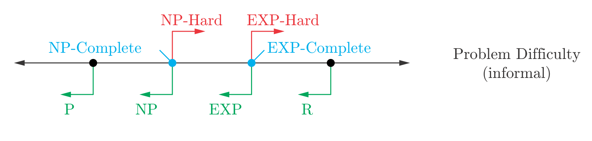

# Introduction to Algorithms: 6.006（算法导论）

Massachusetts Institute of Technology（麻省理工学院）
Instructors（授课教师）: Erik Demaine（埃里克·德梅因）, Jason Ku（顾杰森）, and Justin Solomon（贾斯汀·所罗门）

## **[recitation]** Recitation 19: Complexity（习题课 19：复杂度）

> 源文件 `r19.pdf` 共 5 页（第 1–4 页为讲义正文，第 5 页为版权页）；原文为 MIT 6.006 Spring 2020（2020 年春季）的 Recitation 19（习题课 19）讲义。本译含 5 个页标记（p001–p005）、1 张原书插图（第 4 页的 problem difficulty（问题难度）示意图，已 base64 内嵌）、4 张原表。

> **[note] Note（译者注）:**
>
> 原文第 2–4 页的页眉印作 “Recitation 20: Complexity”，与正文标题 “Recitation 19” 不一致；这是源文件自身的排版错误，本译按原样保留并在对应页标记处注明。原文正文只有讲义式要点与表格，不含任何解答；因此本译不补任何解答内容，也不从别的材料搬解答进来。

<!-- ===== p001 ===== -->

### **[topic]** 0-1 Knapsack Revisited（重访 0-1 背包）

> 源 PDF p.1，Recitation 19（习题课 19）第一节

- **0-1 Knapsack（0-1 背包）**
  – Input（输入）: 一个 volume（容量）为 $S$ 的 knapsack（背包），想用 items（物品）把它装满。
  – 第 $i$ 个 item（物品）有 size（大小）$s_i$ 与 value（价值）$v_i$。
  – Output（输出）: 一个 items（物品）的 subset（子集）（每个 item（物品）可取 0 个或 1 个），满足 $\sum s_i \le S$，并最大化 $\sum v_i$。
  – 该 problem（问题）可以用 dynamic programming（动态规划）在 $O(nS)$ 时间内求解。
- **How does running time compare to input?（运行时间与输入规模相比如何？）**
  – input（输入）的 size（规模）是什么？若数字以 binary（二进制）写出，则 input（输入）的 size（规模）为 $O(n \log S)$ bits（位）。
  – 那么相对于 input（输入），$O(nS)$ 就是 exponential time（指数时间）。
  – 若数字是 polynomially bounded（多项式有界）的，即 $S = n^{O(1)}$，那么该 dynamic program（动态规划）就是 polynomial（多项式）的。〔原抽取串：`S = nO(1)`；上标遗失，按含义重建为 $n^{O(1)}$〕
  – 这种算法称为 pseudopolynomial time algorithm（伪多项式时间算法）。
- 当数字不是 polynomially bounded（多项式有界）时，0-1 Knapsack（0-1 背包）是否能在 polynomial time（多项式时间）内求解？
- 若 $P$（多项式时间类）$\ne NP$（非确定性多项式时间类），则不能。〔原抽取串：`No if P 6= NP`；`6=` 是 $\ne$ 的错抽〕
- 这是什么意思？（更多 Computational Complexity（计算复杂度）见 6.045 与 6.046。）

<!-- ===== p002 ===== -->

> （本页页眉原文：`Recitation 20: Complexity` —— 源文件页眉编号错误，照实保留）

### **[topic]** Decision Problems（判定问题）

> 源 PDF p.1 末至 p.2，Recitation 19（习题课 19）第二节；表格 7 行

- **Decision problem（判定问题）**: 把 input（输入）指派为 No（否，$0$）或 Yes（是，$1$）。
- input（输入）要么是 No instance（否实例），要么是 Yes instance（是实例），即 satisfying instance（可满足实例）。

| Problem（问题） | Decision（判定形式） |
| --- | --- |
| s-t Shortest Path（s-t 最短路径） | 给定的 $G$ 是否含一条从 $s$ 到 $t$、weight（权重）至多 $d$ 的 path（路径）？ |
| Negative Cycle（负环） | 给定的 $G$ 是否含一个负 weight（权重）的 cycle（环）？ |
| Longest Path（最长路径） | 给定的 $G$ 是否含一条 weight（权重）至少 $d$ 的 simple path（简单路径）？ |
| Subset Sum（子集和） | 给定的整数集合 $A$ 是否含一个和为 $S$ 的 subset（子集）？ |
| Tetris（俄罗斯方块） | 对给定的一串 pieces（方块），你能否存活？ |
| Chess（国际象棋） | 给定棋盘下，某位玩家能否强制获胜？ |
| Halting problem（停机问题） | 给定的 computer program（计算机程序）是否对给定的 input（输入）终止？ |

- **Algorithm/Program（算法/程序）**: 一段长度固定的 code（代码）（运行在 word（字）为 $\Omega(\log n)$ bits（位）的 word-RAM（字随机存取机）上），用来解决一个 problem（问题），即它对每一个 input（输入）都产出正确的 output（输出），且 code（代码）长度与 instance size（实例规模）无关。
- 若存在一个 program（程序）能在 finite time（有限时间）内解决该 problem（问题），则称该 problem（问题）是 decidable（可判定的）。

### **[topic]** Decidability（可判定性）

> 源 PDF p.2，Recitation 19（习题课 19）第三节

- program（程序）是有限的 bit string（位串），而 problem（问题）是函数 $p : \mathbb{N} \to \{0, 1\}$，即无限的 bit string（位串）。
- 于是（# of programs（程序的数量）$= |\mathbb{N}|$，countably infinite（可数无穷））$\ll$（# of problems（问题的数量）$= |\mathbb{R}|$，uncountably infinite（不可数无穷））。〔原抽取串：`(# of programs |N|, countably infinite)  (# of problems |R|, uncountably infinite)`；两个括号之间丢失的字符按含义重建为 $\ll$〕
- 这一点用 Cantor's diagonal argument（康托对角线论证）证明，大概在 6.042 里讲过。
- 它证明了：绝大多数 decision problem（判定问题）无法被任何 program（程序）求解，即 undecidable（不可判定）。
- 例如 Halting problem（停机问题）就是 undecidable（不可判定）的，6.045 里有许多非常漂亮的证明。
- 幸运的是，我们能想到的绝大多数 problem（问题）在结构上都是 algorithmic（可算法化的），因此都是 decidable（可判定的）。

### **[topic]** Decidable Problem Classes（可判定的问题类）

> 源 PDF p.2，Recitation 19（习题课 19）第四节；表格 3 行

| Class（类） | Definition（定义） | Remark（备注） |
| --- | --- | --- |
| R（递归语言类） | 可在 finite time（有限时间）内判定的一类 problem（问题） | ‘R’ 来自 recursive language（递归语言） |
| EXP（指数时间类） | 可在 exponential time（指数时间）$2^{n^{O(1)}}$ 内判定的一类 problem（问题） | 我们能想到的绝大多数 problem（问题）都在这里 |
| P（多项式时间类） | 可在 polynomial time（多项式时间）$n^{O(1)}$ 内判定的一类 problem（问题） | efficient algorithm（高效算法），也就是本课的重点 |

- 这三个集合互不相等，即 $P \subset EXP \subset R$，依据是 time hierarchy theorem（时间层级定理），见 6.045。〔原抽取串：`P ( EXP ( R`；其中的 `(` 是 $\subset$ 的错抽〕

<!-- ===== p003 ===== -->

> （本页页眉原文：`Recitation 20: Complexity` —— 源文件页眉编号错误，照实保留）

### **[topic]** Nondeterministic Polynomial Time (NP)（非确定性多项式时间）

> 源 PDF p.2 末至 p.3，Recitation 19（习题课 19）第五节；表格 5 行

- $P$（多项式时间类）是这样一类 decision problem（判定问题）的集合：存在一个 algorithm（算法）$A$，使得对每一个 size（规模）为 $n$ 的 instance（实例）$I$，$A$ 在 $I$ 上以 $poly(n)$ 时间运行并正确解决 $I$。
- $NP$（非确定性多项式时间类）是这样一类 decision problem（判定问题）的集合：存在一个 algorithm（算法）$V$，称为 “verifier（验证器）”，它以 problem（问题）的一个 instance（实例）$I$，以及一个长度关于 $I$ 的 size（规模）为 polynomial（多项式）的 “certificate（证书）” bit string（位串）为 input（输入），使得下面三条成立：
  – $V$ 总是在关于 $I$ 的 size（规模）为 polynomial（多项式）的 time（时间）内运行；
  – 若 $I$ 是 YES-instance（是实例），则存在某个 certificate（证书）$c$，使 $V$ 在 input（输入）$(I, c)$ 上返回 YES；
  – 若 $I$ 是 NO-instance（否实例），则无论交给 $V$ 的 $c$ 是什么，$V$ 在 $(I, c)$ 上总是输出 NO。
- 你可以把 certificate（证书）理解成「$I$ 是 YES-instance（是实例）」的一个 proof（证明）；若 $I$ 实际上是 NO-instance（否实例），那么任何 proof（证明）都不该奏效。

| Problem（问题） | Certificate（证书） | Verifier（验证器） |
| --- | --- | --- |
| s-t Shortest Path（s-t 最短路径） | 一条从 $s$ 到 $t$ 的 path（路径）$P$ | 把 $P$ 上的 weight（权重）相加，检查是否 $\le d$ |
| Negative Cycle（负环） | 一个 cycle（环）$C$ | 把 $C$ 上的 weight（权重）相加，检查是否 $< 0$ |
| Longest Path（最长路径） | 一条 path（路径）$P$ | 检查 $P$ 是否为 weight（权重）至少 $d$ 的 simple path（简单路径） |
| Subset Sum（子集和） | 一组 element（元素）$A'$ | 检查 $A' \subseteq A$ 的元素之和是否为 $S$ |
| Tetris（俄罗斯方块） | 一串 move（走法） | 检查这些 move（走法）是否足以让你存活 |

> 〔原抽取串：`A set of items A0` 与 `Checks if A0 ∈ A has sum S`；`A0` 是 $A'$ 的错抽（撇号上了行），`∈` 按含义重建为 $\subseteq$〕

- $P \subset NP$：如果你能 solve（求解）这个 problem（问题），那么那个 solution（解）本身就是 certificate（证书）。
- 未决问题：$P = NP$ 吗？$NP = EXP$ 吗？
- 大多数人认为 $P \subset NP \subsetneq EXP$，即 generating（生成）解比 checking（检查）解更难。〔原抽取串：`P ( NP (( EXP), i.e.,t generating solutions harder than checking`；第一个 `(` 是 $\subset$，`((` 是 $\subsetneq$，`i.e.,t` 中的 `t` 是抽取时的杂散字符〕
- 无论你从哪一边证出来，人们都会给你很多钱，这就是 $1M Millennium Prize（千禧年大奖）$。
- 我们为什么在乎这件事？因为只要能证明某个 problem（问题）是 $NP$（非确定性多项式时间类）中最难的 problem（问题），那么在 $P \ne NP$ 的前提下，这个 problem（问题）就不可能被在 polynomial time（多项式时间）内求解。
- 那么我们怎样把 problem（问题）之间的难度关联起来？用 Reduction（归约）！

### **[topic]** Reductions（归约）

> 源 PDF p.3，Recitation 19（习题课 19）第六节；表格 3 行

- 假设你想 solve（求解）problem（问题）$A$。
- 一种做法是：把 $A$ 转换成一个你已会解的 problem（问题）$B$。
- 再用针对 $B$ 的 algorithm（算法）求解，并用它的结果算出 $A$ 的 solution（解）。
- 这称为从 problem（问题）$A$ 到 problem（问题）$B$ 的一个 reduction（归约），记作 $A \to B$。
- 因为 $B$ 可以用来 solve（求解）$A$，所以 $B$ 至少一样难，记作 $A \le B$。
- 通用的 algorithm（算法）策略就是：reduce（归约）到一个你已会解的 problem（问题）。

| $A$ | Conversion（转换） | $B$ |
| --- | --- | --- |
| Unweighted Shortest Path（无权最短路径） | 给所有边赋相同 weight（权重） | Weighted Shortest Path（带权最短路径） |
| Product Weighted Shortest Path（乘积权重最短路径） | Logarithm（取对数） | Sum Weighted Shortest Path（和权重最短路径） |
| Sum Weighted Shortest Path（和权重最短路径） | Exponent（取指数） | Product Weighted Shortest Path（乘积权重最短路径） |

- 若 $NP$（非确定性多项式时间类）中的每一个 problem（问题）都能 polynomially reducible（多项式可归约）到 $A$，则称 problem（问题）$A$ 是 NP-Hard（NP-难）的。
- 也就是说，$A$ 至少和 $NP$（非确定性多项式时间类）中的每一个 problem（问题）一样难（都可以拿来 solve（求解）它），即对 $X \in NP$ 有 $X \le A$。
- 于是 NP-Complete（NP-完全）$= NP \cap$ NP-Hard（NP-难）。

<!-- ===== p004 ===== -->

> （本页页眉原文：`Recitation 20: Complexity` —— 源文件页眉编号错误，照实保留）

- 所有 NP-Complete（NP-完全）的 problem（问题）都是等价的，即彼此可以互相 reducible（可归约）。
- 第一个 NP-Complete（NP-完全）的 problem（问题）是哪个？每一个 decision problem（判定问题）都可以归约到「使一个 logical circuit（逻辑电路）可满足」。
- Longest Path（最长路径）、Tetris（俄罗斯方块）是 NP-Complete（NP-完全）的，Chess（国际象棋）是 EXP-Complete（EXP-完全）的。

> 图 1（原书 p.4 插图，按 `page.get_pixmap(dpi=300, clip=Rect(74, 182, 486, 280))` 裁切，1717 × 409 px，base64 内嵌）：这张图主张的一句话是「NP-Complete（NP-完全）的落点严格在 P（多项式时间类）的右侧、EXP-Complete（EXP-完全）的落点严格在 NP（非确定性多项式时间类）的右侧」——两个蓝点各用一根竖线向上牵出红色 NP-Hard（NP-难）与 EXP-Hard（EXP-难）标签，轴下方四个绿色箭头再把 P（多项式时间类）、NP（非确定性多项式时间类）、EXP（指数时间类）、R（递归语言类）逐个指回各自的落点。

### **[topic]** 0-1 Knapsack is NP-Hard（0-1 背包是 NP-难的）

> 源 PDF p.4，Recitation 19（习题课 19）第七节

- 做法是：把一个已知的 NP-Hard（NP-难）problem（问题）归约到 0-1 Knapsack（0-1 背包），这个 problem（问题）就是 Partition（划分）。
  – Input（输入）: $n$ 个数字 $a_i$ 组成的 list（列表）。
  – Output（输出）: 是否存在把它分成两个和相等的 set（集合）的 partition（划分）？
- Reduction（归约）取 $s_i = v_i = a_i$，$S = \frac{1}{2}\sum a_i$。〔原抽取串：`si = vi = ai, S = 21 P ai`；`21` 是 $\frac{1}{2}$ 的错抽，`P` 是 $\sum$ 的错抽，此处按数学含义重建〕
- 于是 0-1 Knapsack（0-1 背包）至少和 Partition（划分）一样难；既然 Partition（划分）是 NP-Hard（NP-难）的，0-1 Knapsack（0-1 背包）也就是 NP-Hard（NP-难）的。
- 而 0-1 Knapsack（0-1 背包）又在 $NP$（非确定性多项式时间类）中，所以它还是 NP-Complete（NP-完全）的。

<!-- ===== p005 ===== -->

> MIT OpenCourseWare（麻省理工学院开放课程）· https://ocw.mit.edu · 6.006 Introduction to Algorithms（算法导论）· Spring 2020（2020 年春季）· 关于如何引用这些材料以及我们的使用条款，请见 https://ocw.mit.edu/terms（本页为版权页，除页脚外无正文）
